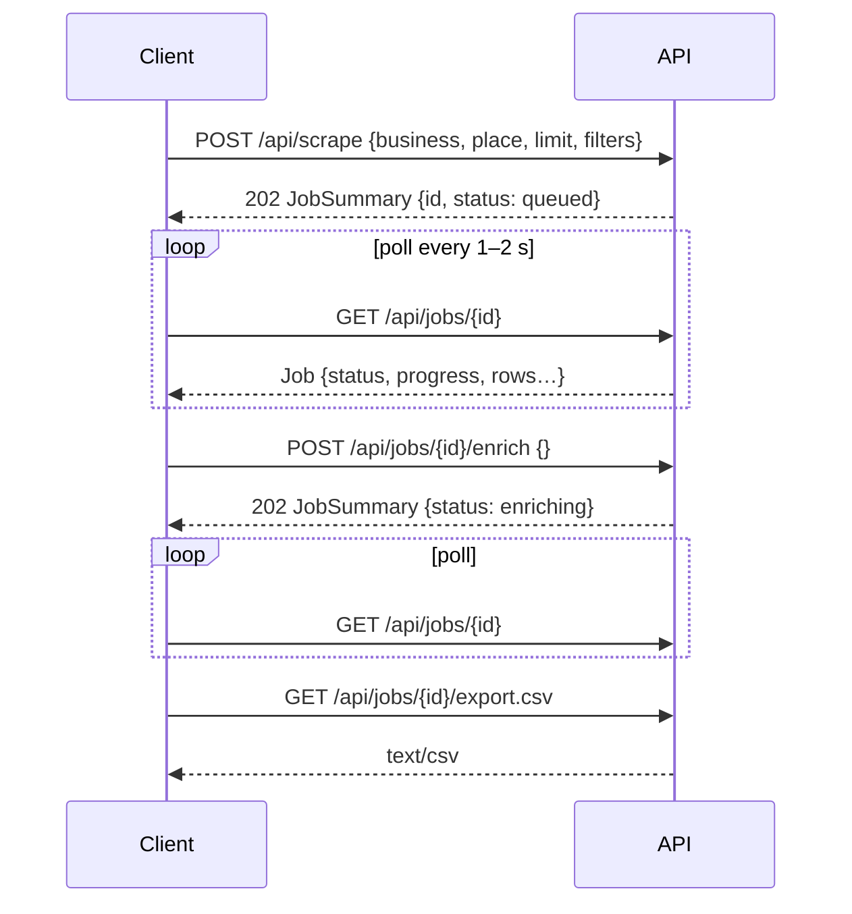

# REST API reference

Base URL: `http://127.0.0.1:8000` (see `HOST` / `PORT`). All request and response bodies are
JSON unless noted. Interactive OpenAPI docs are served at `/docs` (Swagger UI) and
`/redoc`. `tests/test_docs.py` checks that every route in `app/main.py` is listed here.

| Method | Path | Purpose |
| --- | --- | --- |
| GET | `/api/health` | liveness check |
| GET | `/api/config` | limits and column names the panel needs |
| POST | `/api/scrape` | start a scrape job |
| GET | `/api/jobs` | list jobs (newest first, without rows) |
| GET | `/api/jobs/{job_id}` | full job incl. rows and progress |
| DELETE | `/api/jobs/{job_id}` | delete a job (cancels it first if running) |
| POST | `/api/jobs/{job_id}/cancel` | cancel a running scrape / enrichment |
| POST | `/api/jobs/{job_id}/enrich` | look up emails / phones on websites |
| GET | `/api/jobs/{job_id}/export.csv` | download the CSV |
| POST | `/api/jobs/{job_id}/drive` | upload the CSV to Google Drive now |
| GET | `/api/logs` | live log lines (ring buffer with a sequence cursor) |
| GET | `/api/outreach` | mailbox settings, send window, today's count, the last reply check |
| POST | `/api/outreach/check` | check the mailbox for replies and bounces now |
| GET / PATCH | `/api/autopilot` | the autopilot: status / switch it on or off, places, limits |
| GET | `/api/remote` | who searches: this computer, a search computer, or this one for the cloud server |
| POST | `/api/remote/next` | the search computer takes the oldest waiting search (`ROLE=sender`) |
| POST | `/api/remote/jobs/{job_id}/progress` | the search computer's progress; answers whether to stop |
| POST | `/api/remote/jobs/{job_id}/result` | the search computer's finished search |
| GET | `/api/activity` | what happened, newest first |
| GET | `/api/master/{part}.csv` | the master sheet: `campaigns.csv` or `activity.csv`; also `daily.csv` |
| GET | `/api/master/daily` | day by day: emails sent (first emails, follow-ups) and what came back |
| GET / POST | `/api/business-types` | list / add business types |
| GET / PATCH / DELETE | `/api/business-types/{type_id}` | one business type: read, change, delete |
| GET | `/api/business-types/{type_id}/preview` | its emails for two made-up businesses |
| POST | `/api/business-types/{type_id}/test` | send one of its emails to yourself |
| GET / POST | `/api/campaigns` | list / create campaigns |
| GET / PATCH / DELETE | `/api/campaigns/{campaign_id}` | one campaign: read, change its emails, delete |
| POST | `/api/campaigns/{campaign_id}/start` | start (or resume) sending |
| POST | `/api/campaigns/{campaign_id}/pause` | pause |
| GET | `/api/campaigns/{campaign_id}/preview` | its emails as one business gets them |
| POST | `/api/campaigns/{campaign_id}/test` | send one of its emails to yourself |
| PATCH | `/api/campaigns/{campaign_id}/leads/{lead_id}` | rename a business in the emails, leave it out / include it |
| POST | `/api/campaigns/{campaign_id}/drive` | upload its results to Google Drive now |
| GET | `/api/drive` | Google Drive: set up? connected as whom? which folder? when Google ended the sign-in (`lost_at`) |
| POST | `/api/drive/connect` | the Google consent page to open |
| POST | `/api/drive/disconnect` | forget (and revoke) the Drive sign-in |
| GET | `/api/drive/files` | lead files in a business type's Drive folder |
| GET / PATCH | `/api/settings` | every setting (the Settings tab) / save some to `.env` |
| POST | `/api/server/stop` | stop the panel (its Stop button) |
| POST | `/api/server/restart` | restart it (only when started with `start.bat` / `start.py`) |
| GET | `/` | the web panel (also receives Google's sign-in answer) |

Errors use FastAPI's shape: `{"detail": "message"}` with `400`, `403`, `404`, `409` or `422`
(validation) status codes.

## Typical flow



---

### GET `/api/health`

```json
{ "status": "ok", "version": "1.3.0", "jobs": 3 }
```

### GET `/api/config`

```json
{
  "max_results": 500,
  "max_scanned": 1000,
  "headless": true,
  "detail_concurrency": 3,
  "enrich_max_pages": 6,
  "columns": ["Name", "City", "State", "Country", "Email", "Website", "Phone", "Phone Unformatted", "Url", "Rank", "Review Count", "Description"],
  "extended_columns": ["Name", "…", "Enrichment Status"],
  "server": { "can_stop": true, "can_restart": true, "url": "http://127.0.0.1:8000",
              "env_file": "C:\\…\\leadspilot-engine\\.env" }
}
```

`server.can_stop`: started by `run.py` (or `start.bat`), so `POST /api/server/stop` works;
`can_restart`: started by `start.bat` / `start.py`, which starts it again.

### POST `/api/scrape`

Starts a job and returns immediately (`202`). The search sent to Google Maps is
`"<business> in <place>"`.

Request body:

| Field | Type | Required | Notes |
| --- | --- | --- | --- |
| `business` | string (≤120 chars) | yes¹ | what to look for, e.g. `"plumbers"` |
| `place` | string (≤500 chars) | no | where, e.g. `"Austin, TX"`; several places separated by `;` are searched in turn (`"Katy, TX; Pasadena, TX"`) |
| `whole_area` | bool | no (false) | search each place section by section instead of one search, to get past Google's ~120 results per search (needs `business` and `place`) |
| `query` | string (≤200 chars) | yes¹ | a complete free-text search (`"roofing companies near houston"`), used only when `business` is empty |
| `limit` | int 1–500 | no (20) | number of **matching** places; capped by `MAX_RESULTS` |
| `filters` | object | no | see below; omitted = keep every place |
| `enrich` | bool | no (false) | run website enrichment automatically after scraping |
| `headless` | bool | no | override `HEADLESS` for this job (`false` shows the browser) |
| `business_type_id` | string | no | the saved business type the search is for: a campaign made from it starts with that type's emails, and its CSV goes to that type's Drive folder. `400` for an unknown id |

¹ `business` or `query` must be given (the resulting search needs at least 2 characters); `422` otherwise.

`filters` (all optional – rules in [DATA_MODEL.md §9](DATA_MODEL.md#9-search-filters)):

| Field | Values | Default | Meaning |
| --- | --- | --- | --- |
| `website` | `any`, `without`, `with` | `any` | keep places without / with a website of their own |
| `contact` | `any`, `phone`, `email`, `phone_or_email`, `phone_and_email` | `any` | contact details a place must have |
| `profiles_as_no_website` | bool | `true` | a Facebook / Instagram / Yelp / booking / `business.site` page does not count as a website |
| `search_web` | bool | `false` | with `website: without` only: also run a web search per candidate for a website it does not list on Google Maps (slower – a few seconds per business). Its email domain and social page are always checked. |

Responses echo the filters with a read-only `label` (e.g. `"no website · phone or email"`).

```bash
curl -X POST http://127.0.0.1:8000/api/scrape -H "Content-Type: application/json" -d "{\"business\":\"plumbers\",\"place\":\"Austin, TX\",\"limit\":30,\"filters\":{\"website\":\"without\",\"contact\":\"phone_or_email\"}}"
```

With filters the job keeps scrolling Google's list until `limit` places match (or the list
ends) and skips the place page of every listing the results feed already rules out. With
`whole_area` it does that section by section over the whole map of each place
([SCRAPING.md](SCRAPING.md#whole-area-search--map-sections)):

```bash
curl -X POST http://127.0.0.1:8000/api/scrape -H "Content-Type: application/json" -d "{\"business\":\"roofing\",\"place\":\"Houston, TX\",\"whole_area\":true,\"limit\":50,\"filters\":{\"website\":\"without\",\"contact\":\"phone_or_email\"}}"
```

Response (`JobSummary`):

```json
{
  "id": "job_5f0c2a1b9d3e", "query": "plumbers in Austin, TX", "business": "plumbers", "place": "Austin, TX",
  "whole_area": false, "business_type_id": "bt_3f9a1c2d4e5f",
  "filters": { "website": "without", "contact": "phone_or_email", "profiles_as_no_website": true,
               "search_web": false, "label": "no website · phone or email" },
  "limit": 30, "status": "queued",
  "progress": { "phase": "queued", "message": "", "current": 0, "total": 0, "percent": 0.0 },
  "row_count": 0, "email_count": 0, "found": null, "notice": "",
  "created_at": "…", "updated_at": "…", "finished_at": null, "error": null,
  "drive_path": "", "drive_link": ""
}
```

`email_count` is the number of rows with an email; `drive_path` / `drive_link` say where the CSV is
in Google Drive once it was uploaded (`"Plumber/plumbers_in_austin_tx_…_29_09_2026.csv"`).

`found` is the number of places kept once the scrape has finished (rows can be more – one per
email). `notice` explains a result smaller than `limit`, e.g. *"Only 35 businesses found for
“plumbers” in Austin, TX — that's every listing Google Maps has for this search (you asked for
200)."*; it is empty otherwise.

### GET `/api/jobs`

Array of `JobSummary` (see above), newest first.

### GET `/api/jobs/{job_id}`

The full `Job` (see [DATA_MODEL.md](DATA_MODEL.md#6-job-model-api)) including `rows`, `notice`
and `stats` (listings scanned, searches and map sections run, places matched, places skipped by
reason, why the scan stopped, websites found that Google Maps does not list, web searches run).
Rows appear while the job is running, so clients can render progressively. `404` if unknown.

### DELETE `/api/jobs/{job_id}`

`204 No Content`. Cancels the job if it is still running and removes its JSON file.

### POST `/api/jobs/{job_id}/cancel`

Cancels the running scrape or enrichment; rows collected so far are kept and the status
becomes `cancelled` (scrape) or reverts to the previous status (enrichment).
`409` when nothing is running.

### POST `/api/jobs/{job_id}/enrich`

Looks up emails / phone numbers on the websites of the job's rows (see
[ENRICHMENT.md](ENRICHMENT.md)). Returns `202` immediately; poll the job to follow
`progress` (`phase: "enriching"`).

Request body (all optional):

| Field | Type | Default | Meaning |
| --- | --- | --- | --- |
| `row_ids` | string[] | null | only enrich the places these rows belong to (all rows with the same rank are updated). Omit for *every place missing an email or phone*. |
| `force` | bool | false | also process places that already have an email; new addresses become additional rows |

```bash
curl -X POST http://127.0.0.1:8000/api/jobs/job_5f0c2a1b9d3e/enrich -H "Content-Type: application/json" -d "{\"row_ids\":[\"r_1a2b3c4d5e6f\"]}"
```

Errors: `404` unknown job, `400` job has no rows, `409` job is still running or an
enrichment is already in progress.

### GET `/api/jobs/{job_id}/export.csv`

| Query parameter | Default | Meaning |
| --- | --- | --- |
| `extended` | `false` | `true` adds Address, Category, Website Type, Rating, Place ID, Maps URL, Latitude, Longitude, Email Source, Phone Source, Enrichment Status |

Returns `text/csv; charset=utf-8` with a UTF-8 BOM and a
`Content-Disposition: attachment; filename="<query>[_<filters>][_extended]_<DD_MM_YYYY>.csv"` header
(`plumbers_in_austin_tx_no_website_phone_or_email_29_09_2026.csv`; the date is the day the
search was started, in the server's local time). A copy is written to
`data/exports/<job id>.csv`.

```bash
curl -o houston.csv "http://127.0.0.1:8000/api/jobs/job_5f0c2a1b9d3e/export.csv?extended=true"
```

### POST `/api/jobs/{job_id}/drive`

Uploads the job's CSV (the extended export) to its business type's Google Drive folder now – the
same file again when it was uploaded before ([DRIVE.md](DRIVE.md)). Returns
`{"path": "Plumber/plumbers_in_austin_tx_29_09_2026.csv", "link": "https://drive.google.com/…"}`.
Errors: `400` Drive not connected, `409` the job is still running, `502` Google refused (the
message says why).

### GET `/api/logs`

Returns log lines from the in-memory ring buffer that feeds the panel's **Live logs**
section (`LOG_BUFFER_SIZE` lines, default 2000). Every line has a monotonically
increasing `seq`; clients poll with the `next` value they received last.

| Query parameter | Default | Meaning |
| --- | --- | --- |
| `since` | *(omitted)* | return only lines with `seq > since`. Omit it on the first call to get the newest `limit` lines. |
| `limit` | `200` | 1–1000 lines per response |
| `job_id` | *(none)* | only lines produced while this job (scrape or enrichment) was running |
| `level` | *(none)* | minimum level: `DEBUG`, `INFO`, `WARNING`, `ERROR` |

```bash
curl "http://127.0.0.1:8000/api/logs?since=1520&level=WARNING&job_id=job_5f0c2a1b9d3e"
```

```json
{
  "entries": [
    { "seq": 1533, "ts": "2026-09-21T06:09:19.412Z", "level": "WARNING", "logger": "app.jobs",
      "message": "Enrichment failed for #2 Legends Roofing: homepage fetch failed: ...", "job_id": "job_5f0c2a1b9d3e" }
  ],
  "next": 1540,
  "first_seq": 12,
  "last_seq": 1540,
  "truncated": false
}
```

- `next` is the cursor for the following call. When nothing matched the filters it still
  advances to `last_seq`, so filtered-out lines are never re-scanned.
- `truncated: true` means more matching lines were waiting than `limit` allowed – call again
  immediately with `since=next`.
- If `first_seq > since + 1` the buffer wrapped around and lines were dropped in between.
- Exceptions include their traceback in `message` (multi-line).

## Email outreach

How campaigns work – who becomes a lead, templates, when emails go out, replies – is in
[OUTREACH.md](OUTREACH.md). Errors use the usual shape; `400` explains a request that can't be
carried out (e.g. an unknown placeholder, a campaign that can't start yet – the message lists
everything missing), `409` a conflict (a running campaign can't be deleted), `502` the mailbox or
Google refused.

### GET `/api/outreach`

```json
{
  "ready": true, "problems": [], "autosend": true, "running": 1,
  "sender": "Pat <pat@getpatsweb.com>", "smtp": "smtp.gmail.com:587", "imap": "imap.gmail.com:993",
  "window": "Mon–Fri 08:00–12:00 (America/Chicago)", "window_open": true,
  "daily_limit": 30, "sent_today": 12, "next_send_at": "2026-09-29T15:42:10+00:00",
  "last_check": { "at": "2026-09-29T15:40:03+00:00", "error": "", "emails": 41, "replies": 1, "bounces": 0 },
  "contacted": 57,
  "placeholders": { "Business": "the business name, without LLC / Inc. (editable per lead)", "…": "…" },
  "min_reviews": 10, "min_rating": 4.0,
  "sites": {                              // null with PREVIEW_SITES=false (docs/SITES.md)
    "url": "https://sites.leadspilot.co", "uploading": false, "waiting": 0,
    "online": ["texas-home-roofing", "…"],
    "last_upload": { "at": "…", "ok_at": "…", "error": "", "online": 13 }
  }
}
```

`problems` lists every missing setting in plain words (`"IMAP_HOST is not set …"`); no campaign
can start while it isn't empty. Passwords are never returned.

### POST `/api/outreach/check`

Checks the inbox for replies and bounces now; returns `last_check` as above. `400` when the IMAP
settings are missing, `502` when the mailbox refused (the message says why).

### Business types

`GET /api/business-types` – all, by name. A business type:

```json
{
  "id": "bt_3f9a1c2d4e5f", "name": "Roofer", "search": "roofing", "trade": "roofers",
  "steps": [
    { "day": 0, "subject": "website for {Business}", "body": "Hi there,\n\nI came across {Business} …" },
    { "day": 3, "subject": "", "body": "Hi there,\n\nJust bringing this back up …" },
    { "day": 7, "subject": "", "body": "Hi there,\n\nLast note from me …" }
  ],
  "footer": "[[{SenderCompany}\n]]{SenderAddress}\nIf you'd rather not hear from me, just reply \"no\" …",
  "created_at": "…", "updated_at": "…"
}
```

- `POST /api/business-types` `{name, search?, trade?, steps?, footer?}` → `201`; omitted
  `steps` / `footer` are the default emails. `409` when the name exists (case-insensitive).
- `GET /api/business-types/{type_id}` → the type, `404` if unknown.
- `PATCH /api/business-types/{type_id}` – any of `name`, `search`, `trade`, `steps` (1–5),
  `steps_b` (a second version to test, `[]` = none), `footer`. `400` lists what is wrong with the emails (unknown placeholders, days not going up,
  no `{SenderAddress}` in the footer …).
- `DELETE /api/business-types/{type_id}` → `204`. Searches, campaigns and Drive files stay.
- `GET /api/business-types/{type_id}/preview` → `{"from", "samples": [{"label", "to", "emails":
  [{"step", "day", "subject", "body"}], "values": {…}}]}` – the emails for a made-up business with
  good reviews and one with few. `values` are what the placeholders were filled with.
- `POST /api/business-types/{type_id}/test` `{step: 1}` → sends that email, filled in for the
  made-up business, to your own address with `[Test]` in front of the subject:
  `{"to": "pat@getpatsweb.com", "subject": "[Test] website for Acme"}`.

### POST `/api/campaigns`

Creates a **draft** from searches and/or lead files in Google Drive – nothing is sent before
`/start`.

| Field | Type | Default | Meaning |
| --- | --- | --- | --- |
| `job_ids` | string[] | `[]` | searches whose businesses become the leads (`404` unknown, `409` still running) |
| `drive_file_ids` | string[] | `[]` | lead files in Drive ([DRIVE.md](DRIVE.md#lead-files)); `400` when one isn't in the crawler's CSV format |
| `business_type_id` | string | *(omitted)* | whose emails are copied in. Omitted: the searches' business type when they share one, else the default emails; `""`: the default emails |
| `name` | string | `"<type or search> · <place>"` | |
| `trade` | string | the type's | `{Trade}` |

At least one search or file is needed (`422`). Returns the full campaign (`201`):

```jsonc
{
  "id": "camp_7d2e9a0b1c3f", "name": "Plumber · Houston", "trade": "plumbers",
  "job_ids": ["job_d38350fa59d5"], "drive_files": [],
  "business_type_id": "bt_…", "business_type_name": "Plumber",
  "steps": [ /* a copy of the type's */ ], "footer": "…",
  "sites": true,                          // each business has a preview website; first emails wait for it
  "status": "draft",                      // draft | running | paused | finished
  "error": "",                            // why it was paused automatically
  "leads": [ {
      "id": "l_4b1c…", "job_id": "job_d38350fa59d5", "place_id": "ChIJ…",
      "name": "Acme Plumbing LLC", "business": "Acme Plumbing",
      "email": "office@acmeplumbing.example", "other_emails": [], "city": "Houston",
      "rating": 4.7, "reviews": 42, "phone": "(713) 555-0142", "category": "Plumber", "maps_url": "…",
      "site": "acme-plumbing",            // its website: <SITES_URL>/acme-plumbing/ ('' = none)
      "status": "queued",                 // queued | sent | done | replied | unsubscribed | bounced | failed | skipped
      "next_due": null,                   // when the next follow-up may go out
      "sent": [ { "step": 1, "sent_at": "…", "message_id": "<…@getpatsweb.com>", "subject": "…" } ],
      "inbound": [ { "kind": "reply", "received_at": "…", "sender": "…", "subject": "Re: …", "message_id": "…" } ],
      "note": ""
  } ],
  "left_out": [ { "name": "Enterprise Roofing & Skylights", "email": "info@bbbemail.org",
                  "reason": "no address of its own: address of bbbemail.org, not of the business (info@bbbemail.org)" } ],
  "created_at": "…", "updated_at": "…", "started_at": null, "finished_at": null,
  "drive_file_id": "", "drive_link": "", "drive_path": "", "drive_hash": "", "drive_synced_at": null
}
```

`GET /api/campaigns` lists them newest first, without leads but with `counts` (leads per status)
and `emails_sent`.

### The other campaign routes

- `GET /api/campaigns/{campaign_id}` – the full campaign (`404` if unknown).
- `PATCH /api/campaigns/{campaign_id}` – any of `name`, `trade`, `steps`, `steps_b` (a second version
  of the emails: the businesses take turns at their first email; `[]` ends the test), `footer`; allowed while
  it runs (changes apply to the emails not sent yet; the next follow-ups are rescheduled when the
  days change). `400` lists what is wrong with the emails.
- `DELETE /api/campaigns/{campaign_id}` → `204`; `409` while it is running (pause first). The
  businesses it emailed stay on the contacted list.
- `POST /api/campaigns/{campaign_id}/start` → the campaign, `running`. `400` "Can't start yet: …"
  with every problem (mailbox settings, the send window, the emails, `{Trade}`, a business missing
  `{City}` …); `409` when it has finished.
- `POST /api/campaigns/{campaign_id}/pause` → the campaign, `paused`.
- `GET /api/campaigns/{campaign_id}/preview?lead_id=` → `{"lead_id", "business", "to", "from",
  "missing", "emails": [{"step", "day", "subject", "body", "sent_at"}], "values": {…}}` – every email
  as that business (default: the first still to email) gets it; `missing` names placeholders
  without a value.
- `POST /api/campaigns/{campaign_id}/test` `{lead_id?, step: 1}` → sends that email, filled in for
  the business, to your own address (`[Test] …`); the campaign is not changed.
- `PATCH /api/campaigns/{campaign_id}/leads/{lead_id}` `{business?, skipped?}` → the lead.
  `skipped: true` sends it nothing (more); `false` includes it again. `409` when it has already
  replied / bounced / finished, or another campaign emailed it.
- `POST /api/campaigns/{campaign_id}/drive` → `{"path": "Plumber/Outreach/plumber_houston_a1b2c3.csv",
  "link": "…"}` – uploads its results now ([DRIVE.md](DRIVE.md)).

## Autopilot

Finds businesses and starts their campaigns by itself ([AUTOPILOT.md](AUTOPILOT.md)).

- `GET /api/autopilot` → `{"enabled", "business_type_id", "business_type_name", "places": ["Katy, TX", …],
  "next_place", "next": "Sugar Land, TX", "min_waiting", "searches_per_day", "limit", "stopped": "",
  "on_since", "waiting": 4, "searches_today": 1, "searching": "", "searching_job_id": "",
  "holding": "why it isn't searching now", "runs": [{"place", "job_id", "started_at", "finished_at",
  "found", "campaign_id", "emailing", "note"}]}` – `runs` newest first.
- `PATCH /api/autopilot` `{enabled?, business_type_id?, places?, next_place?, min_waiting?,
  searches_per_day?, limit?}` → the status. Switching it on clears `stopped` and starts the bounce
  count afresh; `400` without a business type, `404` unknown business type.
- `GET /api/activity?limit=100` → `[{"at", "what", "detail", "campaign", "business", "email"}]`,
  newest first.
- `GET /api/master/campaigns.csv`, `GET /api/master/activity.csv` → the master sheet's files.
- `GET /api/master/daily` → `{"columns": ["Day", "First emails", "Follow-ups", "Replies", "Websites opened",
  "Bounces", "Unsubscribes"], "rows": [["2026-11-09", 3, 7, 0, 1, 0, 0], …]}` - a row per day of the computer's
  own calendar, oldest first, from the first day anything happened through today (days without anything
  included). *Websites opened* counts a business on the day of its first visit. `GET /api/master/daily.csv` is
  the same as a file. The panel draws it as the *Day by day* charts.

## Searching on another computer

The cloud server (`ROLE=sender`) doesn't search: its searches wait for the search computer
(`ROLE=searcher`), which asks for them – [CLOUD.md](CLOUD.md). The three `POST` routes are only for it:
they need `ROLE=sender`, a `SEARCHER_TOKEN` and the header `Authorization: Bearer <SEARCHER_TOKEN>` –
`404` without the first two, `401` with a wrong token.

- `GET /api/remote` → on `ROLE=all`: `{"role": "all"}`; on the sender: `{"role": "sender", "token_set": true,
  "last_contact": "2026-11-11T14:02:10Z", "searcher_version": "1.19.0", "waiting": 1, "searching":
  ["roofer in Katy, TX"]}`; on the search computer: `{"role": "searcher", "cloud_url", "state": "waiting for
  a search", "last_contact", "pending": ["job_…"]}`.
- `POST /api/remote/next` `{version?}` → `{"job": {"id", "query", "business", "place", "whole_area", "limit",
  "filters", "enrich", "business_type_id"}}` – the oldest waiting search, now *running* and the search
  computer's; `204` when none waits.
- `POST /api/remote/jobs/{job_id}/progress` `{"progress": {phase, message, current, total, percent}, "rows":
  3}` → `{"stop": false}`; `true` when the search was cancelled, given up on (20 minutes without a report)
  or is unknown – the search computer then cancels it.
- `POST /api/remote/jobs/{job_id}/result` – the finished job as the search computer has it (the job JSON,
  [DATA_MODEL.md](DATA_MODEL.md)) → the job summary; the finished-job hook runs (the autopilot makes the
  campaign). `409` when the search isn't wanted any more (cancelled, given up on, already sent) or hasn't
  finished, `400` when the id doesn't match the address.

On the sender, `POST /api/scrape` makes such a waiting search too, and cancelling one marks it cancelled at
once (the search computer stops at its next report).

## Preview websites

### PATCH `/api/sites/{slug}`

`{"hold": true}` puts a website on hold: no end date, and *Your new website is being set up* instead of the
countdown. `{"hold": false}` puts it back on its dates. A reply from the business does the first by itself,
unless the reply says no. The change goes online with the next upload, about 30 seconds later.

## Google Drive

Setting it up: [PLAYBOOK.md §2](PLAYBOOK.md#2-google-drive); folders and files: [DRIVE.md](DRIVE.md).

- `GET /api/drive` → `{"configured": true, "connected": true, "lost_at": "", "email": "pat@gmail.com",
  "folder": "Leads", "auto_upload": true, "problems": [], "last_error": "", "master": {"campaigns":
  {"name", "link", "at"}, "activity": {…}}, "sheets_off": "…"}` – `master`: where the master sheet
  went: `{"sheet": {…}}` (the Google Sheet) or the two CSV files, with `sheets_off` saying why
  (the Google Sheets API is off). `lost_at`: when Google ended the sign-in (expired or revoked) while it's
  not connected again - the panel's red banner; `""` otherwise.
- `POST /api/drive/connect` → `{"auth_url": "https://accounts.google.com/o/oauth2/v2/auth?…"}` –
  open it in the browser; Google sends the browser back to `/` of this server, which stores the
  sign-in and redirects to `/?drive=connected#outreach` (or `/?drive=error&message=…`). `400` when
  `GOOGLE_CLIENT_ID` / `GOOGLE_CLIENT_SECRET` are missing, or the panel isn't opened at
  `127.0.0.1` / `localhost` (Google only sends the answer to this computer).
- `POST /api/drive/disconnect` → `204`; revokes the token at Google and deletes it.
- `GET /api/drive/files?business_type_id=` → `{"folder": "Roofer", "folder_link": "…", "files":
  [{"id", "name", "modified", "link", "sheet"}]}` – the CSV files and Google Sheets in the type's
  folder, newest first. `400` Drive not connected, `502` Google refused.

## Settings and the server itself

These routes answer only the panel opened on this computer: a request from another computer
(`HOST=0.0.0.0`), from another web site (its `Origin`), or through another host name than
`127.0.0.1` / `localhost` gets `403`.

- `GET /api/settings` → `{"groups": [{"key": "mailbox", "title": "Mailbox", "help": "…", "advanced":
  false}, …], "fields": [...], "env_file": "…/.env", "file_error": "", "pending": ["PORT"], "server":
  {…}}`. One field per setting (`app/settings_editor.py` has their groups, labels and help):

  ```json
  { "name": "SMTP_PORT", "group": "mailbox", "label": "SMTP port", "help": "587 (STARTTLS) or 465 (SSL)",
    "kind": "int", "value": "587", "default": "587", "placeholder": "", "choices": [], "min": 1,
    "max": 65535, "needed": "", "restart": false, "saved": true, "locked": "", "pending": false }
  ```

  `kind` is `text`, `int`, `float`, `bool` (then `value` is `true` / `false`), `choice` or `secret`.
  A secret (`MAIL_PASSWORD`, `GOOGLE_CLIENT_SECRET`, `PROXY_SERVER`) never has its `value` sent:
  `is_set` says whether it has one. `saved`: `.env` sets it. `locked`: the environment variable
  that sets it on this computer, which wins over `.env`. `restart`: only read when the server
  starts. `pending`: `.env` holds another value than the one in use until a restart.
  `needed`: `email` / `drive` when that can't work without it. `file_error`: `.env` has a value
  the server couldn't start with.
- `PATCH /api/settings` `{"values": {"SMTP_HOST": "smtp.gmail.com", "SMTP_PORT": 465, "HEADLESS": false,
  "SENDER_COMPANY": null}}` writes them to `.env` – only their lines change; `null` or `""` puts a
  setting back to its default – and uses them at once, except the `restart` ones. → the same as
  `GET` plus `"changed": [...]` (the settings whose value changed) and `"restart": [...]` (of
  those, the ones used after a restart). `400` with `{"detail": {"message": "SMTP port: must be a
  whole number", "fields": {"SMTP_PORT": "must be a whole number"}}}` when a value is no good –
  nothing is written then.
- `POST /api/server/stop` → `{"stopping": true}`; the server finishes open requests and the email
  being sent, then exits. `409` when it wasn't started by `run.py` / `start.bat`.
- `POST /api/server/restart` → `{"restarting": true, "url": "http://127.0.0.1:8000"}` (where it
  will be, after a port change); the server exits with code 75 and `start.py` starts it again.
  `409` unless it was started with `start.bat` / `start.py`.

## The web panel

### GET `/`

Serves the panel (`app/static/index.html`) with version-stamped asset URLs. Static files
under `/static/` are sent with `Cache-Control: no-cache`. With `?state=…&code=…` from Google's
consent page it finishes connecting Google Drive and redirects to the panel.

## Row object

Every element of `rows` is a `PlaceRow`; fields are described in
[DATA_MODEL.md](DATA_MODEL.md). Example:

```json
{
  "row_id": "r_b49cfb28bc8d", "rank": 1,
  "name": "HonestRoof.com", "city": "Arlington", "state": "Texas", "country": "US",
  "email": "", "website": "https://www.honestroof.com/about-us/",
  "phone": "(817) 809-7000", "phone_unformatted": "+18178097000",
  "url": "https://www.google.com/maps/search/?api=1&query=HonestRoof.com&query_place_id=ChIJTZZO_rtiToYRlYiyuKpgWgc",
  "review_count": 196, "description": "",
  "address": "3901 Arlington Highlands Blvd Ste 200, Arlington, TX 76018, United States",
  "category": "Roofing contractor", "rating": 5.0, "place_id": "ChIJTZZO_rtiToYRlYiyuKpgWgc",
  "maps_url": "https://www.google.com/maps/place/HonestRoof.com/data=…",
  "latitude": 32.6807685, "longitude": -97.1082412,
  "email_source": "", "phone_source": "maps", "enrichment_status": "", "enrichment_note": "",
  "website_type": "own"
}
```

`website_type` is derived from `website` (`none`, `own` or `profile`) and read-only.

## Notes for integrators

- The API is unauthenticated and binds to `127.0.0.1` by default. If you expose it on a
  network, put it behind a reverse proxy with authentication. The settings and server routes
  refuse other computers either way.
- Jobs are executed inside the API process; keep one instance per machine (two instances
  would each open their own browsers and compete for CPU).
- Long polling / websockets are not provided; poll `GET /api/jobs/{id}` every 1–2 seconds
  like the panel does.
