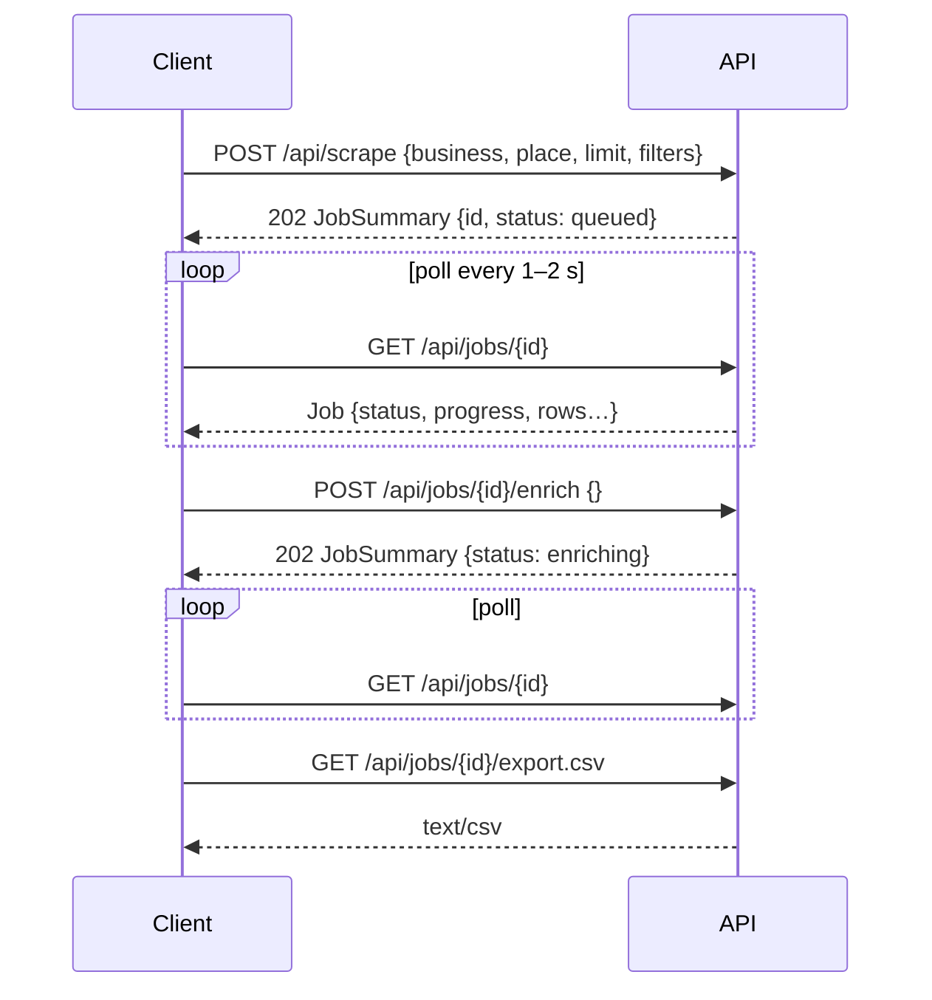

# REST API reference

Base URL: `http://127.0.0.1:8000` (see `HOST` / `PORT`). All request and response bodies are
JSON unless noted. Interactive OpenAPI docs are served at `/docs` (Swagger UI) and
`/redoc`. `tests/test_docs.py` checks that every route in `app/main.py` is listed here.

| Method | Path | Purpose |
| --- | --- | --- |
| GET | `/api/health` | liveness check |
| GET | `/api/config` | limits and column names the panel needs |
| POST | `/api/scrape` | start a scrape job |
| GET | `/api/jobs` | list jobs (newest first, without rows) |
| GET | `/api/jobs/{job_id}` | full job incl. rows and progress |
| DELETE | `/api/jobs/{job_id}` | delete a job (cancels it first if running) |
| POST | `/api/jobs/{job_id}/cancel` | cancel a running scrape / enrichment |
| POST | `/api/jobs/{job_id}/enrich` | look up emails / phones on websites |
| GET | `/api/jobs/{job_id}/export.csv` | download the CSV |
| GET | `/api/logs` | live log lines (ring buffer with a sequence cursor) |
| GET | `/` | the web panel |

Errors use FastAPI's shape: `{"detail": "message"}` with `400`, `404`, `409` or `422`
(validation) status codes.

## Typical flow



---

### GET `/api/health`

```json
{ "status": "ok", "version": "1.3.0", "jobs": 3 }
```

### GET `/api/config`

```json
{
  "max_results": 500,
  "max_scanned": 1000,
  "headless": true,
  "detail_concurrency": 3,
  "enrich_max_pages": 6,
  "columns": ["Name", "City", "State", "Country", "Email", "Website", "Phone", "Phone Unformatted", "Url", "Rank", "Review Count", "Description"],
  "extended_columns": ["Name", "…", "Enrichment Status"]
}
```

### POST `/api/scrape`

Starts a job and returns immediately (`202`). The search sent to Google Maps is
`"<business> in <place>"`.

Request body:

| Field | Type | Required | Notes |
| --- | --- | --- | --- |
| `business` | string (≤120 chars) | yes¹ | what to look for, e.g. `"plumbers"` |
| `place` | string (≤500 chars) | no | where, e.g. `"Austin, TX"`; several places separated by `;` are searched in turn (`"Katy, TX; Pasadena, TX"`) |
| `whole_area` | bool | no (false) | search each place section by section instead of one search, to get past Google's ~120 results per search (needs `business` and `place`) |
| `query` | string (≤200 chars) | yes¹ | a complete free-text search (`"roofing companies near houston"`), used only when `business` is empty |
| `limit` | int 1–500 | no (20) | number of **matching** places; capped by `MAX_RESULTS` |
| `filters` | object | no | see below; omitted = keep every place |
| `enrich` | bool | no (false) | run website enrichment automatically after scraping |
| `headless` | bool | no | override `HEADLESS` for this job (`false` shows the browser) |

¹ `business` or `query` must be given (the resulting search needs at least 2 characters); `422` otherwise.

`filters` (all optional – rules in [DATA_MODEL.md §9](DATA_MODEL.md#9-search-filters)):

| Field | Values | Default | Meaning |
| --- | --- | --- | --- |
| `website` | `any`, `without`, `with` | `any` | keep places without / with a website of their own |
| `contact` | `any`, `phone`, `email`, `phone_or_email`, `phone_and_email` | `any` | contact details a place must have |
| `profiles_as_no_website` | bool | `true` | a Facebook / Instagram / Yelp / booking / `business.site` page does not count as a website |

Responses echo the filters with a read-only `label` (e.g. `"no website · phone or email"`).

```bash
curl -X POST http://127.0.0.1:8000/api/scrape -H "Content-Type: application/json" -d "{\"business\":\"plumbers\",\"place\":\"Austin, TX\",\"limit\":30,\"filters\":{\"website\":\"without\",\"contact\":\"phone_or_email\"}}"
```

With filters the job keeps scrolling Google's list until `limit` places match (or the list
ends) and skips the place page of every listing the results feed already rules out. With
`whole_area` it does that section by section over the whole map of each place
([SCRAPING.md](SCRAPING.md#whole-area-search--map-sections)):

```bash
curl -X POST http://127.0.0.1:8000/api/scrape -H "Content-Type: application/json" -d "{\"business\":\"roofing\",\"place\":\"Houston, TX\",\"whole_area\":true,\"limit\":50,\"filters\":{\"website\":\"without\",\"contact\":\"phone_or_email\"}}"
```

Response (`JobSummary`):

```json
{
  "id": "job_5f0c2a1b9d3e", "query": "plumbers in Austin, TX", "business": "plumbers", "place": "Austin, TX",
  "whole_area": false,
  "filters": { "website": "without", "contact": "phone_or_email", "profiles_as_no_website": true,
               "label": "no website · phone or email" },
  "limit": 30, "status": "queued",
  "progress": { "phase": "queued", "message": "", "current": 0, "total": 0, "percent": 0.0 },
  "row_count": 0, "found": null, "notice": "",
  "created_at": "…", "updated_at": "…", "finished_at": null, "error": null
}
```

`found` is the number of places kept once the scrape has finished (rows can be more – one per
email). `notice` explains a result smaller than `limit`, e.g. *"Only 35 businesses found for
“plumbers” in Austin, TX — that's every listing Google Maps has for this search (you asked for
200)."*; it is empty otherwise.

### GET `/api/jobs`

Array of `JobSummary` (see above), newest first.

### GET `/api/jobs/{job_id}`

The full `Job` (see [DATA_MODEL.md](DATA_MODEL.md#6-job-model-api)) including `rows`, `notice`
and `stats` (listings scanned, searches and map sections run, places matched, places skipped by
reason, why the scan stopped).
Rows appear while the job is running, so clients can render progressively. `404` if unknown.

### DELETE `/api/jobs/{job_id}`

`204 No Content`. Cancels the job if it is still running and removes its JSON file.

### POST `/api/jobs/{job_id}/cancel`

Cancels the running scrape or enrichment; rows collected so far are kept and the status
becomes `cancelled` (scrape) or reverts to the previous status (enrichment).
`409` when nothing is running.

### POST `/api/jobs/{job_id}/enrich`

Looks up emails / phone numbers on the websites of the job's rows (see
[ENRICHMENT.md](ENRICHMENT.md)). Returns `202` immediately; poll the job to follow
`progress` (`phase: "enriching"`).

Request body (all optional):

| Field | Type | Default | Meaning |
| --- | --- | --- | --- |
| `row_ids` | string[] | null | only enrich the places these rows belong to (all rows with the same rank are updated). Omit for *every place missing an email or phone*. |
| `force` | bool | false | also process places that already have an email; new addresses become additional rows |

```bash
curl -X POST http://127.0.0.1:8000/api/jobs/job_5f0c2a1b9d3e/enrich -H "Content-Type: application/json" -d "{\"row_ids\":[\"r_1a2b3c4d5e6f\"]}"
```

Errors: `404` unknown job, `400` job has no rows, `409` job is still running or an
enrichment is already in progress.

### GET `/api/jobs/{job_id}/export.csv`

| Query parameter | Default | Meaning |
| --- | --- | --- |
| `extended` | `false` | `true` adds Address, Category, Website Type, Rating, Place ID, Maps URL, Latitude, Longitude, Email Source, Phone Source, Enrichment Status |

Returns `text/csv; charset=utf-8` with a UTF-8 BOM and a
`Content-Disposition: attachment; filename="<query>[_<filters>].csv"` header
(`plumbers_in_austin_tx_no_website_phone_or_email.csv`). A copy is written to
`data/exports/<job id>.csv`.

```bash
curl -o houston.csv "http://127.0.0.1:8000/api/jobs/job_5f0c2a1b9d3e/export.csv?extended=true"
```

### GET `/api/logs`

Returns log lines from the in-memory ring buffer that feeds the panel's **Live logs**
section (`LOG_BUFFER_SIZE` lines, default 2000). Every line has a monotonically
increasing `seq`; clients poll with the `next` value they received last.

| Query parameter | Default | Meaning |
| --- | --- | --- |
| `since` | *(omitted)* | return only lines with `seq > since`. Omit it on the first call to get the newest `limit` lines. |
| `limit` | `200` | 1–1000 lines per response |
| `job_id` | *(none)* | only lines produced while this job (scrape or enrichment) was running |
| `level` | *(none)* | minimum level: `DEBUG`, `INFO`, `WARNING`, `ERROR` |

```bash
curl "http://127.0.0.1:8000/api/logs?since=1520&level=WARNING&job_id=job_5f0c2a1b9d3e"
```

```json
{
  "entries": [
    { "seq": 1533, "ts": "2026-09-21T06:09:19.412Z", "level": "WARNING", "logger": "app.jobs",
      "message": "Enrichment failed for #2 Legends Roofing: homepage fetch failed: ...", "job_id": "job_5f0c2a1b9d3e" }
  ],
  "next": 1540,
  "first_seq": 12,
  "last_seq": 1540,
  "truncated": false
}
```

- `next` is the cursor for the following call. When nothing matched the filters it still
  advances to `last_seq`, so filtered-out lines are never re-scanned.
- `truncated: true` means more matching lines were waiting than `limit` allowed – call again
  immediately with `since=next`.
- If `first_seq > since + 1` the buffer wrapped around and lines were dropped in between.
- Exceptions include their traceback in `message` (multi-line).

### GET `/`

Serves the panel (`app/static/index.html`) with version-stamped asset URLs. Static files
under `/static/` are sent with `Cache-Control: no-cache`.

## Row object

Every element of `rows` is a `PlaceRow`; fields are described in
[DATA_MODEL.md](DATA_MODEL.md). Example:

```json
{
  "row_id": "r_b49cfb28bc8d", "rank": 1,
  "name": "HonestRoof.com", "city": "Arlington", "state": "Texas", "country": "US",
  "email": "", "website": "https://www.honestroof.com/about-us/",
  "phone": "(817) 809-7000", "phone_unformatted": "+18178097000",
  "url": "https://www.google.com/maps/search/?api=1&query=HonestRoof.com&query_place_id=ChIJTZZO_rtiToYRlYiyuKpgWgc",
  "review_count": 196, "description": "",
  "address": "3901 Arlington Highlands Blvd Ste 200, Arlington, TX 76018, United States",
  "category": "Roofing contractor", "rating": 5.0, "place_id": "ChIJTZZO_rtiToYRlYiyuKpgWgc",
  "maps_url": "https://www.google.com/maps/place/HonestRoof.com/data=…",
  "latitude": 32.6807685, "longitude": -97.1082412,
  "email_source": "", "phone_source": "maps", "enrichment_status": "", "enrichment_note": "",
  "website_type": "own"
}
```

`website_type` is derived from `website` (`none`, `own` or `profile`) and read-only.

## Notes for integrators

- The API is unauthenticated and binds to `127.0.0.1` by default. If you expose it on a
  network, put it behind a reverse proxy with authentication.
- Jobs are executed inside the API process; keep one instance per machine (two instances
  would each open their own browsers and compete for CPU).
- Long polling / websockets are not provided; poll `GET /api/jobs/{id}` every 1–2 seconds
  like the panel does.
