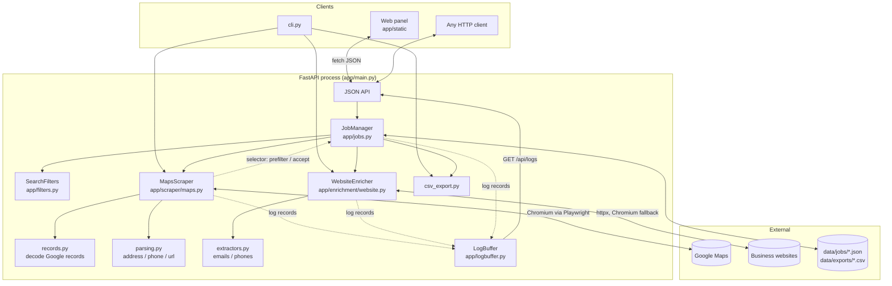
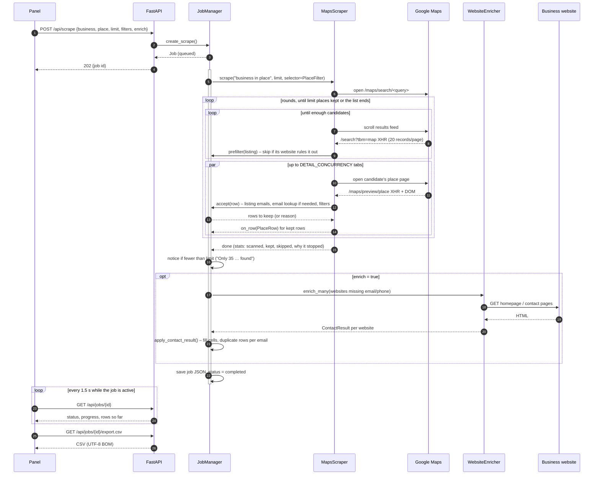
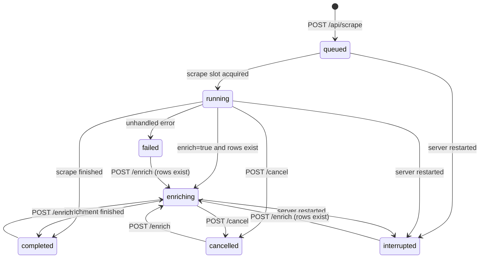
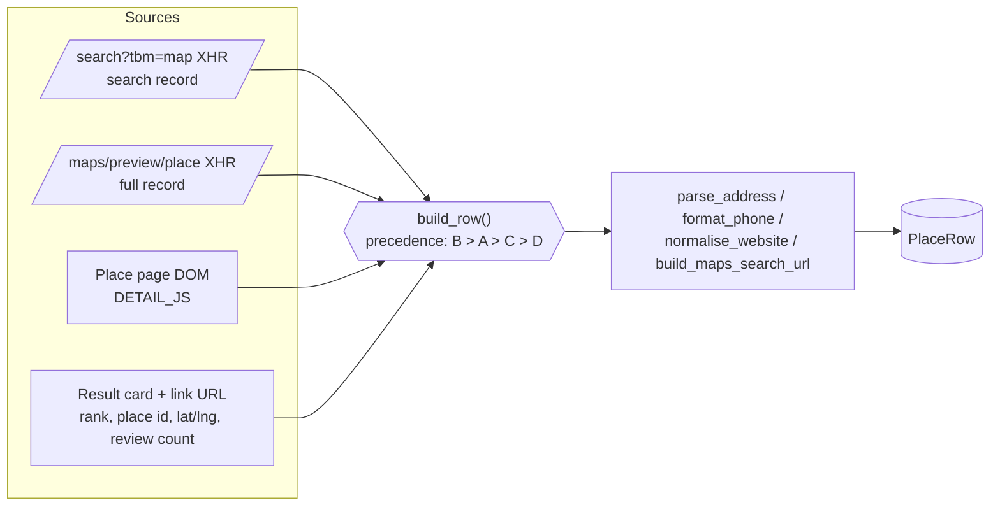
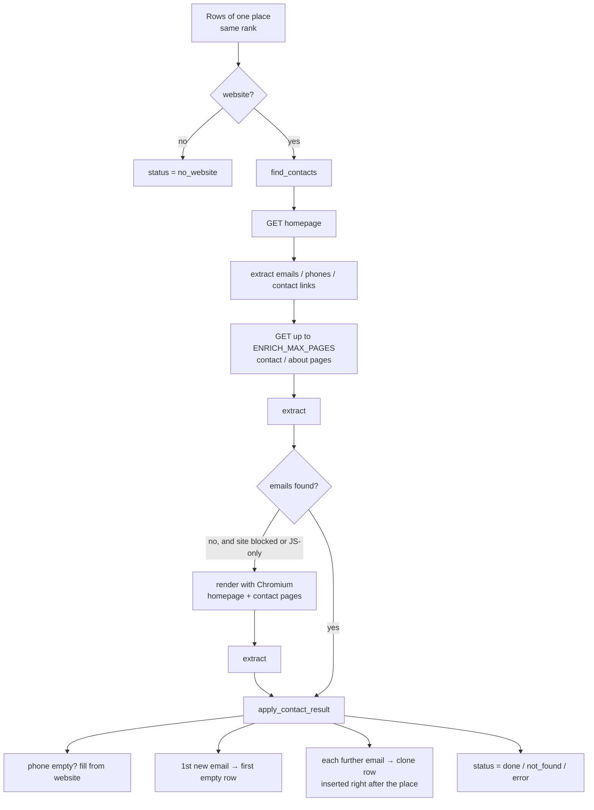
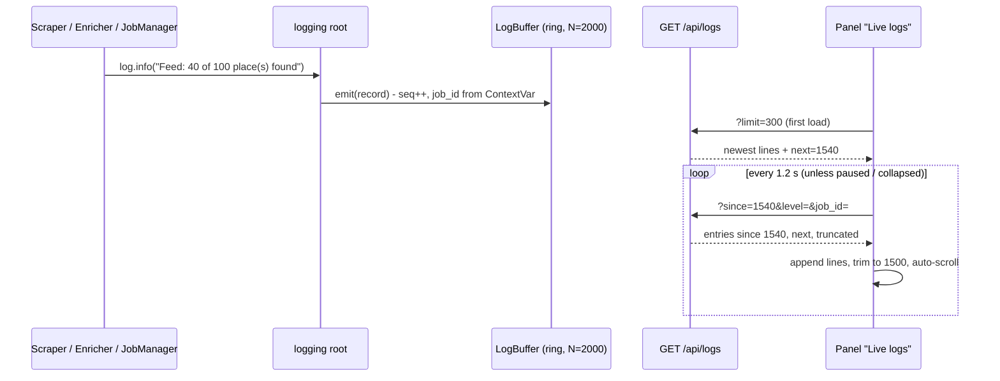

# Architecture

This document describes how the Google Maps Lead Crawler is put together, how data flows
through it and why it is built the way it is. Read [SCRAPING.md](SCRAPING.md) and
[ENRICHMENT.md](ENRICHMENT.md) for the internals of the two crawlers.

## 1. Big picture



Everything runs in **one Python process**. The FastAPI event loop hosts the API, the
background jobs and the Playwright browser (Playwright's async API cooperates with asyncio, so
no threads or worker processes are needed). The panel is plain HTML/JS served by the same
process; it only talks to the JSON API, which means the CLI and any other client get exactly
the same capabilities.

## 2. Components

| Component | File | Responsibility |
| --- | --- | --- |
| **Settings** | `app/config.py` | Typed configuration from environment / `.env` (pydantic-settings). |
| **Models** | `app/models.py` | `PlaceRow` (one output row), `Job` (a search – business, place, filters – with its rows, status, progress and notice), request bodies. |
| **Filters** | `app/filters.py` | `SearchFilters`: the *Website* and *Must have* rules as pure functions (used on the feed, on scraped places and to decide when an email lookup can help). |
| **API** | `app/main.py` | REST routes, CSV download, static panel, cache headers. |
| **JobManager** | `app/jobs.py` | Creates and tracks asyncio tasks for scrapes and enrichments; `PlaceFilter` applies a job's filters while it scrapes (listing emails, inline email lookups); applies enrichment results (incl. duplicate-row rule); writes the short-result `notice`; persists jobs as JSON, restores them on start-up. |
| **MapsScraper** | `app/scraper/maps.py` | Drives Chromium: search page → scroll feed → visit place pages → build rows, in rounds until `limit` places are kept by the selector. Reports progress and rows through callbacks. |
| **records** | `app/scraper/records.py` | Decodes the nested-array place records Google embeds in its XHR responses / HTML. |
| **parsing** | `app/scraper/parsing.py` | Pure helpers: address → city/state/country, phone → national + E.164, URL cleaning, Maps URL builder. |
| **WebsiteEnricher** | `app/enrichment/website.py` | Fetch strategy for a business website (homepage, contact pages, browser fallback), concurrency. |
| **extractors** | `app/enrichment/extractors.py` | Email / phone extraction from HTML (mailto, tel, JSON-LD, Cloudflare obfuscation, `[at]` patterns, text), junk filtering, scoring, contact-link discovery. |
| **csv_export** | `app/export/csv_export.py` | Column layout (default + extended) and CSV serialisation. |
| **LogBuffer** | `app/logbuffer.py` | `logging.Handler` that keeps the last `LOG_BUFFER_SIZE` records in a ring buffer with sequence numbers and tags them with the running job's id; backs `GET /api/logs`. |
| **Panel** | `app/static/*` | Form, progress card, results table with per-row *Find* buttons, history list, CSV download / copy, live log viewer. |
| **CLI** | `cli.py` | Same pipeline without the server. |

## 3. A scrape job, end to end



Rows are appended to the job **as they are scraped**, so the panel fills up progressively
and a cancelled job still keeps what was collected.

## 4. Job state machine



Rules enforced by `JobManager`:

- at most **two scrapes** run concurrently (`asyncio.Semaphore(2)`); further jobs wait in
  `queued`;
- an enrichment can only start when no task is running for that job (409 otherwise);
- every transition is persisted to `data/jobs/<id>.json` (atomic write via temp file +
  rename), progress is persisted at most every 2 s to avoid disk churn;
- on start-up, jobs found in an active state are marked `interrupted` (their rows are kept).

## 5. Data flow inside the scraper



Google's structured records are preferred because they need no parsing (they already contain
city, state, country, E.164 phone, place id, description). The DOM is the safety net when
Google reshuffles its JSON. Details and the index map: [SCRAPING.md](SCRAPING.md).

## 6. Data flow inside enrichment



The duplicate-row rule and the scoring of candidate emails are described in
[ENRICHMENT.md](ENRICHMENT.md).

## 7. Live logs

Every module logs through the standard `logging` package. Besides the console, the root
logger has a `LogBuffer` handler: a fixed-size ring buffer (`LOG_BUFFER_SIZE`, default 2000
records) where each record gets a monotonically increasing sequence number and the id of
the job that produced it. The panel polls `GET /api/logs?since=<seq>` every 1.2 s and
appends only the new lines, so the view stays live without websockets.



The job id travels through a `contextvars.ContextVar` set at the start of each job task;
asyncio copies the context into every task created inside it, so lines from the scraper's
worker tabs and the enricher's concurrent fetches are attributed to the right job. That is
what the *This job only* filter in the panel uses.

## 8. Persistence layout

```
data/
  jobs/job_<id>.json        full Job (query, status, progress, rows, stats)
  exports/<job>.csv         last CSV download of a job (convenience copy)
  exports/<query>.csv       CLI output default location
```

Nothing else is stored. Deleting `data/` resets the application.

## 9. Design decisions

| Decision | Why |
| --- | --- |
| **Playwright + real Chromium** instead of HTTP requests to Google | Maps is a JavaScript application; results only exist after the app runs. A real browser also keeps us on the normal, un-suspicious code path. |
| **Capture Google's XHR records instead of scraping only the DOM** | Structured fields (city/state/country, E.164 phone, place id, description) come for free and are far more stable than obfuscated CSS class names. The DOM remains as fallback. |
| **Visit every place page** (rather than trusting the list page) | The list records lack description and review count; the place XHR has everything. Cost: ~1–3 s per place, mitigated with parallel tabs. |
| **Single process, asyncio tasks** for jobs | Simple to run (`python run.py`), no broker or database to install; fine for one user / a small team. |
| **JSON files for persistence** | Human-readable, zero setup, easy to back up; jobs are small (hundreds of rows). |
| **Vanilla JS panel, no build step** | Nothing to compile; the UI is a thin client over the API and can be edited with any text editor. |
| **One row per email** | Matches how lead lists are consumed in spreadsheets / CRMs (one contact per row) — explicitly requested. |
| **Business + place instead of one query box** | Matches how leads are searched ("plumbers" in "Austin, TX"), names jobs and files clearly; the text sent to Google is still one query (`plumbers in Austin, TX`), and free-text queries keep working. |
| **Filter while scanning; `limit` counts matches** | "20 businesses without a website" is what the user wants, not "20 listings, some without a website". The scraper keeps scrolling until enough places matched. |
| **Pre-filter on the feed, confirm on the place page** | Visiting a place page is the slow part (1–3 s). The feed's records already say whether a listing has a website, so pages that cannot match are never opened; the final decision is always made on the fully scraped place. |
| **A Facebook / Yelp / booking page is not a website** (switchable) | For lead generation such businesses have no site of their own; enrichment reads only that page, never the platform's own contact pages. |
| **Short results are explained, not errors** | Asking for 200 in a city with 35 matches should give the 35 and say that's all Google lists — or that Google's ~120-per-search cap was hit, so the user knows whether searching nearby areas can find more. |
| **No junk-email filtering** | Heuristic blocklists dropped real addresses (`john@smithplumbing.com`, `…@thecleaningcompany.com`); keeping everything and ordering by score loses nothing. |
| **UTF-8 BOM in CSV** | Excel on Windows otherwise mangles accented names. |
| **Docs-consistency tests** | Columns, routes, settings and record indexes are cross-checked against the docs so the documentation cannot silently rot. |
| **Polling instead of websockets for progress and logs** | One code path that works through any proxy, trivially testable with `TestClient`; a 1.2 s poll of a few KB is negligible next to the browser work. |

## 10. Scaling notes

- Throughput is dominated by place-page visits: ~1–3 s each with `DETAIL_CONCURRENCY=3`
  (≈ 100 places in 1–2 minutes). Raise the concurrency on a fast machine, lower it if Google
  starts serving captchas.
- Enrichment runs `ENRICH_CONCURRENCY` websites in parallel; the Chromium fallback is the slow
  path (a few seconds per site) and only triggers when plain HTTP found nothing.
- For many parallel users or very large batches move the job runner behind a queue
  (e.g. Redis + workers) — `JobManager` is the only place that would change; the scraper and
  enricher are already independent async classes.
