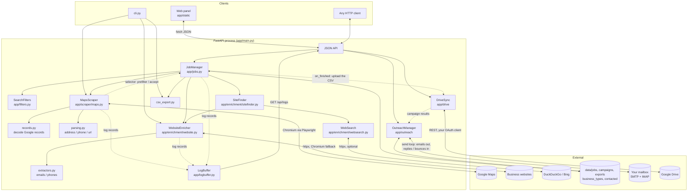
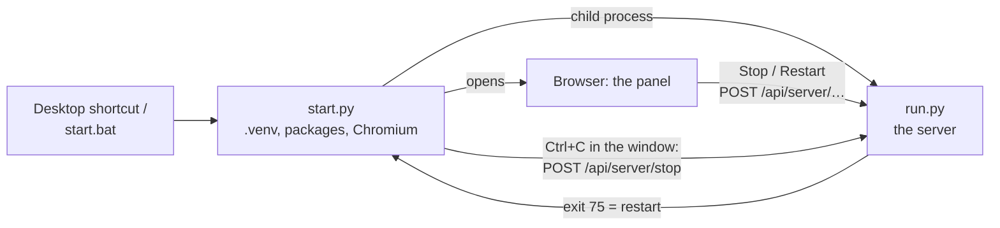
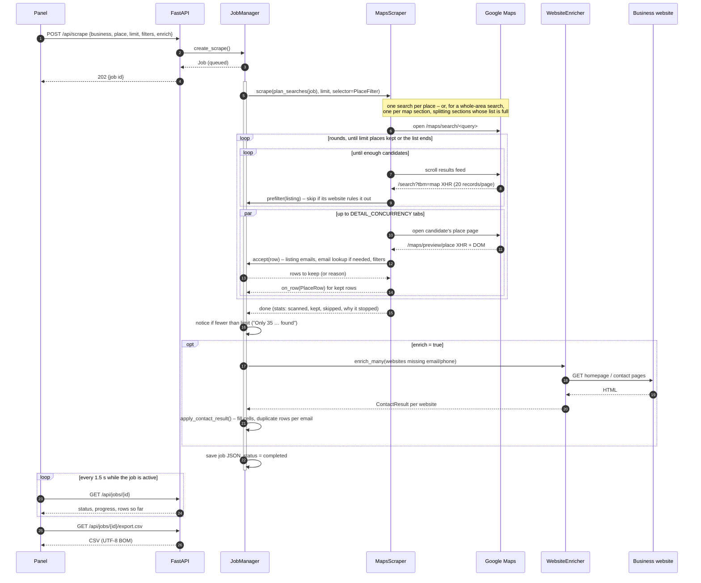
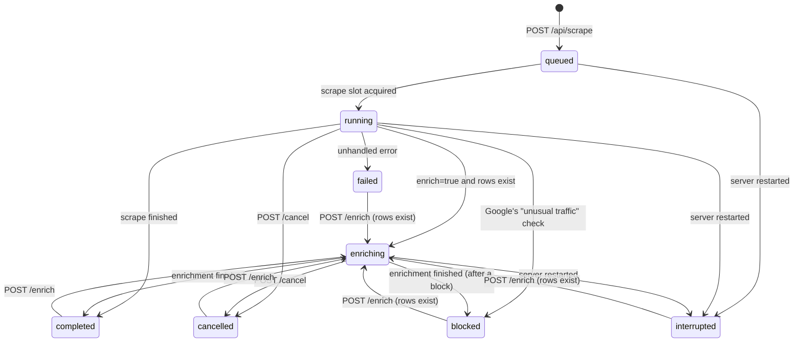
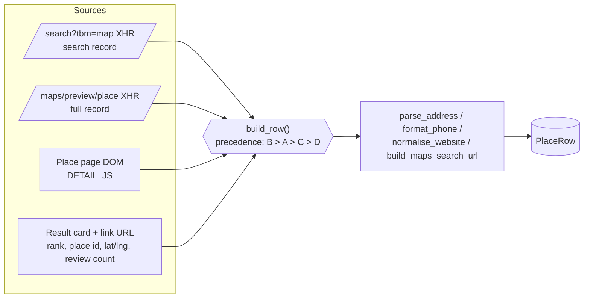
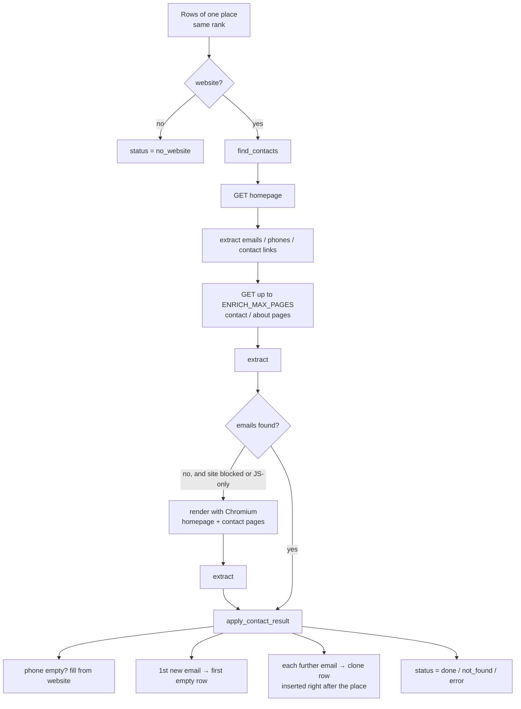
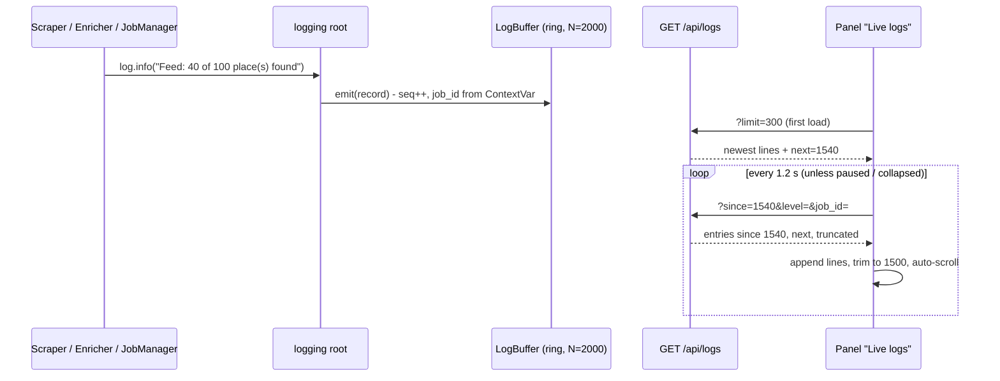

# Architecture

This document describes how the Leads Pilot Engine is put together, how data flows
through it and why it is built the way it is. Read [SCRAPING.md](SCRAPING.md) and
[ENRICHMENT.md](ENRICHMENT.md) for the internals of the two crawlers.

## 1. Big picture



Everything runs in **one Python process**. The FastAPI event loop hosts the API, the
background jobs and the Playwright browser (Playwright's async API cooperates with asyncio, so
no threads or worker processes are needed). The panel is plain HTML/JS served by the same
process; it only talks to the JSON API, which means the CLI and any other client get exactly
the same capabilities.

Started with the desktop shortcut (`start.bat` → `start.py`), a small launcher process sits in
front of it: it sets up what is missing, runs `run.py` as its child and opens the browser, passes
Ctrl+C in its window on as a Stop request, and starts `run.py` again when it exits for the panel's
Restart button:



## 2. Components

| Component | File | Responsibility |
| --- | --- | --- |
| **Settings** | `app/config.py` | Typed configuration from environment / `.env` (pydantic-settings). |
| **Settings tab** | `app/settings_editor.py` | Every setting's group, label and help; reads `.env`, writes only the lines that change, validates, and puts new values into the running `settings` object (the few read only at start-up wait for a restart). |
| **Server control** | `app/control.py`, `run.py`, `start.py` | Stop and Restart from the panel: `run.py` hands its uvicorn server to `control`; `start.py` restarts it when it exits with `RESTART_CODE`. On the way out the running searches stop first (`JobManager.shutdown`, while Playwright still answers; saved as *interrupted*), and a process still alive 10 s after the app has shut down is ended (`control.exit_if_stuck`), so a Restart never hangs. |
| **Models** | `app/models.py` | `PlaceRow` (one output row), `Job` (a search – business, place, filters – with its rows, status, progress and notice), request bodies. |
| **Filters** | `app/filters.py` | `SearchFilters`: the *Website* and *Must have* rules as pure functions (used on the feed, on scraped places and to decide when an email lookup can help). |
| **API** | `app/main.py` | REST routes, CSV download, static panel, cache headers. |
| **JobManager** | `app/jobs.py` | Creates and tracks asyncio tasks for scrapes and enrichments; `PlaceFilter` applies a job's filters while it scrapes (listing emails, inline email lookups, the unlisted-website check); applies enrichment results (incl. duplicate-row rule); writes the short-result `notice`; persists jobs as JSON, restores them on start-up. |
| **MapsScraper** | `app/scraper/maps.py` | Drives Chromium: search page → scroll feed → visit place pages → build rows, in rounds until `limit` places are kept by the selector. Reports progress and rows through callbacks. Stops at once, keeping what it found, when Google shows its "unusual traffic" check (`GoogleBlocked`). |
| **area** | `app/scraper/area.py` | Map sections for whole-area searches: reads the view Google fits to a place, builds section URLs, splits sections into quarters (pure geometry). |
| **records** | `app/scraper/records.py` | Decodes the nested-array place records Google embeds in its XHR responses / HTML. |
| **parsing** | `app/scraper/parsing.py` | Pure helpers: address → city/state/country, phone → national + E.164, URL cleaning, Maps URL builder. |
| **WebsiteEnricher** | `app/enrichment/website.py` | Fetch strategy for a business website (homepage, contact pages, browser fallback), concurrency. |
| **extractors** | `app/enrichment/extractors.py` | Email / phone extraction from HTML (mailto, tel, JSON-LD, Cloudflare obfuscation, `[at]` patterns, text), validation, scoring, contact-link discovery, links to other sites. |
| **SiteFinder** | `app/enrichment/sitefinder.py` | For a *No website* search: looks for a website the listing does not show (email domain, profile-page links, optional web search) and verifies it by the business's phone number on the site's home page ([ENRICHMENT.md §8](ENRICHMENT.md#8-websites-google-maps-does-not-list)). |
| **WebSearch** | `app/enrichment/websearch.py` | DuckDuckGo / Bing result pages over plain HTTP (never Google), one search at a time, stops for the job when both engines refuse. |
| **csv_export** | `app/export/csv_export.py` | Column layout (default + extended) and CSV serialisation. |
| **LogBuffer** | `app/logbuffer.py` | `logging.Handler` that keeps the last `LOG_BUFFER_SIZE` records in a ring buffer with sequence numbers and tags them with the running job's id; backs `GET /api/logs`. |
| **OutreachManager** | `app/outreach/manager.py` | Business types and campaigns (JSON under `data/`), the checks before a campaign starts, and the send loop: at most one email per 20 s round, inside the send window, under the daily limit, after a fresh reply check; replies / bounces / unsubscribes stop a lead's follow-ups. See [OUTREACH.md](OUTREACH.md). |
| **templates / leads / schedule** | `app/outreach/*.py` | Pure helpers: filling the emails (`{placeholders}`, `[[optional parts]]`), which businesses become leads and why the others don't, the send window. |
| **Mailbox** | `app/outreach/mailbox.py` | `smtplib` / `imaplib` in a worker thread; building the plain-text emails (threaded follow-ups, `List-Unsubscribe`) and reading what arrives (reply, auto-reply, bounce, unsubscribe). |
| **DriveClient / DriveSync** | `app/drive/*.py` | Google Drive over httpx: the OAuth sign-in (PKCE, the answer comes back to `/`), folders per business type, uploading search CSVs and campaign results, reading lead files ([DRIVE.md](DRIVE.md)). |
| **Panel** | `app/static/*` | *Search* tab: form with the business-type list, progress card, results table with per-row *Find* buttons, history list, CSV download / copy / *Save to Drive*, *Email these businesses*, live log viewer. *Outreach* tab (`outreach.js`): setup checklist, mailbox status, campaigns, business types and their email editor with live previews. |
| **Search computer** | `app/remote.py`, `JobManager.claim_remote` … | Two computers ([CLOUD.md](CLOUD.md)): on `ROLE=sender` a new search isn't run but waits as *queued* (`Job.remote`) until the search computer takes it (`POST /api/remote/next`); `RemoteSearcher` (`ROLE=searcher`) runs it under the same id, reports progress and sends the result back, and the sender's finished-job hook runs as if it had searched. A search whose search computer stays silent for 20 minutes is given up as *interrupted* (`expire_remote`, from the autopilot's tick). |
| **CLI** | `cli.py` | Same pipeline without the server. |

## 3. A scrape job, end to end



Rows are appended to the job **as they are scraped**, so the panel fills up progressively
and a cancelled job still keeps what was collected.

## 4. Job state machine



Rules enforced by `JobManager`:

- at most **two scrapes** run concurrently (`asyncio.Semaphore(2)`); further jobs wait in
  `queued`;
- an enrichment can only start when no task is running for that job (409 otherwise);
- every transition is persisted to `data/jobs/<id>.json` (atomic write via temp file +
  rename), progress is persisted at most every 2 s to avoid disk churn;
- on start-up, jobs found in an active state are marked `interrupted` (their rows are kept);
- a scrape that Google answers with its "unusual traffic" check stops at once and ends as
  `blocked`: the rows found before are kept, `error` explains what happened and what to do
  (`blocked_message()`), and enrichment still runs – it reads the businesses' own websites.

## 5. Data flow inside the scraper



Google's structured records are preferred because they need no parsing (they already contain
city, state, country, E.164 phone, place id, description). The DOM is the safety net when
Google reshuffles its JSON. Details and the index map: [SCRAPING.md](SCRAPING.md).

## 6. Data flow inside enrichment



The duplicate-row rule and the scoring of candidate emails are described in
[ENRICHMENT.md](ENRICHMENT.md).

## 7. Live logs

Every module logs through the standard `logging` package. Besides the console, the root
logger has a `LogBuffer` handler: a fixed-size ring buffer (`LOG_BUFFER_SIZE`, default 2000
records) where each record gets a monotonically increasing sequence number and the id of
the job that produced it. The panel polls `GET /api/logs?since=<seq>` every 1.2 s and
appends only the new lines, so the view stays live without websockets.



The job id travels through a `contextvars.ContextVar` set at the start of each job task;
asyncio copies the context into every task created inside it, so lines from the scraper's
worker tabs and the enricher's concurrent fetches are attributed to the right job. That is
what the *This job only* filter in the panel uses.

## 8. Persistence layout

```
data/
  jobs/job_<id>.json        full Job (query, status, progress, rows, stats)
  remote.json               ROLE=searcher: the cloud server's searches still to report (CLOUD.md)
  exports/<job>.csv         last CSV download of a job (convenience copy)
  exports/<query>.csv       CLI output default location
  campaigns/camp_<id>.json  a campaign with its leads, what was sent and what came back
  business_types.json       the business types and their emails (after the first change)
  contacted.json            every address that got a first email - never emailed again
  google_drive.json         the Google Drive sign-in (a refresh token - keep it private)
```

Nothing else is stored. Deleting `data/` resets the application – including the list of
businesses already emailed, so keep `contacted.json` if you start over.

## 9. Design decisions

| Decision | Why |
| --- | --- |
| **Playwright + real Chromium** instead of HTTP requests to Google | Maps is a JavaScript application; results only exist after the app runs. A real browser also keeps us on the normal, un-suspicious code path. |
| **Capture Google's XHR records instead of scraping only the DOM** | Structured fields (city/state/country, E.164 phone, place id, description) come for free and are far more stable than obfuscated CSS class names. The DOM remains as fallback. |
| **Visit every place page** (rather than trusting the list page) | The list records lack description and review count; the place XHR has everything. Cost: ~1–3 s per place, mitigated with parallel tabs. |
| **Single process, asyncio tasks** for jobs | Simple to run (`python run.py`), no broker or database to install; fine for one user / a small team. |
| **A launcher process around the server** (`start.py`) | Restart has to be a new process (settings like `PORT` are read at start-up), and something has to start it; the launcher also turns Ctrl+C into a key press, so cmd.exe doesn't ask *"Terminate batch job?"* and a click in the window can't freeze the server (QuickEdit). |
| **Settings saved to `.env`, applied in place** | One file stays the source of truth for the panel, the CLI and hand edits; most values are read where they are used, so setting them on the shared `settings` object takes effect without a restart. |
| **JSON files for persistence** | Human-readable, zero setup, easy to back up; jobs are small (hundreds of rows). |
| **Vanilla JS panel, no build step** | Nothing to compile; the UI is a thin client over the API and can be edited with any text editor. |
| **One row per email** | Matches how lead lists are consumed in spreadsheets / CRMs (one contact per row) — explicitly requested. |
| **Business + place instead of one query box** | Matches how leads are searched ("plumbers" in "Austin, TX"), names jobs and files clearly; the text sent to Google is still one query (`plumbers in Austin, TX`), and free-text queries keep working. |
| **Filter while scanning; `limit` counts matches** | "20 businesses without a website" is what the user wants, not "20 listings, some without a website". The scraper keeps scrolling until enough places matched. |
| **Pre-filter on the feed, confirm on the place page** | Visiting a place page is the slow part (1–3 s). The feed's records already say whether a listing has a website, so pages that cannot match are never opened; the final decision is always made on the fully scraped place. |
| **A Facebook / Yelp / booking page is not a website** (switchable) | For lead generation such businesses have no site of their own; enrichment reads only that page, never the platform's own contact pages. |
| **Whole-area search as a quadtree of map sections** | Google lists ~120 businesses per search, most prominent first, so the smaller businesses of a city never appear. Searching zoomed-in sections gets the full list of each section; splitting only sections whose list is full keeps the number of searches proportional to how busy the area is (one search for a small town, dozens for a metro). Sections are geometric (from the view Google fits to the place), so no list of neighbourhoods or external geocoder is needed. |
| **Short results are explained, not errors** | Asking for 200 in a city with 35 matches should give the 35 and say that's all Google lists — or that Google's ~120-per-search cap was hit, so the user knows whether searching nearby areas can find more. |
| **No junk-email filtering** | Heuristic blocklists dropped real addresses (`john@smithplumbing.com`, `…@thecleaningcompany.com`); keeping everything and ordering by score loses nothing. |
| **UTF-8 BOM in CSV** | Excel on Windows otherwise mangles accented names. |
| **Docs-consistency tests** | Columns, routes, settings and record indexes are cross-checked against the docs so the documentation cannot silently rot. |
| **Polling instead of websockets for progress and logs** | One code path that works through any proxy, trivially testable with `TestClient`; a 1.2 s poll of a few KB is negligible next to the browser work. |
| **Send from your own mailbox over SMTP, read replies over IMAP** | No third-party sending service or account; it works with Gmail / Workspace app passwords and most providers. IMAP is required because stopping the follow-ups for anyone who replied is the point – without it nothing is sent. |
| **One email per round, in a window, with random gaps and a daily cap** | Looks like a person sending, keeps a new mailbox's reputation, and a campaign can't flood anyone if something goes wrong. Follow-ups are spaced from the email actually sent before, so a server that was off never sends two emails to one business back to back. |
| **Campaigns copy the business type's emails** | Editing a business type for the next city never changes what a running campaign sends. |
| **A contacted list outside the campaigns** | "Never email a business twice" survives deleting a campaign and holds across cities and business types. |
| **Business type as the thread through everything** | One choice in the search form picks what Google Maps is searched for, the Drive folder, and the emails – the user's mental model ("roofers in Houston") instead of three settings. |
| **Drive over plain REST with the user's own OAuth client** | No Google client libraries (heavy), no shared app credentials; the loopback redirect lands on the panel's own server, so connecting is one click once the client exists. Full Drive scope because the crawler writes into folders the user made and reads files the user put there. |

## 10. Scaling notes

- Throughput is dominated by place-page visits: ~1–3 s each with `DETAIL_CONCURRENCY=3`
  (≈ 100 places in 1–2 minutes). Raise the concurrency on a fast machine, lower it if Google
  starts serving captchas.
- Enrichment runs `ENRICH_CONCURRENCY` websites in parallel; the Chromium fallback is the slow
  path (a few seconds per site) and only triggers when plain HTTP found nothing.
- For many parallel users or very large batches move the job runner behind a queue
  (e.g. Redis + workers) — `JobManager` is the only place that would change; the scraper and
  enricher are already independent async classes.
