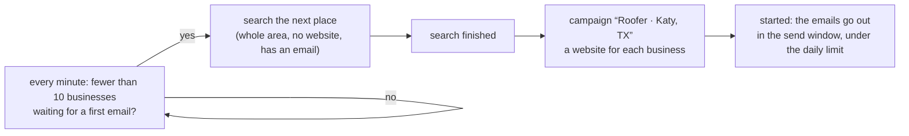

# Autopilot and the master sheet

The autopilot finds businesses and starts their campaigns by itself. The master sheet in Google
Drive shows every campaign and everything that happened. Code: `app/outreach/autopilot.py`,
`app/outreach/activity.py`, `app/outreach/master.py`.

## 1. What the autopilot does

It works through **a list of places** for **one business type** (Roofer). It starts with Houston's
suburbs, then Dallas–Fort Worth, San Antonio and Austin; you can edit the list. Each search looks
at the whole area for businesses **without a website that have an email**, like the search form
with *Whole area*, *No website* and *Has an email*. When the search finishes, the autopilot makes
the campaign with the business type's emails and starts it. Businesses that were emailed before,
or are in another campaign, are left out as usual ([OUTREACH.md](OUTREACH.md)). Each business gets
its website ([SITES.md](SITES.md)), and its first email waits until the website is online.

It searches only when the running campaigns are about to run out of businesses to email, so
websites aren't built weeks before anyone is emailed and Google Maps isn't searched more than
needed.

| Setting | Default | Meaning |
| --- | --- | --- |
| business type | Roofer | what it looks for, and the emails its campaigns use |
| places | 20 Texas places | searched in this order; *next* is the next one |
| `min_waiting` | 10 | search when fewer businesses than this wait for their first email (two days at 5 a day) |
| `searches_per_day` | 2 | at most this many searches a day, one at a time |
| `limit` | 60 | businesses wanted per search |

### When it holds back

- a search is running;
- the mailbox settings have a problem, or a campaign was paused because of the mailbox;
- enough businesses are waiting, or today's searches are used up.

The panel shows which one applies.

### When it stops itself

The autopilot switches itself off, says why, and writes it in the activity log when:

- **2 of the last 20 businesses emailed bounced.** It also pauses the running campaigns, because
  bounces hurt the mailbox's reputation. Check the addresses and the mailbox, then switch it on
  again; bounces from before that don't count. The campaigns it paused stay paused until you start
  them, and it won't search for more while they are.
- **Google blocked a search** (its *unusual traffic* check). Wait a day, then switch it on again.
- every place on the list has been searched, or its business type was deleted.

A search that didn't finish (the panel was closed during it) is searched again. So is one that failed with an error (say the browser didn't survive the laptop sleeping), until it has failed three times in a row: then the next place is searched. A search you cancelled isn't searched again. Each try counts toward the searches a day.

### Every day, on its own

The autopilot, the emails and the follow-ups run inside the panel, so they only happen while the
panel runs on this computer:

- `start.bat --autostart` starts the panel when you sign in to Windows, minimised and without
  opening the browser (`--no-autostart` undoes it).
- `start.bat --weekday-start` adds a Windows Task Scheduler task that starts the panel at 18:00
  (the computer's time) Monday to Friday unless it is already running, or as soon as the computer is
  awake after that. A closed window then costs at most a few hours, not a day of emails
  (`--no-weekday-start` removes it). In India 18:00 is half an hour before the send window opens.
- How the panel stopped is in `data/logs/panel.log`: *the window was closed*, *exited normally* (Stop
  button or Ctrl+C) or *unexpectedly with exit code …*, after the panel's own log lines.
- While the panel runs, Windows doesn't go to sleep (`KEEP_AWAKE`, on by default); the screen still
  turns off. Closing a laptop's lid can still put it to sleep, depending on its power settings.
- Missed while the computer was off? The emails go out once the panel runs again, in the send
  window.

## 2. The activity log

Every event is a line in `data/activity.jsonl`:

- searches started, finished or blocked;
- campaigns made, started, paused or finished;
- every email sent or refused;
- every reply, automatic reply, bounce and unsubscribe;
- the autopilot switched on or off, or stopping itself.

The Outreach tab shows the newest, and `GET /api/activity` returns them.

## 3. The master sheet

**Leads Pilot - Master sheet** is a Google Sheet in `DRIVE_FOLDER` (`app/drive/sheets.py`). It is
updated within about 5 minutes of a change while Drive is connected and `DRIVE_AUTO_UPLOAD` is on. Both
tabs can also be downloaded as CSV from the Outreach tab.

| Tab | What's in it |
| --- | --- |
| **Campaigns** | an **All campaigns** row, then a row per campaign: Status, Created, Started, Businesses, Emailed, Waiting, In sequence, Replied, No reply, Bounced, Unsubscribed, Bad address, Skipped, Left out, Opened website, Tapped, Emails sent, Last email, and a link to its results file. Rows are green while running, yellow when paused, blue when finished |
| **Activity** | the activity log, newest first: When, What, Campaign, Business, Email, Detail. Replies are green, emails sent blue, bounces / refusals / pauses / stops red, campaigns made or started yellow, searches lilac, website visits and taps teal, test copies grey |

The panel makes it once and formats it once: a purple header row that stays at the top, filter
buttons, column widths and the colour rules. After that it only writes the values. Don't type into
it, because every update replaces the values; use a copy, or the filters, to work with it.
`data/master_sheet.json` remembers which sheet it is. Delete the sheet in Drive and a new one is
made.

It needs the **Google Sheets API** switched on in the Google Cloud project of `GOOGLE_CLIENT_ID`
(*APIs & Services › Library › Google Sheets API › Enable*). Until it is on, the master sheet is saved
as two CSV files, `Leads Pilot - campaigns.csv` and `Leads Pilot - activity.csv`, and the Outreach
tab says so. The panel tries the Sheets API again every 10 minutes and switches over by itself.

Each campaign's own results file, with one row per business, stays in `<business type>/Outreach/`
([DRIVE.md](DRIVE.md)). Times are the computer's.

## 4. API

`GET /api/autopilot`, `PATCH /api/autopilot`, `GET /api/activity`,
`GET /api/master/campaigns.csv`, `GET /api/master/activity.csv` ([API.md](API.md#autopilot)).
