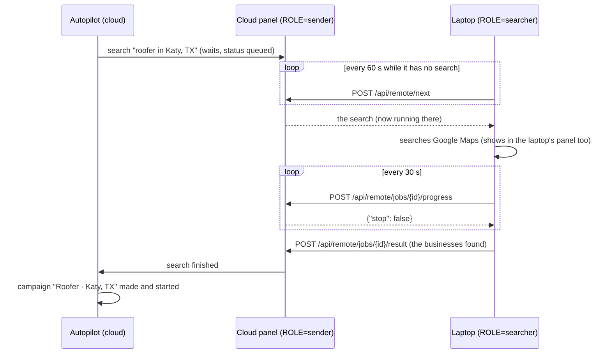
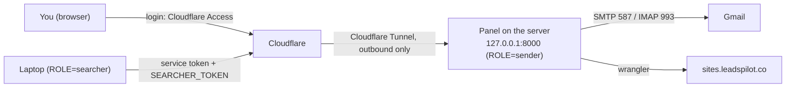

# Cloud server: sending from the cloud, searching on this computer

The panel can run on two computers at once: a **cloud server** that is always on and sends the emails,
and **this computer** (the laptop) that runs the Google Maps searches. Campaigns, follow-ups and
reply checks then keep going while the laptop is closed; only new searches wait for it.

Leave `ROLE` on `all` (the default) to do everything on one computer, as before.

## 1. Why two computers

| Job | Where | Why |
| --- | --- | --- |
| Google Maps searches | the laptop (`ROLE=searcher`) | Google blocks searches from data-centre addresses with its "unusual traffic" page; a home connection looks like a person |
| Campaigns, emails, follow-ups | the cloud server (`ROLE=sender`) | the send window is 19:30–23:30 IST, Monday to Friday; a closed laptop sends nothing |
| Reply and bounce checks, alerts | the cloud server | they stop follow-ups on time |
| Preview websites, website visits, quote requests | the cloud server | they're built when a campaign starts |
| The autopilot (which place is next, how many a day) | the cloud server | it decides what gets searched |
| Google Drive uploads | both, if connected | each one uploads what it makes |

Nothing is ever sent from the laptop while it is a searcher, so the two can never email the same
business twice.

## 2. How a search travels

Every search the cloud server starts – the autopilot's, and any started in its panel – **waits there**
for the laptop. The laptop asks for one every minute while it's on:

1. **Waiting.** The cloud keeps the search as *queued* ("Waiting for the search computer"). A restart of
   the cloud panel keeps it waiting.
2. **Taken.** `POST /api/remote/next` hands the oldest waiting search to the laptop, once. The laptop runs
   it under the same id, like any search.
3. **Progress.** Every 30 s the laptop reports its progress; the cloud panel shows it. The answer is
   `{"stop": true}` when the search was cancelled in the cloud panel or given up on – the laptop then
   cancels it too.
4. **Result.** The finished search (its businesses, or why it failed) goes back; the cloud makes the
   campaign as if it had searched itself – a failed or interrupted search counts towards the autopilot's
   *three failures in a row, then the next place* rule ([AUTOPILOT.md](AUTOPILOT.md#when-it-holds-back)).

**When the laptop sleeps or loses its connection mid-search**, it stops reporting. After **20 minutes**
without a report (`REMOTE_SILENCE_S` in `app/outreach/autopilot.py`) the cloud gives the search up as
*interrupted* and the autopilot searches that place again; a late result is refused (`409`) and the
laptop drops it.

**When the laptop's panel restarts mid-search**, its search comes back *interrupted* and is sent as such
– the place is searched again. A result that couldn't be sent (no internet) is sent on the next round:
the searches it still has to report are kept in `data/remote.json`.

## 3. Settings

Set them in the Settings tab (group **Cloud server**) or in `.env`. `ROLE` takes effect after a restart.

| Setting | Cloud server | Laptop |
| --- | --- | --- |
| `ROLE` | `sender` | `searcher` |
| `SEARCHER_TOKEN` | a long random text | **the same** text |
| `CLOUD_URL` | – | the cloud panel's address, e.g. `https://panel.leadspilot.co` |
| `CLOUD_ACCESS_ID` / `CLOUD_ACCESS_SECRET` | – | the Cloudflare Access service token (§4) |
| `TRUSTED_HOSTS` | the panel's name behind the login, e.g. `panel.leadspilot.co` | – |

Make the token with `python -c "import secrets; print(secrets.token_urlsafe(32))"`. It is a password:
it never goes in the repository, a chat or a screenshot.

Without `ROLE=sender` and a `SEARCHER_TOKEN`, the cloud server's remote routes answer `404`; with a
wrong token, `401`.

## 4. The cloud server

> **Status:** the server and the panel service are running (`ROLE=sender`, sending off, no mailbox login,
> autopilot off – it can't email anyone). The tunnel and the login come next; then the move (§5).

What runs where:

- **Server.** Oracle Cloud *Always Free*, home region Mumbai: `VM.Standard.A1.Flex` (Ampere ARM),
  1 OCPU, 6 GB memory, Ubuntu 24.04, 47 GB boot volume, an ephemeral public IP. The account is on *Pay As
  You Go* so Oracle doesn't reclaim the idle server, with a 1 USD budget alert at 1 % so any charge is
  noticed at once. Only the SSH port is open (Oracle's iptables rules); unattended upgrades are on; the
  time zone is Asia/Kolkata; a 2 GB swap file.
- **Login.** `ssh leadspilot-cloud` – an entry in the laptop's `~/.ssh/config` for user `ubuntu` with the
  key `~/.ssh/leadspilot_oracle`. The private key never leaves the laptop.
- **The panel** is `~/leadspilot-engine` (its own `venv`, Node.js for wrangler in `/usr/local`), listens on
  `127.0.0.1:8000` only and runs as the systemd service `leadspilot` (`Restart=always`,
  `LEAD_CRAWLER_LAUNCHER=1` so the panel's Restart button works), so it starts with the server and after a
  crash. Its `.env` (mode 600) holds `ROLE=sender` and the `SEARCHER_TOKEN` made on the server.
  `journalctl -u leadspilot -f` shows its log, as does `data/logs/panel.log`.
- **Reaching it.** A Cloudflare Tunnel (`cloudflared`, outbound only – no port is opened) publishes it at
  the panel's name; **Cloudflare Access** in front of it lets only your Google account in. The laptop gets
  past the login with an Access **service token** (`CLOUD_ACCESS_ID` / `CLOUD_ACCESS_SECRET`) and then
  also needs the `SEARCHER_TOKEN`.
- **Settings, Stop and Restart** in the cloud panel work at the names in `TRUSTED_HOSTS` – the tunnel
  connects from the server itself, and Access has already checked who you are. Never list a name there
  that has no login in front of it.
- **Google Drive.** Google only sends its sign-in back to `127.0.0.1`, so the cloud panel can't connect
  Drive itself: the sign-in (`data/google_drive.json`) is copied from the laptop. If Google ends it (you get
  the *Google Drive disconnected* email), connect on the laptop and copy the file again – or publish the
  Google app so it doesn't end every 7 days ([PLAYBOOK.md](PLAYBOOK.md) step 2).
- **Updates.** The laptop's git has a second remote, `cloud` (`leadspilot-cloud:leadspilot.git`, a bare
  repository on the server). `git push cloud main` after pushing to GitHub: the repository's
  `post-receive` hook checks the code out into `~/leadspilot-engine`, installs changed requirements, runs
  `npm ci` for the worker and restarts the service. The server never needs a GitHub login.

## 5. Moving the sending to the cloud

Done once, outside the send window (19:30–23:30 IST, Monday to Friday), so no email is half-sent:

1. Stop the laptop's panel.
2. Copy the laptop's `data/` (campaigns, business types, contacted list, autopilot, activity log,
   website files, the Google Drive sign-in) and `.env` to the server.
3. On the server: `ROLE=sender`, `SEARCHER_TOKEN`, `TRUSTED_HOSTS`. Start it.
4. On the laptop: `ROLE=searcher`, `CLOUD_URL`, the same `SEARCHER_TOKEN`, the Access service token. Start
   it.

From then on, change sending settings (emails per day, hours …), campaigns and the autopilot **in the
cloud panel**; the laptop's copies of the campaigns are only a snapshot and no longer change.

## 6. What the panels show

`GET /api/remote` ([API.md](API.md#searching-on-another-computer)):

- cloud: when the laptop last asked, its version, how many searches wait and which one runs;
- laptop: what it's doing (*waiting for a search*, *searching …*, or what's wrong) and when it last
  reached the cloud.

The laptop's log says the same, once per problem – see [TROUBLESHOOTING.md](TROUBLESHOOTING.md#cloud-server).
