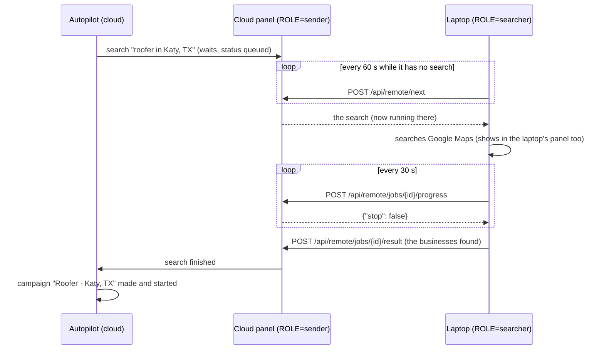
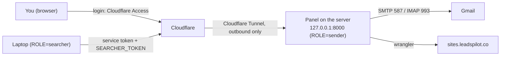

# Cloud server: sending from the cloud, searching on this computer

The panel can run on two computers at once: a **cloud server** that is always on and sends the emails,
and **this computer** (the laptop) that runs the Google Maps searches. Campaigns, follow-ups and
reply checks then keep going while the laptop is closed; only new searches wait for it.

Leave `ROLE` on `all` (the default) to do everything on one computer, as before.

## 1. Why two computers

| Job | Where | Why |
| --- | --- | --- |
| Google Maps searches | the laptop (`ROLE=searcher`) | Google blocks searches from data-centre addresses with its "unusual traffic" page; a home connection looks like a person |
| Campaigns, emails, follow-ups | the cloud server (`ROLE=sender`) | the send window is 19:30–23:30 IST, Monday to Friday; a closed laptop sends nothing |
| Reply and bounce checks, alerts | the cloud server | they stop follow-ups on time |
| Preview websites, website visits, quote requests | the cloud server | they're built when a campaign starts |
| The autopilot (which place is next, how many a day) | the cloud server | it decides what gets searched |
| Google Drive: the master sheet, campaign results | the cloud server | the laptop's campaigns are an old copy |
| Google Drive: a search's CSV file | both, if connected | the same file: the later one replaces it |

Nothing is ever sent from the laptop while it is a searcher, so the two can never email the same
business twice.

## 2. How a search travels

Every search the cloud server starts – the autopilot's, and any started in its panel – **waits there**
for the laptop. The laptop asks for one every minute while it's on:



1. **Waiting.** The cloud keeps the search as *queued* ("Waiting for the search computer"). A restart of
   the cloud panel keeps it waiting.
2. **Taken.** `POST /api/remote/next` hands the oldest waiting search to the laptop, once. The laptop runs
   it under the same id, like any search.
3. **Progress.** Every 30 s the laptop reports its progress; the cloud panel shows it. The answer is
   `{"stop": true}` when the search was cancelled in the cloud panel or given up on – the laptop then
   cancels it too.
4. **Result.** The finished search (its businesses, or why it failed) goes back; the cloud makes the
   campaign as if it had searched itself – a failed or interrupted search counts towards the autopilot's
   *three failures in a row, then the next place* rule ([AUTOPILOT.md](AUTOPILOT.md#when-it-holds-back)).

**When the laptop sleeps or loses its connection mid-search**, it stops reporting. After **20 minutes**
without a report (`REMOTE_SILENCE_S` in `app/outreach/autopilot.py`) the cloud gives the search up as
*interrupted* and the autopilot searches that place again; a late result is refused (`409`) and the
laptop drops it.

**When the laptop's panel restarts mid-search**, its search comes back *interrupted* and is sent as such
– the place is searched again. A result that couldn't be sent (no internet) is sent on the next round:
the searches it still has to report are kept in `data/remote.json`.

## 3. Settings

Set them in the Settings tab (group **Cloud server**) or in `.env`. `ROLE` takes effect after a restart.

| Setting | Cloud server | Laptop |
| --- | --- | --- |
| `ROLE` | `sender` | `searcher` |
| `SEARCHER_TOKEN` | a long random text | **the same** text |
| `CLOUD_URL` | – | the cloud panel's address, e.g. `https://panel.leadspilot.co` |
| `CLOUD_ACCESS_ID` / `CLOUD_ACCESS_SECRET` | – | the Cloudflare Access service token (§4) |
| `TRUSTED_HOSTS` | the panel's name behind the login, e.g. `panel.leadspilot.co` | – |

Make the token with `python -c "import secrets; print(secrets.token_urlsafe(32))"`. It is a password:
it never goes in the repository, a chat or a screenshot.

Without `ROLE=sender` and a `SEARCHER_TOKEN`, the cloud server's remote routes answer `404`; with a
wrong token, `401`.

## 4. The cloud server

> **Status: live since 2026-11-12.** The cloud server sends (`ROLE=sender`: campaigns, follow-ups, reply
> checks, preview websites, the autopilot); the laptop only searches (`ROLE=searcher`). The panel is online
> at `https://panel.leadspilot.co` behind Cloudflare Access (application *Leads Pilot panel*, policy *Me*:
> your email, a one-time code, 1-month session; `TRUSTED_HOSTS=panel.leadspilot.co`). The laptop gets past
> the login with the service token `laptop-searcher` (policy *Laptop*).

What runs where:



- **Server.** Oracle Cloud *Always Free*, home region Mumbai: `VM.Standard.A1.Flex` (Ampere ARM),
  1 OCPU, 6 GB memory, Ubuntu 24.04, 47 GB boot volume, an ephemeral public IP. A 1 USD budget alert at
  1 % notices any charge at once. Only the SSH port is open (Oracle's iptables rules); unattended upgrades
  are on; the time zone is Asia/Kolkata; a 2 GB swap file.
- **Idle reclamation.** Oracle takes back an *Always Free* server that is idle for 7 days: CPU, network
  **and** memory all under 20 % (95th percentile). The panel alone uses about 10 % memory and almost no
  CPU, so it would count as idle. Until the account is upgraded to *Pay As You Go* (exempt, still free
  within the Always Free limits), the systemd service `memory-ballast` holds 1.3 GB of memory (locked, no
  CPU, no network; `/usr/local/lib/memory-ballast.py`), keeping memory at about 33 %. It is the first
  thing the kernel ends if memory runs short (`OOMScoreAdjust=1000`). After the upgrade:
  `sudo systemctl disable --now memory-ballast`.
- **Login.** `ssh leadspilot-cloud` – an entry in the laptop's `~/.ssh/config` for user `ubuntu` with the
  key `~/.ssh/leadspilot_oracle`. The private key never leaves the laptop.
- **The panel** is `~/leadspilot-engine` (its own `venv`, Node.js for wrangler in `/usr/local`), listens on
  `127.0.0.1:8000` only and runs as the systemd service `leadspilot` (`Restart=always`,
  `LEAD_CRAWLER_LAUNCHER=1` so the panel's Restart button works), so it starts with the server and after a
  crash. Its `.env` (mode 600) holds `ROLE=sender` and the `SEARCHER_TOKEN` made on the server.
  `journalctl -u leadspilot -f` shows its log, as does `data/logs/panel.log`.
- **Reaching it.** A Cloudflare Tunnel (`cloudflared`, outbound only – no port is opened) publishes it at
  the panel's name; **Cloudflare Access** in front of it lets only your Google account in. The laptop gets
  past the login with an Access **service token** (`CLOUD_ACCESS_ID` / `CLOUD_ACCESS_SECRET`) and then
  also needs the `SEARCHER_TOKEN`.
- **Settings, Stop and Restart** in the cloud panel work at the names in `TRUSTED_HOSTS` – the tunnel
  connects from the server itself, and Access has already checked who you are. Never list a name there
  that has no login in front of it.
- **Google Drive.** Google only sends its sign-in back to `127.0.0.1`, so the cloud panel can't connect
  Drive itself: **the laptop hands it its sign-in** (since 1.19.5). Every round the laptop tells the cloud
  which sign-in it has (an id, `POST /api/remote/drive`); when the cloud hasn't got it, the laptop sends it
  and the cloud saves it in `data/google_drive.json` (activity log: *Google Drive connected – the sign-in
  came from the laptop*). When Google ends it, the **cloud** emails you (*[Leads Pilot] Google Drive
  disconnected*, saying to connect on the laptop) and the laptop forgets its copy too, so its panel shows the
  red *Connect Google Drive* banner. Connect in the **laptop's** panel (`http://127.0.0.1:8000` › Outreach);
  within a minute the cloud has it. The cloud panel's own *Connect* button says so. Publish the Google app so
  it doesn't end every 7 days ([PLAYBOOK.md](PLAYBOOK.md) step 2).
- **Updates.** The laptop's git has a second remote, `cloud` (`leadspilot-cloud:leadspilot.git`, a bare
  repository on the server). `git push cloud main` after pushing to GitHub: the repository's
  `post-receive` hook checks the code out into `~/leadspilot-engine`, installs changed requirements, runs
  `npm ci` for the worker and restarts the service. The server never needs a GitHub login.

## 5. Moving the sending to the cloud

Done once, outside the send window (19:30–23:30 IST, Monday to Friday), so no email is half-sent:

1. Stop the laptop's panel.
2. Copy the laptop's `data/` (campaigns, business types, contacted list, autopilot, activity log,
   website files, the Google Drive sign-in) and `.env` to the server.
3. On the server: `ROLE=sender`, `SEARCHER_TOKEN`, `TRUSTED_HOSTS`. Start it.
4. On the laptop: `ROLE=searcher`, `CLOUD_URL`, the same `SEARCHER_TOKEN`, the Access service token. Start
   it.

From then on, change sending settings (emails per day, hours …), campaigns and the autopilot **in the
cloud panel**; the laptop's copies of the campaigns are only a snapshot and no longer change.

A search the laptop is running carries on through a restart or an update of the cloud panel (`git push
cloud main`): the cloud keeps it as the laptop's and takes its result when it comes.

**Done on 2026-11-12** (outside the send window). The server's `.env` is the laptop's (mailbox, sender,
Google Drive app, `SITES_VISITS_KEY` …) without `CLOUD_URL` / `CLOUD_ACCESS_*`, plus `ROLE=sender`,
`HOST=127.0.0.1`, `PORT=8000`, its `SEARCHER_TOKEN`, `KEEP_AWAKE=false` and `TRUSTED_HOSTS`. Its data
before the move is kept in `~/leadspilot-engine/data.pre-move` and `.env.pre-move`. **To undo it**: stop the
server's panel (`sudo systemctl stop leadspilot`), copy its `data/` back to the laptop (the campaigns and
the contacted list changed there), then on the laptop remove `ROLE` (or set `ROLE=all`) and start its
panel – never let both send.

## 6. Not watching the panels

The two computers watch each other: the **laptop** emails you when it can't reach the cloud server for 30
minutes (*Cloud server not reachable* – nothing is sent while it's down), and again when it's back. The
cloud server emails you (`ALERT_TO`) when something needs a look – the autopilot stopped, a campaign
paused, Google blocked a search, the laptop silent for 24 hours … – and a summary every morning at 08:00
([OUTREACH.md §8](OUTREACH.md#8-emails-to-you-about-the-panel-appoutreachalertspy)). The master sheet's first
tab, **Status**, says the same at a glance – red rows need a look, and an old *Updated* time means the cloud
server isn't running ([AUTOPILOT.md §3](AUTOPILOT.md#3-the-master-sheet)).

## 7. What the panels show

`GET /api/remote` ([API.md](API.md#searching-on-another-computer)):

- cloud: when the laptop last asked, its version, how many searches wait and which one runs;
- laptop: what it's doing (*waiting for a search*, *searching …*, or what's wrong) and when it last
  reached the cloud.

The laptop's log says the same, once per problem – see [TROUBLESHOOTING.md](TROUBLESHOOTING.md#cloud-server).

## 8. What is where – and what isn't on GitHub

Every kind of data, and where it is:

| Data | Cloud server | Laptop | Google Drive | Cloudflare | Mailbox | GitHub |
| --- | --- | --- | --- | --- | --- | --- |
| Campaigns (who, which email is next, what came back) | **live** | old copy | daily backup; results files + master sheet | – | – | – |
| Contacted list (nobody is emailed twice) | **live** | old copy | daily backup | – | – | – |
| Business types and their email texts | **live** | old copy | daily backup | – | – | – |
| Autopilot: places, progress, buffer | **live** | old copy | daily backup | – | – | – |
| Activity log | **live** | old copy | daily backup; master sheet | – | – | – |
| Search results | copy | **made here** | daily backup; a CSV per search | – | – | – |
| Preview websites | **source** | old copy | – | **online** | – | – |
| Website visits, quote requests | – | – | – | **visits database** | quotes (forwarded) | – |
| Emails sent, replies, bounces | reads them | – | – | – | **all of them** | – |
| Settings and passwords (`.env`) – keep in a password manager | its own | its own | – | – | – | never |
| Google Drive sign-in | from the laptop | **made here** | – | – | – | never |
| SSH key to the server – keep in a password manager | the lock (public key) | **the key** | – | – | – | never |
| Code, docs, the server's setup files | copy | **edited here** | – | – | – | copy |

**Bold**: the one in use. *Copy*: kept up to date. *Old copy*: the laptop's `data/`, frozen at the move
(12 Nov 2026, 11:53). *Daily backup*: `Backups/leadspilot-backup-YYYY-MM-DD.zip`, the newest 30 (a month).

GitHub has the code, the docs and the cloud server's own files (`deploy/cloud/`). On purpose it doesn't
have anything secret or personal – the repository is public:

| What | Where it lives | Keep a copy |
| --- | --- | --- |
| The laptop's `.env` (mailbox password, Google OAuth client, `SITES_VISITS_KEY`, `EMAIL_VERIFY_KEY`, `SEARCHER_TOKEN`, `CLOUD_ACCESS_ID` / `CLOUD_ACCESS_SECRET`) | the laptop's project folder | **yes – in your password manager** (the server's `.env` has all of it except the Access token) |
| The SSH key for the server (`~/.ssh/leadspilot_oracle` and the `leadspilot-cloud` entry in `~/.ssh/config`) | the laptop's `C:\Users\<you>\.ssh` | **yes – in your password manager** (the private key file) |
| Campaigns, the contacted list, business types, the autopilot, the activity log, the searches (`data/`) | **the cloud server** (`~/leadspilot-engine/data`); the laptop's `data/` is an old copy from the move | **done by itself:** every day after 03:00 a zip in Google Drive › `Backups/` (`leadspilot-backup-YYYY-MM-DD.zip`, the newest 30; `app/drive/backup.py`); the master sheet's Status tab shows the last one |
| The Google Drive sign-in (`data/google_drive.json`) | both computers | no – connect again on a new laptop |
| The Cloudflare login for the preview websites (`data/wrangler`) | the cloud server (it uploads them) and the laptop | no – `python sites/deploy.py --login` on a laptop (it opens the browser), then copy its `data/wrangler` to the server |
| Accounts: Oracle Cloud, Cloudflare (Zero Trust, the domain, the Worker), Google Cloud (OAuth app), Google Workspace (the mailbox) | online | your logins |

## 9. A new laptop (the search computer)

The laptop only searches, so a new one needs no campaign data – the cloud server has it all. About 30
minutes:

1. **Install** Git, [Python 3.11+](https://www.python.org/downloads/) (tick *Add python.exe to PATH*), and
   clone the code: `git clone https://github.com/wandringspirit/leadspilot-engine.git C:\Projects\leadspilot-engine`.
2. **The SSH key.** Copy `leadspilot_oracle` (and `.pub`) from your password manager / the old laptop into
   `C:\Users\<you>\.ssh\`, and add to `C:\Users\<you>\.ssh\config`:

   ```
   Host leadspilot-cloud
       HostName <the server's public IP – Oracle console › Compute › Instances>
       User ubuntu
       IdentityFile ~/.ssh/leadspilot_oracle
       IdentitiesOnly yes
   ```

   `ssh leadspilot-cloud` must log in. *Lost the key?* Make a new one (`ssh-keygen -t ed25519 -f
   ~/.ssh/leadspilot_oracle`) and put its `.pub` line into the server's `~/.ssh/authorized_keys` from the
   Oracle console (*the instance › Cloud Shell connection* or *Console connection*).
3. **`.env`.** Best: the copy from your password manager. Else start from the server's –
   `scp leadspilot-cloud:leadspilot-engine/.env .env` – and change it for the laptop: delete the lines
   `HOST`, `PORT`, `KEEP_AWAKE`, `TRUSTED_HOSTS`, and set

   ```
   ROLE=searcher
   CLOUD_URL=https://panel.leadspilot.co
   CLOUD_ACCESS_ID=…
   CLOUD_ACCESS_SECRET=…
   ```

   (`SEARCHER_TOKEN` is already in it.) The Access token's secret is only shown when it is made: if you
   don't have it, make a new one – Cloudflare Zero Trust › *Access › Service credentials › Service Tokens ›
   Create* (non-expiring), add it to the *Laptop* policy of the *Leads Pilot panel* application, and delete
   the old token.
4. **Start it once:** double-click `start.bat` – it installs everything (a few minutes) and opens the
   panel. Then `start.bat --autostart` (or `python start.py --autostart`) so it starts with Windows.
5. **Google Drive:** the panel at `http://127.0.0.1:8000` › Outreach › *Connect Google Drive*. Within a
   minute the laptop hands the sign-in to the cloud server (§4).
6. **Updates from this laptop:** `git remote add cloud leadspilot-cloud:leadspilot.git` – then
   `git push origin main` and `git push cloud main` deploy as before (§4).
7. **Check:** `http://127.0.0.1:8000/api/remote` says *waiting for a search* (or *searching …*), and the
   master sheet's Status tab shows the laptop's last check-in within a few minutes.
8. **The old laptop:** stop its panel and `start.bat --no-autostart`, so only one computer searches. If it
   was lost, delete its Access service token (step 3) and remove its key from the server's
   `~/.ssh/authorized_keys`.

## 10. A new cloud server

If Oracle reclaims the server, or you move to another one: an Ubuntu 24.04 machine (ARM or x86), about
1 GB of memory for the panel. `deploy/cloud/` has its files.

1. **The machine:** Oracle *Always Free* `VM.Standard.A1.Flex` (1 OCPU, 6 GB) in your home region, your
   `leadspilot_oracle.pub` as its SSH key; update the IP in the laptop's `~/.ssh/config`. On it:
   `sudo timedatectl set-timezone Asia/Kolkata`, a 2 GB swap file, `sudo apt install python3-venv git` and
   Node.js 20+ (for wrangler). Unattended upgrades are on in Ubuntu's image.
2. **The code:** `git init --bare ~/leadspilot.git`, copy `deploy/cloud/post-receive` to
   `~/leadspilot.git/hooks/post-receive` (`chmod +x`), `mkdir ~/leadspilot-engine`, then from the laptop
   `git push cloud main`. On the server: `cd ~/leadspilot-engine && python3 -m venv venv &&
   venv/bin/pip install -r requirements.txt`, and `cd sites/worker && npm ci`.
3. **The panel as a service:** `sudo cp deploy/cloud/leadspilot.service /etc/systemd/system/ && sudo
   systemctl enable --now leadspilot`.
4. **Data and settings:** copy the old server's `data/` and `.env`, then `chmod 600 .env`. If the server is
   gone:
   - **data:** unzip the newest backup from Google Drive › `Backups/` into `~/leadspilot-engine/data/` before
     the panel's first start;
   - **`.env`:** take the laptop's with the changes of §5 step 3 – `ROLE=sender`, a new `SEARCHER_TOKEN`
     (put it in the laptop's `.env` too), `TRUSTED_HOSTS`, `KEEP_AWAKE=false`;
   - **Google Drive:** connect it on the laptop – it hands the sign-in over;
   - **the preview websites' Cloudflare login** (`data/wrangler`): run `python sites/deploy.py --login` on the
     laptop (it needs a browser) and copy the laptop's `data/wrangler` to the server.
5. **The tunnel:** install `cloudflared` (Cloudflare's apt repository), `cloudflared tunnel login`,
   `cloudflared tunnel create leadspilot-panel` (or reuse the existing tunnel's credentials file),
   `cloudflared tunnel route dns leadspilot-panel panel.leadspilot.co`, copy
   `deploy/cloud/cloudflared-config.yml` to `/etc/cloudflared/config.yml` with the tunnel's id, then
   `sudo cloudflared service install`. The Access application and its policies stay as they are.
6. **Idle reclamation** (until the account is *Pay As You Go*, §4): `sudo cp deploy/cloud/memory-ballast.py
   /usr/local/lib/ && sudo cp deploy/cloud/memory-ballast.service /etc/systemd/system/ && sudo systemctl
   enable --now memory-ballast`.
7. **Check:** `sudo systemctl status leadspilot cloudflared`, the laptop's `/api/remote`, and the master
   sheet's Status tab.

