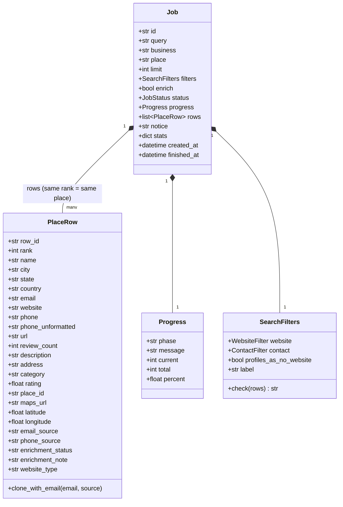

# Data model & CSV format

The single source of truth for a result row is `PlaceRow` in `app/models.py`; the CSV
column order lives in `app/export/csv_export.py`. `tests/test_docs.py` fails if a column
is added there without being documented here.

## 1. Default CSV columns

These match the spreadsheet layout the tool was designed for, in this order:

| # | Column | `PlaceRow` field | Type | Source / rule |
| --- | --- | --- | --- | --- |
| 1 | `Name` | `name` | text | business name as shown on Google Maps |
| 2 | `City` | `city` | text | Google's structured address component; fallback: parsed from the address. Empty for service-area businesses without an address. |
| 3 | `State` | `state` | text | full name (`Texas`), expanded from the 2-letter code for US / CA / AU |
| 4 | `Country` | `country` | text | ISO-3166 alpha-2 (`US`, `GB`, `CA`) |
| 5 | `Email` | `email` | text | Google Maps shows none: from website enrichment (incl. lookups made while a filter scans), or an address written in the listing's description. One row per email. Every valid address is kept (no junk filtering). |
| 6 | `Website` | `website` | url | as listed on Google Maps, normalised (`https://` added, tracking parameters and fragments removed). Can be a profile page (Facebook, Yelp, booking …) – see `Website Type`. |
| 7 | `Phone` | `phone` | text | national format, e.g. `(817) 606-8303` (from Maps, or from the website when Maps has none) |
| 8 | `Phone Unformatted` | `phone_unformatted` | text | E.164, e.g. `+18176068303` (empty when the number could not be validated) |
| 9 | `Url` | `url` | url | `https://www.google.com/maps/search/?api=1&query=<name>&query_place_id=<place id>` – opens the listing in Google Maps |
| 10 | `Rank` | `rank` | int | 1-based position in the Google Maps results for the query. Duplicated (multi-email) rows share the rank. With filters the ranks have gaps – each match keeps its position in Google's list. |
| 11 | `Review Count` | `review_count` | int | number of Google reviews (empty if unknown) |
| 12 | `Description` | `description` | text | the business's own "From the business" description on Google Maps; whitespace collapsed to one line. Empty when the business has none. |

## 2. Extended CSV columns (`?extended=true` / `--extended`)

Appended after the default columns:

| Column | `PlaceRow` field | Type | Meaning |
| --- | --- | --- | --- |
| `Address` | `address` | text | full formatted address as printed by Google |
| `Category` | `category` | text | primary category, e.g. `Roofing contractor` |
| `Website Type` | `website_type` | text | `none` (no website), `own` (the business's own site) or `profile` (a page on a platform from `PROFILE_DOMAINS`: Facebook, Instagram, Yelp, booking sites, retired `business.site` pages …). Derived from `Website`, never stored. |
| `Rating` | `rating` | float | average star rating (0–5) |
| `Place ID` | `place_id` | text | Google place id (`ChIJ…`) – stable key for de-duplication across jobs |
| `Maps URL` | `maps_url` | url | the `/maps/place/…` page that was visited |
| `Latitude` | `latitude` | float | |
| `Longitude` | `longitude` | float | |
| `Email Source` | `email_source` | url | page where the email in this row was found |
| `Phone Source` | `phone_source` | text | `maps` or `website` |
| `Enrichment Status` | `enrichment_status` | text | `done`, `not_found`, `no_website`, `error`, `pending` or empty (see [ENRICHMENT.md](ENRICHMENT.md#5-row-status-values)) |

Internal fields that are **not exported**: `row_id` (unique per row, used by the panel and
the enrichment API), `enrichment_note` (human-readable detail, shown as a tooltip in the
panel and returned by the API).

## 3. CSV encoding details

- UTF-8 with a byte-order mark (`EF BB BF`) so Microsoft Excel detects the encoding; Google
  Sheets, LibreOffice and pandas (`encoding="utf-8-sig"`) handle it transparently.
- `\r\n` line endings, comma delimiter, minimal quoting (fields containing commas, quotes or
  newlines are wrapped in double quotes; quotes are doubled).
- Rows are sorted by `Rank`, then by insertion order, so duplicated rows stay together.
- `None` values become empty cells; floats are printed without trailing zeros (`4.8`).
- The download file name is derived from the query
  (`roofing_companies_near_houston.csv`, `…_extended.csv`).

## 4. Address parsing rules (`parse_address`)

Used when Google's structured components are unavailable. Google prints addresses as
comma-separated parts ending with the country:

| Input | street | city | state | postal | country |
| --- | --- | --- | --- | --- | --- |
| `123 Main St, Arlington, TX 76010, United States` | 123 Main St | Arlington | Texas | 76010 | US |
| `100 Queen St W, Toronto, ON M5H 2N2, Canada` | 100 Queen St W | Toronto | Ontario | M5H 2N2 | CA |
| `1 Macquarie St, Sydney NSW 2000, Australia` | 1 Macquarie St | Sydney | New South Wales | 2000 | AU |
| `10 Downing St, London SW1A 2AA, United Kingdom` | 10 Downing St | London | *(empty)* | SW1A 2AA | GB |
| `Corpus Christi, TX 78401` | *(empty)* | Corpus Christi | Texas | 78401 | US |

Country names are mapped to ISO codes with a built-in table (`COUNTRY_CODES`); unknown
names are kept verbatim.

## 5. Phone formatting rules (`format_phone`)

- Parsed with the `phonenumbers` library; numbers starting with `+` are taken as-is,
  others are interpreted in the row's country (fallback `DEFAULT_REGION`).
- `Phone` = national format of that region (`(817) 606-8303` for US, `020 7946 0958` for GB).
- `Phone Unformatted` = E.164 (`+18176068303`).
- Numbers that fail validation keep the raw text in `Phone` and leave
  `Phone Unformatted` empty, so nothing is silently dropped.

## 6. Job model (API)

```jsonc
{
  "id": "job_5f0c2a1b9d3e",
  "query": "plumbers in Austin, TX",    // the search sent to Google Maps
  "business": "plumbers",               // "" for free-text queries and jobs from before 1.2
  "place": "Austin, TX",
  "limit": 200,
  "filters": { "website": "without", "contact": "phone_or_email", "profiles_as_no_website": true,
               "label": "no website · phone or email" },   // see §9
  "enrich": false,
  "status": "completed",            // queued | running | enriching | completed | failed | cancelled | interrupted
  "progress": { "phase": "done", "message": "Done - 35 of 200 found", "current": 35, "total": 200, "percent": 100.0 },
  "rows": [ { /* PlaceRow */ } ],
  "error": null,
  "notice": "Only 35 of the 87 businesses Google Maps lists for “plumbers” in Austin, TX match your filters (no website · phone or email) — that's all of them (you asked for 200).",
  "created_at": "2026-09-20T15:04:28.123Z",
  "updated_at": "2026-09-20T15:06:01.456Z",
  "finished_at": "2026-09-20T15:06:01.456Z",
  "stats": {
    "links_found": 87,              // listings read from Google's results list
    "scraped": 38,                  // place pages opened
    "matched": 35,                  // places kept (= places, not rows)
    "skipped": { "has a website": 49, "no phone or email": 3 },   // places left out, by reason
    "failed": 0,
    "reached_end": true,
    "stopped": "end_of_list",       // limit | end_of_list | no_results | single | stalled | scan_limit
    "errors": []
  }
}
```

`progress.phase` is one of `queued`, `collecting` (scrolling the feed), `details` (visiting
place pages), `enriching`, `done`. With filters, `progress.current / total` count matches out of
`limit`.

`notice` is set when fewer places than `limit` were found and says why, based on
`stats.stopped`:

| `stopped` | Notice (example) |
| --- | --- |
| `end_of_list`, fewer than 100 listings | *Only 35 businesses found for “plumbers” in Austin, TX — that's every listing Google Maps has for this search (you asked for 200).* With filters: *Only 35 of the 87 businesses … match your filters (…) — that's all of them.* |
| `end_of_list`, 100 or more listings | *Google Maps stopped listing “plumbers” in Austin, TX after 120 results — it shows at most about 120 per search, so there may be more. … Search smaller areas …* |
| `no_results` / `single` | *Google Maps has no results for …* / *Google Maps shows a single place for …* |
| `stalled` | the list stopped loading – there may be more; try again or raise `SCROLL_PAUSE_MS` |
| `scan_limit` | `MAX_SCANNED` listings were examined |

## 7. Log entry (API)

`GET /api/logs` returns lines from the in-memory log buffer:

```jsonc
{
  "seq": 1533,                          // monotonically increasing, use as `since` cursor
  "ts": "2026-09-21T06:09:19.412Z",     // UTC
  "level": "WARNING",                   // DEBUG | INFO | WARNING | ERROR | CRITICAL
  "logger": "app.jobs",                 // python logger name (module)
  "message": "Enrichment failed for #2 Legends Roofing: ...",   // tracebacks are appended, multi-line
  "job_id": "job_5f0c2a1b9d3e"          // null for lines outside a job (start-up, API errors)
}
```

## 8. Entity relationships



## 9. Search filters

`SearchFilters` (`app/filters.py`) decides which places a job keeps. A place is kept when it
passes both checks:

| `website` | Keeps places… |
| --- | --- |
| `any` | with or without a website |
| `without` | whose `Website` is empty – or a profile page, while `profiles_as_no_website` is `true` |
| `with` | with a website of their own – or a profile page, while `profiles_as_no_website` is `false` |

| `contact` | Keeps places that have… |
| --- | --- |
| `any` | anything |
| `phone` | a phone number |
| `email` | an email address |
| `phone_or_email` | a phone number, an email address or both |
| `phone_and_email` | both |

- *Profile pages* are URLs on the platforms listed in `PROFILE_DOMAINS`
  (`app/scraper/parsing.py`): social networks (Facebook, Instagram, X, TikTok, LinkedIn, YouTube,
  WhatsApp …), link-in-bio pages (Linktree …), directories and review sites (Yelp, Yellow Pages,
  Tripadvisor, Justdial, IndiaMART …), booking and ordering platforms (Booksy, Fresha, Vagaro,
  Calendly, Square Appointments, OpenTable, DoorDash …) and Google's own pages (the retired
  `business.site` / `negocio.site` websites, `g.page`). Sub-domains match (`m.facebook.com`);
  site builders such as `sites.google.com` or `*.wixsite.com` count as own websites.
- A phone is the Google Maps phone (or one found on the website). An email is one written in
  the listing's description or – when an email requirement would otherwise reject the place –
  one found on its website / profile page while scanning.
- `limit` counts kept places. The feed is scrolled until that many matched, Google's list ends
  (about 120 listings per search) or `MAX_SCANNED` listings were examined; `notice` explains a
  shorter result (§6).
