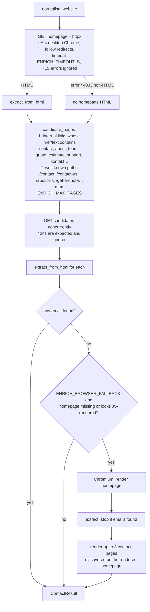
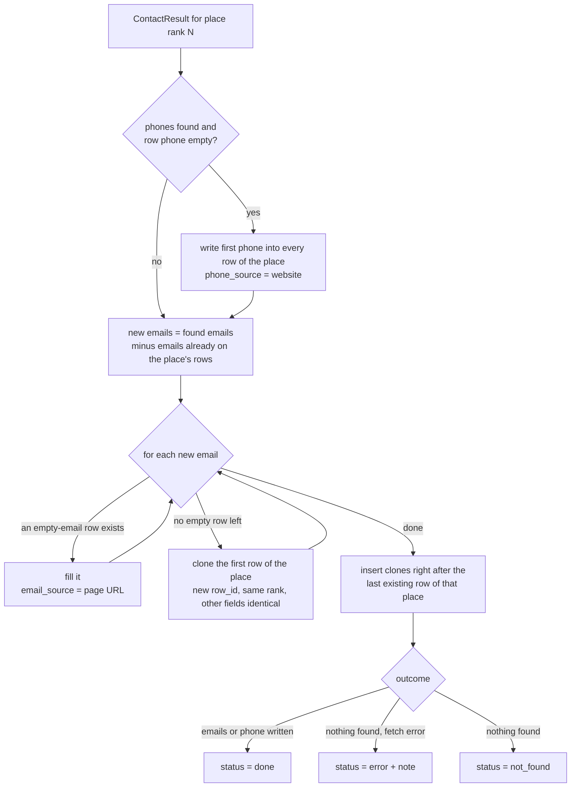
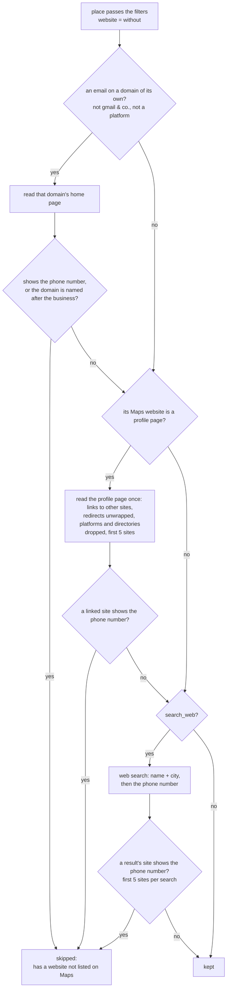

# Website enrichment (emails & phones)

Google Maps never exposes email addresses, and a few listings lack a phone number. The
enrichment step visits the **business website** stored in the row and looks for both.
Code: `app/enrichment/website.py` (fetch strategy) and `app/enrichment/extractors.py`
(extraction rules); results are applied to rows by `apply_contact_result()` in `app/jobs.py`.

## 1. When it runs

| Trigger | What is enriched |
| --- | --- |
| **✉ Find** button on a row | that place (all rows sharing its rank) – `POST /api/jobs/{id}/enrich` with `row_ids` |
| **✉ Find missing emails / phones** button | every place that has a website and is missing an email *or* a phone |
| *Afterwards, look for emails & phones on websites / social pages* checkbox / `--enrich` (CLI) | same as above, automatically when the scrape finishes |
| `force: true` in the API | re-run even for places that already have an email (new addresses are added as extra rows) |
| A search whose *Must have* filter needs an email (*Email*, *Phone or email*, *Phone and email*) | while scanning, only a place that would otherwise be rejected for lack of an email – see `PlaceFilter` in `app/jobs.py`. Places looked up this way are not fetched again by the automatic run. |
| A *No website* search | while scanning, the profile page (Facebook, booking page …) of every place that would be kept, for a link to a website of its own (§8); the emails / phone it shows are written into the rows as well, and it is not fetched again by the automatic run. |

Places **without any website** are marked `no_website` and skipped. A place whose website is a
**profile page** – a Facebook page, Instagram profile, Yelp listing, booking page … (see
`PROFILE_DOMAINS` and [DATA_MODEL.md §9](DATA_MODEL.md#9-search-filters)) – is searched too, but
only that page (§2).

Separately, every scraped place's **Google listing description** is scanned for addresses
(`emails_in_text()`); they fill the Email column with `Email Source` = the listing's Maps URL,
following the same one-row-per-email rule (§4).

## 2. Fetch strategy

- **Profile pages** skip the crawl: only the listed page is fetched (and rendered with Chromium
  when it looks JavaScript-rendered or blocks plain HTTP); `candidate_pages()` and the discovered
  contact links are not used, because `facebook.com/contact` or `yelp.com/about` describe the
  platform, not the business. Many platforms show little to logged-out visitors, so expect
  `not_found` more often than on real websites.
- `_looks_js_rendered()` – a page with several `<script>` tags and almost no body text, or an
  SPA root (`id="root"`, `id="__next"`), is treated as JavaScript-rendered.
- Sites that return 403 / drop the connection for plain HTTP clients get the browser pass too
  (many small-business hosts run bot protection that lets a real browser through).
- Results are cached nowhere: every *Find* click fetches again (websites change, and the
  requests are cheap).

## 3. Extraction rules (`extract_from_html`)

Sources checked in each page, in order:

1. `mailto:` links (multiple addresses and `?subject=` handled) and `tel:` links.
2. Cloudflare email obfuscation (`data-cfemail` – decoded with the XOR key).
3. JSON-LD blocks (`LocalBusiness` / `Organization`): `email`, `telephone`.
4. Visible text and the raw HTML (catches addresses in data attributes) with a strict email
   regex.
5. Obfuscated text patterns: `name [at] domain [dot] com`, `name (at) domain.com`,
   `name AT domain DOT com`.
6. Phone numbers in visible text through `phonenumbers.PhoneNumberMatcher` (only *valid*
   numbers for the row's country are kept).

It also lists the page's **links to other sites** (`external_links`, used by §8): websites named
in the page's data first – `"website"` / `"external_url"` values in embedded JSON (a Facebook
page's website, an Instagram bio link) and JSON-LD `url` / `sameAs` – then the links in document
order. Redirect links are unwrapped without requesting them (`l.facebook.com/l.php?u=…`,
`yelp.com/biz_redir?url=…`, Google / DuckDuckGo / Bing result links; `unwrap_redirect()` in
`app/scraper/parsing.py`).

Validation (`clean_email`) – there is deliberately **no junk filtering**: every address that is
syntactically valid is kept, even placeholder-looking ones (`you@example.com`, `john@…`) and
platform addresses (`…@sentry.io`, `…@wixpress.com`). An address is only rejected when it
isn't one:

- it must match `local@domain.tld` (2–24 letter TLD), no `..`, local part ≤ 64 chars, domain
  ≤ 253 chars;
- image / asset file names that look like emails (`hero@2x.png`, `…@3x.jpg`, `.css`, `.js`, …) –
  none of those extensions is a real top-level domain.

Scoring (`score_email`) decides the order in which emails are written into rows:

| Signal | Score |
| --- | --- |
| domain equals / is a sub-domain of the website's domain | +100 |
| role mailbox: `info`, `contact`, `hello`, `office`, `sales`, `admin`, `support`, … | +50 … +38 (in that order) |
| free-mail provider (`gmail.com`, `yahoo.com`, …) | +10 (kept, but below own-domain addresses) |
| `privacy@`, `legal@`, `abuse@`, `dmca@`, `webmaster@`, `unsubscribe@` | −60 |
| `noreply@`, `no-reply@`, `donotreply@` | −200 |

All emails that survive filtering are returned (sorted by score); the caller decides how
many rows to create.

## 4. Applying results – the duplicate-row rule

`apply_contact_result(rows, rank, result)` mutates the job's rows in place:

Example – the website lists `info@triadhsgc.com` and `hb@triadhsgc.com`:

| Rank | Name | Email | … |
| --- | --- | --- | --- |
| 19 | Triad Home Solutions & General Contracting, LLC | info@triadhsgc.com | identical |
| 19 | Triad Home Solutions & General Contracting, LLC | hb@triadhsgc.com | identical |

Both rows keep the same rank, phone, website, description and Maps URL; only `Email`,
`Email Source` and the internal `row_id` differ. In the panel, cloned rows are shown
indented (`↳`). In the CSV they are consecutive rows.

Re-running enrichment on a place that already has emails (`force`) only adds addresses it
has not seen; existing rows are never overwritten.

## 5. Row status values

| `enrichment_status` | Meaning |
| --- | --- |
| *(empty)* | never enriched |
| `pending` | lookup in progress |
| `done` | at least one email or phone was written |
| `not_found` | pages were fetched but contained no usable contact |
| `no_website` | the listing has no website – nothing to search |
| `error` | the site could not be fetched (DNS, timeout, 403 …) – details in `enrichment_note` |

`enrichment_note` records how many pages were checked or the error, and is exported in the
extended CSV together with `Email Source` / `Phone Source`.

## 6. Tuning

| Setting | Default | Effect |
| --- | --- | --- |
| `ENRICH_TIMEOUT_S` | 15 | per HTTP request; also the Chromium navigation timeout |
| `ENRICH_MAX_PAGES` | 6 | contact/about pages fetched per site after the homepage |
| `ENRICH_CONCURRENCY` | 4 | websites processed in parallel |
| `ENRICH_BROWSER_FALLBACK` | true | allow the Chromium pass (slower, but finds JS-rendered / bot-protected contacts) |
| `ENRICH_MAX_BYTES` | 2 000 000 | pages larger than this are truncated |
| `DEFAULT_REGION` | US | phone-number region when the row has no country |

## 7. Known limitations

- Contact forms without a visible address cannot be resolved (there is no email to find).
- Images of email addresses are not OCR'd.
- Sites behind hard bot walls (Cloudflare challenge pages, DataDome) return `error` – open
  the site manually.
- Free-mail addresses found on a page might belong to a third party (e.g. a testimonial);
  they rank below own-domain addresses but are still returned.
- Because nothing is filtered as junk, placeholder and tracking addresses in a page's HTML
  (`you@example.com`, Sentry keys on Wix sites `…@sentry-next.wixpress.com`) become extra rows.
  They sort after the site's own addresses; drop them in the spreadsheet if you don't want them.
- Businesses without a website rarely publish an email anywhere, and Facebook / Instagram often
  show logged-out visitors a login page instead of the business's details, so profile-page
  lookups frequently return `not_found`.

## 8. Websites Google Maps does not list

A Google Maps listing shows the website its owner entered in the Business Profile – often
nothing, or a Facebook / booking / BBB page – even when the business has a site of its own (the
listing has no website, a Google search finds `roofing4texas.com`). With the *No website* filter,
every place that passes the other filters is checked for one before it is kept, and skipped as
`has a website not listed on Maps` when it has one. Code: `SiteFinder` in
`app/enrichment/sitefinder.py`, `WebSearch` in `app/enrichment/websearch.py`, called by
`PlaceFilter` in `app/jobs.py`.

**When a site is the business's own.** The site's *home page* – not the page the link points to
– or, when the home page does not show it, one of its first two contact pages must list the
business's phone number (compared in E.164, so `(281) 932-4462` matches `+1 281-932-4462`) among
at most 5 different numbers: a page listing many businesses is a directory. Checking the home
page keeps a directory's page about the business from counting. For the business's own email
domain, and for any site when the listing has no phone number, a site also counts when its
domain contains the business's name (two of its words – `american-ridge.com` for *American Ridge
Roofing LLC* – or its only word), it has real text and is not a parked domain; a web search
result must then also mention the business's city.

Never the business's own site: profile platforms (`PROFILE_DOMAINS`), directories and lead sites
(`THIRD_PARTY_DOMAINS`: MapQuest, Bizapedia, Chamber of Commerce, Trustpilot …), search engines
and big platforms, government and education sites, and any link that redirects to one of them –
a domain that forwards to the business's Facebook page is not a website. Addresses on platform
domains (`…@bbbemail.org`) stay in the Email column; they are only not taken for the business's
domain.

**Web search** (`search_web`, off by default; *Also search the web …* in the panel,
`--search-web` in the CLI): plain HTTP requests to DuckDuckGo's HTML results page, Bing as the
fallback – deliberately **not Google**, so these searches cannot get the IP that scrapes Google
Maps blocked. Searches run one at a time, at least `WEB_SEARCH_DELAY_S` apart, and at most two
per business (the phone number only when the name found nothing), so expect a few seconds per
candidate. An engine that answers with a captcha / "unusual traffic" page is not asked again
during the job; when both refuse, or three searches in a row reach neither (network blocked,
offline), web search is switched off for the rest of the job and the job's notice says so.

Pages read for these checks are remembered for the job, so a site that comes up for many
businesses (a local directory) is fetched once.

| Setting | Default | Effect |
| --- | --- | --- |
| `WEB_SEARCH_ENGINE` | duckduckgo | engine asked first: `duckduckgo` or `bing` (the other is the fallback) |
| `WEB_SEARCH_DELAY_S` | 3 | minimum pause between two web searches |
| `ENRICH_TIMEOUT_S` | 15 | per page read for the checks |

Limits:

- Pages are read with plain HTTP. A site that only renders with JavaScript or blocks non-browser
  clients is not recognised, and the place is kept.
- A site that shows a different number than Google Maps (a call-tracking line, the owner's cell)
  is only recognised by name, through the business's email domain; otherwise the place is kept.
- Facebook and Instagram often show logged-out visitors a login page, so the profile-page check
  finds fewer links there than on booking and directory pages.
- Every check costs time per candidate: the email domain and profile page usually one to a few
  page loads, the web search at least `WEB_SEARCH_DELAY_S` per search. Search engines limit
  automated searches, so a long job may see web search switched off part way.
