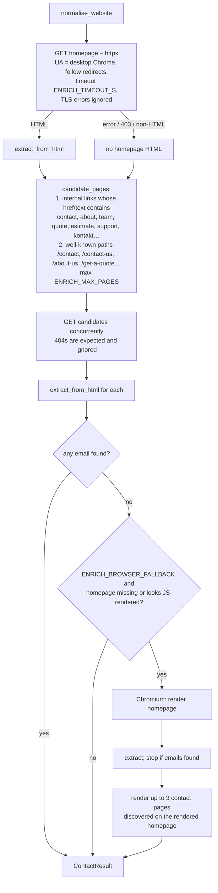
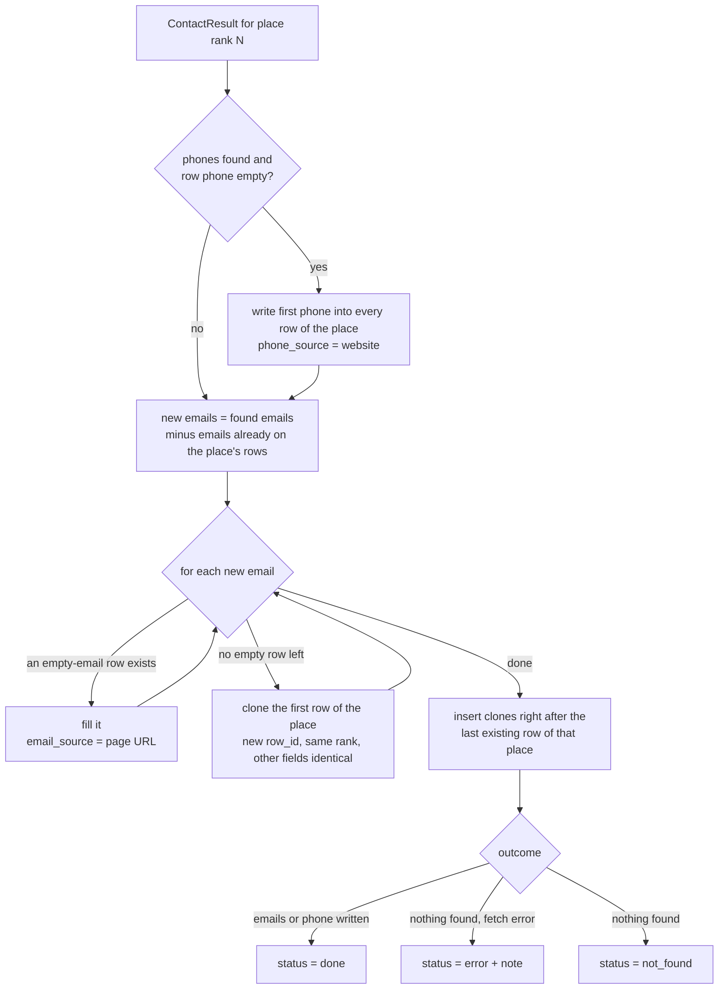

# Website enrichment (emails & phones)

Google Maps never exposes email addresses, and a few listings lack a phone number. The
enrichment step visits the **business website** stored in the row and looks for both.
Code: `app/enrichment/website.py` (fetch strategy) and `app/enrichment/extractors.py`
(extraction rules); results are applied to rows by `apply_contact_result()` in `app/jobs.py`.

## 1. When it runs

| Trigger | What is enriched |
| --- | --- |
| **✉ Find** button on a row | that place (all rows sharing its rank) – `POST /api/jobs/{id}/enrich` with `row_ids` |
| **✉ Find missing emails / phones** button | every place that has a website and is missing an email *or* a phone |
| *Find emails & phones after scraping* checkbox / `--enrich` (CLI) | same as above, automatically when the scrape finishes |
| `force: true` in the API | re-run even for places that already have an email (new addresses are added as extra rows) |

Places **without a website** are marked `no_website` and skipped.

## 2. Fetch strategy

- `_looks_js_rendered()` – a page with several `<script>` tags and almost no body text, or an
  SPA root (`id="root"`, `id="__next"`), is treated as JavaScript-rendered.
- Sites that return 403 / drop the connection for plain HTTP clients get the browser pass too
  (many small-business hosts run bot protection that lets a real browser through).
- Results are cached nowhere: every *Find* click fetches again (websites change, and the
  requests are cheap).

## 3. Extraction rules (`extract_from_html`)

Sources checked in each page, in order:

1. `mailto:` links (multiple addresses and `?subject=` handled) and `tel:` links.
2. Cloudflare email obfuscation (`data-cfemail` – decoded with the XOR key).
3. JSON-LD blocks (`LocalBusiness` / `Organization`): `email`, `telephone`.
4. Visible text and the raw HTML (catches addresses in data attributes) with a strict email
   regex.
5. Obfuscated text patterns: `name [at] domain [dot] com`, `name (at) domain.com`,
   `name AT domain DOT com`.
6. Phone numbers in visible text through `phonenumbers.PhoneNumberMatcher` (only *valid*
   numbers for the row's country are kept).

Junk filtering (`clean_email`):

- must match `local@domain.tld` (2–24 letter TLD), no `..`, local part ≤ 64 chars;
- image / asset names that look like emails (`hero@2x.png`, `…@3x.jpg`, `.css`, `.js`, …);
- placeholder domains (`example.com`, `yourdomain`, `email.com`, `domain.com`, …) and
  platform noise (`sentry.io`, `wixpress.com`, `godaddy`, `wordpress.com`, `w3.org`,
  `schema.org`, `cloudflare`, `shopify`, `mailchimp`, …);
- placeholder locals (`user@`, `name@`, `email@`, `yourname@`, `john@`, `test@`, …).

Scoring (`score_email`) decides the order in which emails are written into rows:

| Signal | Score |
| --- | --- |
| domain equals / is a sub-domain of the website's domain | +100 |
| role mailbox: `info`, `contact`, `hello`, `office`, `sales`, `admin`, `support`, … | +50 … +38 (in that order) |
| free-mail provider (`gmail.com`, `yahoo.com`, …) | +10 (kept, but below own-domain addresses) |
| `privacy@`, `legal@`, `abuse@`, `dmca@`, `webmaster@`, `unsubscribe@` | −60 |
| `noreply@`, `no-reply@`, `donotreply@` | −200 |

All emails that survive filtering are returned (sorted by score); the caller decides how
many rows to create.

## 4. Applying results – the duplicate-row rule

`apply_contact_result(rows, rank, result)` mutates the job's rows in place:

Example – the website lists `info@triadhsgc.com` and `hb@triadhsgc.com`:

| Rank | Name | Email | … |
| --- | --- | --- | --- |
| 19 | Triad Home Solutions & General Contracting, LLC | info@triadhsgc.com | identical |
| 19 | Triad Home Solutions & General Contracting, LLC | hb@triadhsgc.com | identical |

Both rows keep the same rank, phone, website, description and Maps URL; only `Email`,
`Email Source` and the internal `row_id` differ. In the panel, cloned rows are shown
indented (`↳`). In the CSV they are consecutive rows.

Re-running enrichment on a place that already has emails (`force`) only adds addresses it
has not seen; existing rows are never overwritten.

## 5. Row status values

| `enrichment_status` | Meaning |
| --- | --- |
| *(empty)* | never enriched |
| `pending` | lookup in progress |
| `done` | at least one email or phone was written |
| `not_found` | pages were fetched but contained no usable contact |
| `no_website` | the listing has no website – nothing to search |
| `error` | the site could not be fetched (DNS, timeout, 403 …) – details in `enrichment_note` |

`enrichment_note` records how many pages were checked or the error, and is exported in the
extended CSV together with `Email Source` / `Phone Source`.

## 6. Tuning

| Setting | Default | Effect |
| --- | --- | --- |
| `ENRICH_TIMEOUT_S` | 15 | per HTTP request; also the Chromium navigation timeout |
| `ENRICH_MAX_PAGES` | 6 | contact/about pages fetched per site after the homepage |
| `ENRICH_CONCURRENCY` | 4 | websites processed in parallel |
| `ENRICH_BROWSER_FALLBACK` | true | allow the Chromium pass (slower, but finds JS-rendered / bot-protected contacts) |
| `ENRICH_MAX_BYTES` | 2 000 000 | pages larger than this are truncated |
| `DEFAULT_REGION` | US | phone-number region when the row has no country |

## 7. Known limitations

- Contact forms without a visible address cannot be resolved (there is no email to find).
- Images of email addresses are not OCR'd.
- Sites behind hard bot walls (Cloudflare challenge pages, DataDome) return `error` – open
  the site manually.
- Free-mail addresses found on a page might belong to a third party (e.g. a testimonial);
  they rank below own-domain addresses but are still returned.
