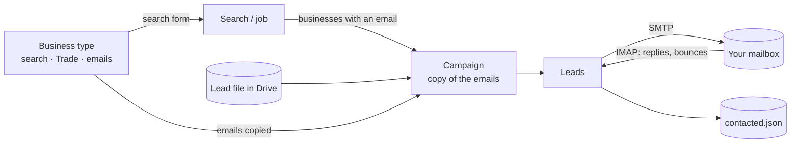
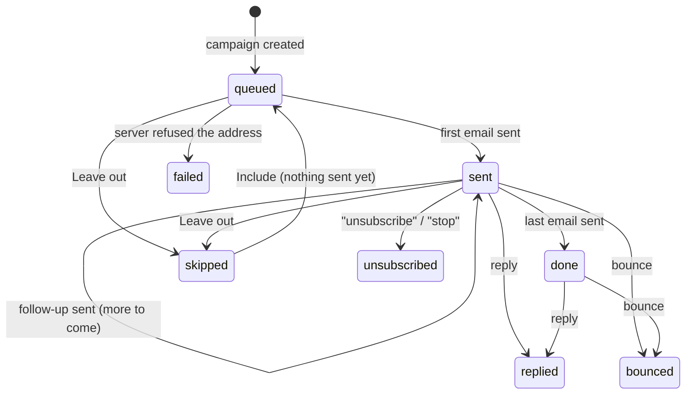
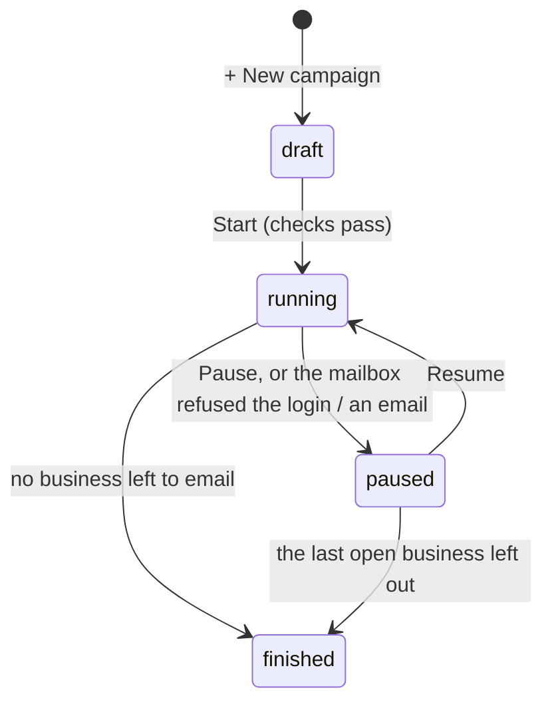

# Email outreach

How the crawler emails the businesses it found: business types and their emails, campaigns, who
becomes a lead, when emails go out, how replies and bounces are noticed, and what is stored.
Setting it up step by step: [PLAYBOOK.md](PLAYBOOK.md). Google Drive: [DRIVE.md](DRIVE.md).

## 1. The pieces

| Piece | What it is | Stored in |
| --- | --- | --- |
| **Business type** | A kind of business: its name (also the Drive folder), what the search form types into Google Maps, `{Trade}`, and the emails a campaign starts with: the first email, up to 4 follow-ups, and the footer. | `data/business_types.json`. The 17 default types stay in memory until you change one. |
| **Search** (job) | Remembers the business type it was run for (`business_type_id`). | `data/jobs/*.json` |
| **Campaign** | The businesses of one or more searches or Drive lead files, with a **copy** of a business type's emails, so editing the type later doesn't change a running campaign. | `data/campaigns/camp_*.json` |
| **Lead** | One business of a campaign: the one address it is emailed at, its status, the emails sent, what came back. | inside its campaign |
| **Contacted list** | Every address a first email went to, with its campaign. No campaign emails an address on it again, even after its campaign is deleted. | `data/contacted.json` |

## 2. Who becomes a lead (`app/outreach/leads.py`)

One lead per business; a business with several rows (one per email) is still one lead. A business
is **left out**, and the campaign lists it with the reason, when it:

| Reason | Why |
| --- | --- |
| `has a website (…)` | the emails say it has none |
| `no email` | nothing to send to |
| `no address of its own: …` | only addresses that aren't the business's, such as a BBB staff address (`…@bbbemail.org`), a placeholder (`name@example.com`), or an address on a platform / directory domain |
| `emailed on … (campaign “…”)` | on the contacted list |
| `already in campaign “…”` | a lead of another campaign (unless left out there before anything was sent) |
| `found by two of the selected searches` | the same place (Google place id) in two jobs |
| `same email as …, already a lead` | two businesses sharing one address |

The **first usable address** is emailed; further usable ones are kept as `other_emails`, and a
reply from them counts. `{Business}` is the Google Maps name without *LLC / Inc. / Ltd / Corp*;
change it per lead with ✎.

## 3. Templates (`app/outreach/templates.py`)

Plain text with placeholders in braces:

| Placeholder | Value |
| --- | --- |
| `{Business}` | the business name, without LLC / Inc. (editable per lead) |
| `{City}` | the place that was searched (`Houston`). For a search of several places, the one the business is in; for a lead file, the file's `City` column |
| `{Trade}` | what the campaign calls these businesses (`roofers`) |
| `{Rating}`, `{Reviews}` | Google rating and review count, **only** with at least `OUTREACH_MIN_REVIEWS` reviews and `OUTREACH_MIN_RATING` stars, else empty |
| `{Website}` | the business's preview website, e.g. `https://sites.leadspilot.co/acme/` (empty without one - [SITES.md](SITES.md)) |
| `{SenderName}`, `{SenderCompany}`, `{SenderAddress}` | `SENDER_NAME`, `SENDER_COMPANY`, `SENDER_ADDRESS` |

Optional parts:

- `[[ in {City}]]` is left out when a placeholder inside it has no value.
- `[[A||B]]` gives `A` when every placeholder in `A` has a value, else `B`. The default first email
  uses it for the stars: *"4.8 stars from 57 reviews, but there's no website on your listing"*,
  or *"There's no website on your Google listing"*.

Trailing spaces are dropped and blank lines collapse to one.

**Subjects.** A follow-up without a subject of its own gets *"Re: <first subject>"*. It is sent with
`In-Reply-To` / `References`, so it lands in the same thread.

**Footer.** Added under every email. It must contain `{SenderAddress}`, and it holds the opt-out
line.

**Checks before a campaign can start:**

- no unknown placeholders or unclosed `[[`;
- the first email is on day 0 and has a subject;
- the follow-ups' days go up;
- the footer has `{SenderAddress}`;
- `{Trade}` is filled in when an email uses it;
- no business misses a value used outside `[[ … ]]` (e.g. `{City}`).

**The editor.** Every email is a block you can open and close: its text on the left, and on the
right the email as it goes out, filled in while you type for a business you pick. A ✓ in the
header means it is filled in; **!** means something is wrong. The panel fills the templates the
same way the server does, and the server checks them again on *Save*.

**Testing two versions.** A business type or campaign can have a second version of its emails,
`steps_b` (API only for now: `PATCH /api/campaigns/{id}` / `/api/business-types/{id}` with
`{"steps_b": [...]}`; `[]` ends the test). The businesses then take turns at their first email: each
gets **A** (`steps`) or **B** (`steps_b`), whichever fewer businesses have had so far across all
campaigns, and keeps it for its follow-ups (`variant` on the lead). The activity log says
*email 1 of 3 (version B)*, and the results file has a **Version** column. Businesses emailed before
the test started stay on A. `SITE_STEPS_ASK_FIRST` in `templates.py` is the website emails' B: no
link in the first email - it asks *Can I send you the link?* - and the link in the second.

**The address check** (`app/outreach/domains.py`). Just before a business's first email, the panel
asks whether its address's domain can receive email at all. If the domain doesn't exist or has no mail
server, the business is skipped (*Address skipped* in the activity log, status *refused*, never tried
again), so it can't bounce. It uses Cloudflare's DNS over HTTPS, not the computer's DNS, which a home
router can answer wrongly. When the lookup fails, the email goes out as usual. It can't see whether the
mailbox itself exists, so an address like `admin@` on a working domain can still bounce.

## 4. When emails go out (`app/outreach/manager.py`, `schedule.py`)

The server's send loop wakes every 20 s (only with `OUTREACH_AUTOSEND=true`) and sends **at most
one email** per round when all of this holds:

- a campaign is **running**;
- the **send window** is open: `OUTREACH_DAYS` and `OUTREACH_HOURS` in `OUTREACH_TIMEZONE`, by
  default Mon–Fri 08:00–12:00 America/Chicago;
- fewer than `OUTREACH_DAILY_LIMIT` emails went out today, counting all campaigns and follow-ups,
  by the window's calendar day;
- the random pause since the last email (`OUTREACH_MIN_GAP_S`–`OUTREACH_MAX_GAP_S`) is over;
- the inbox was checked less than 2 minutes ago, and the check worked. If replies can't be
  checked, nothing is sent.

**Order:** follow-ups that are due go first, earliest first; then first emails, in the order of
the campaign's list, oldest campaign first.

**Spacing:** a follow-up is due its gap in days after **the previous email actually went out**:
day 3 and day 7 mean 3 days after the first email, then 4 days after the second. That spacing
holds even when the server was off for a while. It only goes out inside the window, so a Saturday
follow-up waits until Monday.

## 5. Replies, bounces, unsubscribes (`app/outreach/mailbox.py`)

The inbox (`IMAP_FOLDER`, default `INBOX`) is opened **read-only**: nothing is marked read, moved
or deleted.

- **When it's checked:** before every email, and every `OUTREACH_CHECK_MINUTES` inside the window,
  hourly outside it. Every emailed business is watched for 45 days after its last email; one that
  replied, for 45 days after it last wrote.
- **Which emails:** those since the first email to a watched business. Only their headers are
  read, plus the start of a bounce's text and of a reply (*Re: ...*).
- **Alerts:** every reply also sends you an email, *[Leads Pilot] Reply from {business}*, with what
  they wrote above the quoted email – to `ALERT_TO` (since 1.20.0), else the From address. Answer the
  business from the sending mailbox. So outside the send window it can take up to an hour. A later
  reply is added to the business in the campaign and to the Activity tab, and its status stays
  `replied`. Bounces of your own answers aren't tracked.

| Arrives | Recognised by | Result |
| --- | --- | --- |
| **Reply** | sent from the lead's address, or answering one of our emails (`In-Reply-To` / `References`) | `replied`, no more emails |
| **Unsubscribe** | a reply whose subject is *unsubscribe / stop / remove*. Gmail's unsubscribe link sends exactly that, via the `List-Unsubscribe` header (with `OUTREACH_UNSUBSCRIBE_HEADER` on) | `unsubscribed`, no more emails |
| **Bounce** | from `mailer-daemon` / `postmaster`, or a delivery-status report, naming the address (`X-Failed-Recipients`, or in its text) | `bounced`, no more emails |
| **Automatic reply** | `Auto-Submitted`, `X-Autoreply`, or an *Out of office* / *Automatic reply* subject | noted, the follow-ups **continue** |
| **Delivery delayed** | a delivery report saying it is still trying (*Delivery Status Notification (Delay)*) | noted as *Delivery delayed*, the follow-ups **continue**; it becomes a bounce if the mail server gives up |
| a *delivery delayed* notice | *Delay* / *will retry* in its subject | ignored |

A reply saying *"no"* is a reply: it stops the follow-ups, and because the address is on the
contacted list it is never emailed again. Replies are for you to answer in your mail program; the
tool never answers them.

**When the mailbox refuses.**

- **Login refused**, or **an email refused** (spam filter, sending limit): every running campaign
  is **paused** with the server's answer.
- **One address refused** (`550 no such user`): only that lead is marked `failed`.
- **Anything else** (network): tried again after 5 minutes. After 3 failures in a row the
  campaigns are paused.

## 6. What is sent

Plain-text emails, UTF-8, from `SENDER_NAME <SENDER_EMAIL or MAIL_USERNAME>`, with a
`Message-ID` on your own domain and `In-Reply-To` / `References` for follow-ups. With
`OUTREACH_UNSUBSCRIBE_HEADER` on, also `List-Unsubscribe: <mailto:you?subject=unsubscribe>` (Gmail's
unsubscribe link) - off by default: in tests, one-to-one emails with it went to Promotions or Spam,
the same email without it to the inbox. The footer says to reply "no" either way. Gmail and Google
Workspace keep a copy in *Sent* themselves. No tracking pixels, no links added (besides `{Website}`).
Who opened their website is known from the website itself ([SITES.md](SITES.md#5-who-opened-their-website)).

**Test copy.** With `OUTREACH_TEST_COPY_TO` set to your own addresses (a Gmail, a Yahoo …), each
day's first email also goes to them, word for word, right after it went to the business, so you can
see which tab it lands in: Primary, Promotions or Spam. Its website link ends in `?copy`, so opening
it isn't counted as the business's visit. It doesn't count towards the daily limit; the activity log
says *Test copy sent*. A fresh address that has never written to you shows the placement best: Gmail
puts mail from people you've written to in Primary more readily.

**✉ Send me this** sends one email, filled in for the business you picked, to your own address,
with *[Test]* in front of the subject. It changes nothing in the campaign.

## 7. Staying on the right side of the rules

This is cold email to businesses. In the US, CAN-SPAM allows it when you:

- include your postal address (`SENDER_ADDRESS`, in the footer of every email);
- honour opt-outs (a reply or unsubscribe stops everything to that address, for good);
- use honest subject lines and From names.

Other countries have stricter rules (Canada's CASL, the EU / UK's GDPR and PECR). Check them
before emailing businesses there. Keep the volume low (`OUTREACH_DAILY_LIMIT`), send from a
separate warmed-up domain, and let people say no. This is not legal advice.

## 8. Emails to you about the panel (`app/outreach/alerts.py`)

So the panel doesn't need watching, it emails you (`ALERT_TO`, else the From address) – only while
`OUTREACH_AUTOSEND` is on, and never from the laptop when it is the search computer:

- **Problems**, within a minute: the autopilot stopped (also its bounce stop: 2 of the last 20 businesses
  emailed bounced, which pauses the running campaigns), Google blocked a search, a campaign paused – not by
  you –, an email refused, a campaign not made or not started; on the cloud server also *Laptop not
  searching* when the laptop hasn't asked for a search for 24 hours (once per silence). Several are sent
  together, at most one email every 30 minutes, each kind with what to do about it.
- **A daily summary** at 08:00 (the computer's time): yesterday's emails – first emails and follow-ups – and
  what came back, the campaigns, the next email, the autopilot, the laptop's last check-in, Google Drive and
  the last day's problems.
- **Google Drive disconnected** has its own email ([DRIVE.md](DRIVE.md)); **replies** too (§5).

What's still to be sent is kept in `data/alerts.json`: a restart loses nothing and doesn't send the day's
summary twice. A problem email that can't go out (the mailbox is the problem) is tried again later.

## 9. Settings

`SMTP_HOST`, `SMTP_PORT`, `IMAP_HOST`, `IMAP_PORT`, `IMAP_FOLDER`, `MAIL_USERNAME`,
`MAIL_PASSWORD`, `SENDER_EMAIL`, `SENDER_NAME`, `SENDER_COMPANY`, `SENDER_ADDRESS`, `ALERT_TO`,
`OUTREACH_AUTOSEND`, `OUTREACH_TIMEZONE`, `OUTREACH_DAYS`, `OUTREACH_HOURS`,
`OUTREACH_DAILY_LIMIT`, `OUTREACH_MIN_GAP_S`, `OUTREACH_MAX_GAP_S`, `OUTREACH_CHECK_MINUTES`,
`OUTREACH_MIN_REVIEWS`, `OUTREACH_MIN_RATING`, `OUTREACH_TEST_COPY_TO`. What each one does and its default:
[DEVELOPMENT.md §4](DEVELOPMENT.md#4-configuration-reference).

The routes (`/api/outreach`, `/api/campaigns…`, `/api/business-types…`) are in
[API.md](API.md#email-outreach); the stored models in [DATA_MODEL.md](DATA_MODEL.md#10-outreach).
