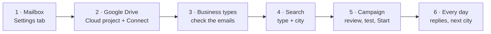

# Playbook: set everything up, in this order

From a fresh start to your first campaign sending by itself. Each step builds on the one before
it, and the **Setup** box in the panel's *Outreach* tab ticks them off as you go. Plan on about an
hour for steps 1–3, done once; after that a new city or business type takes a few minutes.

| # | What | Where | Done when |
| --- | --- | --- | --- |
| 0 | Install and start the crawler | `start.bat`, then the desktop shortcut | the panel opens in your browser |
| 1 | Your mailbox | panel › Settings › *Mailbox*, *You, in the emails* | Setup ✓ *Mailbox* |
| 2 | Google Drive | Google Cloud console, panel › Settings › *Google Drive*, Connect | Setup ✓ *Google Drive* |
| 3 | The emails of each business type | panel › Outreach › Business types | Setup ✓ *The emails …* |
| 4 | A search | panel › Search | Setup ✓ *A search with emails*, the CSV is in Drive |
| 5 | A campaign | panel › Outreach › + New | Setup ✓ *Your first campaign* |
| 6 | Every day | panel › Outreach | – |

---

## 0. Install and start

Install Python 3.11 or newer from <https://www.python.org/downloads/> and tick *Add python.exe to
PATH* while installing. Then double-click **`start.bat`** in the project folder. The first time
takes a few minutes: it makes a virtual environment, installs the Python packages and Chromium, and
puts a **Google Maps Lead Crawler** shortcut on your desktop. The panel opens in your browser.

From then on **double-click the desktop shortcut** to start the panel. (Right-click it › *Pin to
taskbar* for one click.) The black window that opens with it is the panel's console: the log shows
there, and it has to stay open while campaigns are sending – minimise it. To stop the panel press
**⏻ Stop** at the top right of the panel, or Ctrl+C in that window.

Every setting is in the panel's **Settings** tab, with a line of help each. *Save* writes them to the
`.env` file in the project folder and the panel uses them at once; only the *Panel* group (address,
port, data folder) needs *Restart*, a button in the same tab. The Setup box's *Fill in ›* buttons
take you to the settings a step still needs.

## 1. Your mailbox (emails go out from it, replies come back to it)

The crawler sends from an ordinary mailbox over SMTP and reads its inbox over IMAP to notice
replies and bounces. It needs both: without IMAP it could not stop the follow-ups for someone
who answered, so it sends nothing.

**Use a separate address for cold email**, ideally on a domain of its own (e.g.
`getyourbrand.com`, not your main domain). If some recipients mark you as spam, your main
domain's email is not affected. Let a new mailbox warm up for 2–3 weeks before a campaign, and
keep `OUTREACH_DAILY_LIMIT` low (30 is the default).

**Gmail or Google Workspace:**

1. Google Account › Security › turn on **2-Step Verification**.
2. Google Account › Security › **App passwords** (or <https://myaccount.google.com/apppasswords>):
   make one called *Lead Crawler*. Copy the 16-letter password. (A Workspace admin can turn app
   passwords off; ask them if the page is missing.)
3. In Gmail's settings (*See all settings › Forwarding and POP/IMAP*), IMAP must be on. Newer
   accounts have it always on.

In the panel, **Settings › Mailbox**:

1. **Use Gmail's servers** fills in `smtp.gmail.com`, `imap.gmail.com` and their ports.
2. **Username**: your address. **Password**: the 16-letter app password (spaces don't matter).

Then **Settings › You, in the emails**: **Your name**, **Company** (optional) and **Postal address**,
and **Save**. Settings marks what is still *needed*, and the Settings tab shows a red count
until everything for sending is filled in.

The postal address is required: US law (CAN-SPAM) wants a postal address in every commercial
email, and the footer of every email carries it with the opt-out line. Other providers: Zoho Mail
is `smtp.zoho.com` port `465` / `imap.zoho.com`. Microsoft 365 and Outlook.com have been
switching password logins for SMTP/IMAP off; if yours refuses the login, use another provider.

Optional, **Settings › When emails go out**. The defaults: Monday–Friday 08:00–12:00 in
`America/Chicago` (your leads' time zone), at most 30 emails a day.

Convert the window to your own time zone. 08:00–12:00 in Houston is 14:00–18:00 in London and
18:30–22:30 in India in summer. **The panel has to be running during the window**, because it is
what sends the emails.

*Outreach*: Setup shows ✓ **Mailbox**, and the *Mailbox* box shows your address and the window. If
something is missing, the Setup box lists exactly what.

## 2. Google Drive

Each search's CSV goes into a folder named after its business type, e.g. `Roofer`, `Plumber`.
Campaigns can run from files in those folders, and each campaign keeps its results there
([DRIVE.md](DRIVE.md)). The crawler uploads through the Google Drive API with your own OAuth
client. You set that up once in the Google Cloud console; it is free.

1. Open <https://console.cloud.google.com/> with the Google account whose Drive you want to use.
   Create a project, e.g. *Lead Crawler*.
2. **APIs & Services › Library** → search *Google Drive API* → **Enable**.
3. **OAuth consent screen**, called *Google Auth Platform* in newer consoles → *Get started*:
   - App name *Lead Crawler*, your email as the support email.
   - Audience **External**, your email as the contact.
   - Under *Audience* (or *Test users*), add your own Google account as a test user.
4. Still there, **Publish app**, which moves it *In production*. While an app is only *Testing*,
   Google ends its sign-ins after 7 days and you would have to reconnect every week. Your app
   is not reviewed by Google, and that is fine for your own use. When you connect, Google warns
   *"Google hasn't verified this app"*: click **Advanced › Go to Lead Crawler**, because it is
   your own app.
5. **Credentials** (or *Clients*) › **Create credentials › OAuth client ID** › application type
   **Desktop app** › *Create*. Copy the **Client ID** and the **Client secret**.
6. In the panel, **Settings › Google Drive**: paste the **Client ID** and the **Client secret**, and
   set **Folder** – where the business-type folders go:
   - **Empty:** straight in *My Drive*. Use this if your `Plumber` / `Roofer` folders are there.
   - **A folder name or path:** e.g. `Leads` or `Leads/2026`, made if it doesn't exist.
   - **A folder's link:** e.g. `https://drive.google.com/drive/folders/…`. This also works for a
     folder someone shared with you.

   **Save**.
7. **The panel must be open at <http://127.0.0.1:8000>** (the desktop shortcut opens it there);
   Google only sends the sign-in back to this computer. Go to *Outreach › Setup › Connect Google
   Drive*.
8. Pick your account, allow access to Google Drive, and you are back in the panel: *Google Drive
   connected*.

The access is full Drive access: the crawler needs to write into folders you made and read lead
files you put there. It stays on your computer in `data/google_drive.json`.
*Disconnect* in the Setup box removes it; your Google account's *Security › Third-party access*
page can remove it too.

## 3. Business types and their emails

A **business type** connects everything: what the search form types into Google Maps, the
Drive folder, and the emails a campaign for these businesses starts with. The crawler starts
with 17 (Roofer, Plumber, HVAC …), all with the same three emails.

For each type you will use (*Outreach › Business types*, click one):

1. **Name** is shown in the search form's list and is the Drive folder's name. **Search Google
   Maps for** is what gets typed into Maps, e.g. `roofing`.
2. **What the emails call these businesses** fills `{Trade}`, e.g. *roofers*.
3. Each email is a block you can open and close: its text on the left, and the email as it will
   go out on the right, filled in while you type. The ✓ in its header means it is filled in; a
   red **!** means something is wrong (hover over it). The first email goes out on day 0. Each
   follow-up has its day (3, 7 …), and without a subject of its own it answers the first email
   (*Re: …*) in the same thread.
4. Placeholders (`{Business}`, `{City}`, `{Rating}` …) are inserted with the chips above the
   emails. `[[ … ]]` parts are left out when a placeholder in them has no value; the *How the
   placeholders work* box explains them.
5. **Save**, then **✉ Send me this** on an email: it arrives in your own inbox with *[Test]* in the
   subject. Read it on your phone too.

## 4. Search

*Search* tab:

1. **Business type**: pick one (e.g. *Roofer*). *Other* lets you type any search, but then it
   isn't connected to a type's emails or folder.
2. **City / area**: e.g. `Houston`; several places separated by `;`.
3. Keep **Search the whole area** ticked. Filters: **Website › No website**, **Must have › Email**.
4. **Search**. A whole city takes a while. When it finishes, its CSV is uploaded to
   `DRIVE_FOLDER/<Business type>/…_DD_MM_YYYY.csv`, and the results card links to it.

Space whole-area searches out; many in a row is what gets Google to block the crawler
([TROUBLESHOOTING.md](TROUBLESHOOTING.md)).

## 5. A campaign

Start it one of two ways:

- **From a search:** press **✉ Email these businesses** in the results card.
- **From anywhere:** *Outreach › Campaigns › + New*, then tick one or more searches, or lead files
  from the business type's Drive folder.

**Lead files.** A CSV or Google Sheet counts as a lead file when it has a header row with at least
`Name` and `Email`. The crawler's own CSVs have those; a list you cleaned up works too. See
[DRIVE.md](DRIVE.md#lead-files).

**Who gets left out.** One email address per business, its own, is emailed. These businesses are
left out automatically, and the campaign lists who and why:

- businesses with a website of their own;
- businesses with only a BBB or placeholder address (e.g. `name@example.com`);
- businesses already emailed by another campaign.

Then:

1. **Check the list.** **Leave out** anyone you don't want to email. **✎** changes how a name is
   written in the emails; *LLC* and *Inc.* are already dropped.
2. **Check the emails.** They are a copy of the business type's, so changes here affect only this
   campaign. Pick a business under *Preview filled in for* to see its emails. Send yourself a test.
3. **▶ Start sending.** From now on, while the server runs:
   - It sends in the window, a few minutes apart, at most `OUTREACH_DAILY_LIMIT` a day, with
     follow-ups before new first emails.
   - It checks your inbox before every email. A **reply**, an **unsubscribe** or a **bounce**
     stops that business's follow-ups; an out-of-office reply doesn't.

**Nothing is ever sent before Start.** **❚❚ Pause** stops at once. If the mailbox refuses the
login or an email, all campaigns pause by themselves and say why.

## 6. Every day

- **Replies.** Open your inbox; Gmail threads each reply with your email. Answer the ones that
  say yes, with the link to their site. Replying yourself, not the tool, is on purpose. In the
  panel the business shows **replied**; *↻ Check replies* checks the inbox right away.
- **Results in Drive.** `DRIVE_FOLDER/<type>/Outreach/<campaign>.csv` has who was emailed when,
  who answered, who bounced. It is updated every few minutes while a campaign runs, and
  *⇪ Save results to Drive* updates it at once.
- **The next city.** Search it with the same business type, then make a new campaign. Businesses
  emailed before are skipped automatically, even if their old campaign was deleted.
- **Watch the numbers.** If *bounced* grows, your leads are stale. If nobody replies, change the
  business type's first email or subject before the next city.

## Quick reference

| I want to … | Do this |
| --- | --- |
| start the panel | double-click the desktop shortcut (or `start.bat`) |
| stop the panel | *⏻ Stop* at the top right, or Ctrl+C in its window – running campaigns carry on when it's started again |
| see what is missing | *Outreach › Setup* – every step lists what's still needed |
| change the send window / daily limit | *Settings › When emails go out*, Save |
| stop all sending at once | *❚❚ Pause* on each running campaign, or *Settings › When emails go out › Send automatically* off |
| email a business again | not possible on purpose – every address emailed is on the list in `data/contacted.json` |
| use another Drive folder | *Settings › Google Drive › Folder*, Save |
| add a business type | *Outreach › Business types › + New* (its name is the Drive folder) |
| look up a setting | the *Settings* tab explains each one; all are listed in [DEVELOPMENT.md §4](DEVELOPMENT.md#4-configuration-reference) |
| fix a problem | [TROUBLESHOOTING.md](TROUBLESHOOTING.md) |

More detail: [OUTREACH.md](OUTREACH.md) (how sending, follow-ups and reply checks work) and
[DRIVE.md](DRIVE.md) (folders, files, the sign-in).
