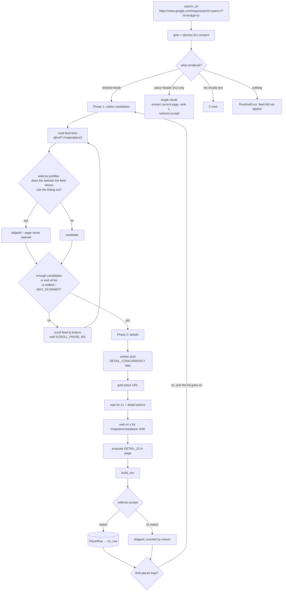
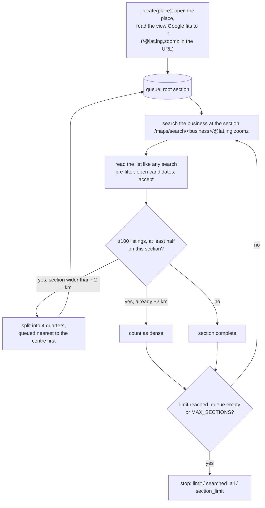

# Google Maps scraping internals

`app/scraper/maps.py` drives a real Chromium browser through Playwright. This page explains
each phase, where every field comes from, and what to check when Google changes something.

## 1. Pipeline

Without filters there is a single round – collect `limit` links, scrape them all – exactly as
before filters existed. See [Filtered searches](#filtered-searches--scanning-for-matches).

### Phase 1 – collect links

- The results feed is `div[role="feed"]`; every listing is an `a[href*="/maps/place/"]`
  whose `aria-label` is the business name. Links are de-duplicated by URL (without query
  string) and numbered in feed order → **Rank**.
- The result card next to the link is read for the visible review count (`span.UY7F9`,
  e.g. `(344)`) and rating (`span.MW4etd`). These are only fallbacks.
- The card's *Website* button (`a[data-value="Website"]`, `aria-label="Visit … website"`) is read
  as well. With the feed's structured record it gives the listing's website *before* its page is
  opened (`website_hint()`): the record decides (no website there means none); the button can
  only add a website – its absence is never trusted, layouts change; with neither, the website
  is unknown and the page has to be opened.
- Scrolling: `feed.scrollTop = feed.scrollHeight`, then wait `SCROLL_PAUSE_MS` (+ random
  jitter). Google appends 20 results per page. The loop stops when
  1. `limit` links are collected,
  2. the feed shows *"You've reached the end of the list."*, or
  3. `SCROLL_STALL_LIMIT` consecutive scrolls produced no new links.
- While scrolling, every `GET /search?tbm=map…` XHR response is captured (`RecordCapture`).
  Each contains the structured record of every listed place (see §3).

### Phase 2 – details

`DETAIL_CONCURRENCY` tabs pull place URLs from a queue. For each place:

1. `page.goto(href)` – the href from the feed already contains the `!19s<place id>` and
   `!3d<lat>!4d<lng>` fragments, which are parsed as a last-resort source.
2. Wait for the header (`h1.DUwDvf`) and for one of the detail buttons
   (`button[data-item-id="address"]`, `a[data-item-id="authority"]`,
   `button[data-item-id^="phone"]`).
3. Wait up to ~4 s for the `GET /maps/preview/place…` XHR, which carries the **full record**
   of the place (description, review count, everything). If it never arrives, the page HTML
   is scanned for `window.APP_INITIALIZATION_STATE` (older layout).
4. Run `DETAIL_JS` inside the page to read the DOM.
5. `build_row()` merges all sources (precedence below).
6. Sleep a random `MIN_DELAY_MS`–`MAX_DELAY_MS` before the next place.

Failures retry `DETAIL_RETRIES` times; a place that still fails produces a row from the
search record / link only, with the error stored in `enrichment_note` and in
`Job.stats.errors`.

### Single-result queries

When the query is unambiguous (`"Triad Home Solutions Arlington"`), Google skips the feed
and renders the place directly. The scraper detects the header without a feed and extracts
that page as rank 1 (it still goes through the job's filters). The search XHR still fires and
supplies the full record.

### Filtered searches – scanning for matches

`MapsScraper.scrape(query, limit, selector=...)` takes a *selector* – `PlaceFilter` in
`app/jobs.py`, built from the job's filters ([DATA_MODEL.md §9](DATA_MODEL.md#9-search-filters)).
`limit` then counts **kept** places, and the scan runs in rounds (`_scan()`):

1. `_next_candidates(want)` reads the feed and scrolls until it has `want` = *places still
   missing* new candidates. Each new listing gets the next rank and a website hint;
   `selector.prefilter()` skips it without opening its page when that hint rules it out (a
   *No website* search skips every listing whose record or Website button shows its own site).
   Only the website is pre-filtered – phones are always checked on the place page.
2. The candidates are scraped (Phase 2). `selector.accept()` adds emails written in the listing's
   description, looks for an email on the website / profile page if only an email is missing,
   and applies the filters to the finished place. Rejected places are counted by reason.
3. If fewer than `limit` places were kept and the feed can go on, the next round asks for the
   difference – further down the list.

The scan stops (`ScrapeStats.stopped`) when `limit` places were kept (`limit`), Google shows
*"You've reached the end of the list"* (`end_of_list` – about 120 listings per search at most),
the feed stops growing (`stalled`) or `MAX_SCANNED` listings were read (`scan_limit`); a direct
place page gives `single`, an empty search `no_results`. A shorter result is not an error: the
job completes with what it found and its `notice` says why.

Ranks keep each listing's position in Google's list, so a filtered result has gaps (3, 7, 12 …).
`ScrapeStats` records `links_found` (listings read), `scraped` (place pages opened), `matched`
(places kept) and `skipped` (reason → count, before or after opening the page).

### Several searches in one job

`scrape()` also takes a list of `Search(text, area="")`. The job manager builds it
(`plan_searches()`): one text search per place (`roofing in Katy, TX`, `roofing in Pasadena, TX`),
or – with *whole area* – one area search per place. They run in order until `limit` places were
kept. Listings are de-duplicated across searches by place id (`listing_key()`), so a place that
several searches list is checked once; ranks then number the places in the order they were found.
If a search cannot be opened it is logged and skipped; three failures in a row fail the job (a
lone search still fails immediately, as before). The job stops with `searched_all` when every
search ran out.

### Whole-area search – map sections

A Google Maps search lists about 120 businesses at most, the most prominent first. For a whole
city that means the established businesses – a real search for “roofing” in Houston listed 117,
114 of them with websites – and the smaller ones never appear. Zoomed into a small part of the map, the
same search lists the businesses *there*, and when fewer than ~120 match, the list runs out: it
holds all of them. `_search_area()` uses that (geometry in `app/scraper/area.py`):

- **Sections** are rectangles in Web-Mercator world pixels. Each is searched at the zoom that
  fits it into the *visible* map – the 1366 × 900 window minus the ~408 px results panel that
  covers the left of the full-width map – with a 10 % margin, so neighbouring sections overlap a
  little. The URL centre is the window centre, so it is placed half a panel west of the section.
- **Splitting** only happens when the list is full *and* at least half of its listings lie on the
  section (±10 %): if Google zooms out to show businesses from elsewhere (an empty section), the
  list is not about this section and splitting would only repeat that.
- A section whose search failed is split too, so its area is still covered.
- `MAX_SECTION_ZOOM` (16, sections ~2 km wide) ends the splitting; a still-full section there is
  counted in `stats.dense` and the notice says a few very busy spots may hold more.
- `MAX_SECTIONS` (default 100) caps the sections per job (`section_limit`).
- If the place's map cannot be read (no `/@…z` in the URL), the place is searched as one text
  search instead.

Cost: each section is one results list (~5–15 s to scroll); only candidates' place pages are
opened. A large city for a common trade needs a few dozen sections; the search stops as soon as
`limit` places were kept. The logs show every section with its listing count and whether it was
split. These assumptions about Google (the results panel over the map, local results for a
zoomed-in view) are covered by `tests/test_area_search.py` against a simulated Google; if Google
changes them, a section search may return fewer local results – see §6.

## 2. Field sources and precedence

`build_row(ref, dom, full_record, search_record)` picks the first non-empty value in this
order: **place XHR record → search XHR record → DOM → result card / link URL**.

| Field | Place / search record | DOM (`DETAIL_JS`) | Card / URL |
| --- | --- | --- | --- |
| Name | `[11]` | `h1.DUwDvf` | `aria-label` of the link |
| Address | `[39]` (or `[2]` lines joined) | `button[data-item-id="address"]` aria-label | – |
| City / State / Country | `[183][1]` components (city `[3]`, state `[5]`, country `[6]`) | parsed from the address (`parse_address`) | – |
| Website | `[7][0]` | `a[data-item-id="authority"]` href | card's `a[data-value="Website"]` (pre-filter only) |
| Phone | `[178][0][3]` (E.164) or `[178][0][0]` | `button[data-item-id^="phone:tel:"]` | – |
| Rating | `[4][7]` | `div.F7nice span[aria-hidden]` | `span.MW4etd` |
| Review count | `[4][8]` | `span[aria-label$="reviews"]` | `span.UY7F9` |
| Category | `[13][0]` | `button.DkEaL` | – |
| Description | `[154][0][0]` ("From the business"), fallback `[32][1][1]` (editorial) | `div.PYvSYb` | – |
| Place id | `[78]` | – | `!19s…` in the href |
| Latitude / longitude | `[9][2]`, `[9][3]` | – | `!3d…!4d…` in the href |
| CID | `[10]` | – | – |
| Status (closed) | `[34][4][4]` | `span[aria-label*="Permanently closed"]` | – |
| Rank | – | – | position in the feed |

Post-processing (all in `app/scraper/parsing.py`):

- `country` → ISO-3166 alpha-2 (`United States` → `US`), `state` → full name (`TX` → `Texas`)
  for US / CA / AU codes;
- `phone` → national format `(817) 606-8303`, `phone_unformatted` → E.164 `+18176068303`
  via the `phonenumbers` library, region taken from the country;
- `website` → scheme added, `utm_*` / `gclid` / `fbclid` … parameters and `#fragments`
  removed, Google redirect wrappers unwrapped;
- `url` → `https://www.google.com/maps/search/?api=1&query=<name>&query_place_id=<id>`;
- `description` → whitespace collapsed to single spaces.

## 3. Google's place record (index map)

Google Maps ships place data as deeply nested JSON arrays prefixed with `)]}'` in three
places: the `/search?tbm=map` XHR (list page), the `/maps/preview/place` XHR (place page) and
sometimes inside `window.APP_INITIALIZATION_STATE`. `app/scraper/records.py` never relies
on *where* a record sits: `find_place_records()` walks the tree and returns every list that
looks like a place (index `[11]` is a name string and `[78]` a place id).

Index map used by `record_to_dict()` (`IDX` in `records.py`, checked by
`tests/test_records.py::test_index_map_is_documented`):

| Key | Path | Notes |
| --- | --- | --- |
| name | `[11]` | |
| address | `[39]` | full formatted address |
| address_lines | `[2]` | `["street", "City, ST zip", "Country"]` |
| website | `[7][0]` | |
| phone_e164 | `[178][0][3]` | `+18176068303` |
| phone_intl | `[178][0][0]` | `+1 817-606-8303` |
| rating | `[4][7]` | float |
| review_count | `[4][8]` | int – **absent in list-page records** |
| place_id | `[78]` | `ChIJ…` |
| cid | `[10]` | `0x…:0x…` |
| categories | `[13]` | list of strings, first one is the primary category |
| latitude / longitude | `[9][2]` / `[9][3]` | |
| components | `[183][1]` | `[borough, street, street, city, postal_code, state, country]` |
| description | `[154][0][0]` | "From the business" text – **only in place-page records** |
| editorial | `[32][1][1]` | Google's editorial summary (older layout, usually `null` now) |
| status | `[34][4][4]` | e.g. `"Permanently closed"` |

Every lookup goes through `dig()`, which returns `None` for a missing / moved index, so a
layout change degrades to empty fields rather than an exception — and the DOM fallback
usually still fills the important ones.

## 4. Browser configuration

| Setting | Effect |
| --- | --- |
| `HEADLESS` | headless Chromium (default). `false` (or *Show the browser window* in the panel) opens a visible window – invaluable for debugging selectors. |
| `LOCALE` / `?hl=en` | forces the English UI so texts like *"You've reached the end of the list"* and aria-label prefixes (`Address:`, `Phone:`) match. |
| `REGION_CODE` | adds `&gl=<code>` to bias results to a country (Google otherwise uses your IP's country). |
| `USER_AGENT` | a normal desktop Chrome UA – Playwright's default announces *HeadlessChrome*. |
| `--disable-blink-features=AutomationControlled` | hides `navigator.webdriver`. |
| `BLOCK_MEDIA` | aborts image / font / media / tile requests: pages load 2–3× faster and use far less bandwidth. |
| `PROXY_SERVER` | routes all browser traffic through a proxy. |

EU visitors get a consent interstitial first; `_dismiss_consent()` clicks *Accept all* /
*Reject all* when it appears.

## 5. Anti-bot behaviour and limits

- Google usually tolerates a few hundred place views per hour from a residential IP. The
  built-in jitter (`MIN_DELAY_MS`–`MAX_DELAY_MS`), media blocking and modest concurrency keep
  the footprint small.
- Signs of throttling: the feed never appears (captcha / "unusual traffic" page), place pages
  load without detail buttons, empty records. The job fails with
  *"Google Maps results feed did not appear"* – wait, lower `DETAIL_CONCURRENCY`, or use a
  proxy.
- Google stops paging at roughly **120 results** per query. The whole-area search gets past it
  by searching map sections; several places (`Katy, TX; Pearland, TX`) or narrower queries work
  too. A job that runs into this cap says so in its notice instead of claiming the city has no
  more businesses.
- A whole-area search opens many more result lists than a single search – keep an eye on the
  logs for captchas, and use a proxy for large areas.
- Results depend on the searching IP's location unless the query names a place; use
  `REGION_CODE` to pin the country.

## 6. When Google changes its layout

Symptoms → what to look at:

| Symptom | Likely cause | Fix |
| --- | --- | --- |
| 0 links collected, job fails at feed | feed selector or consent flow changed | run with `HEADLESS=false`, inspect the results pane, update `FEED_SELECTOR` / `PLACE_LINK_SELECTOR` |
| rows have name but no phone/website/address | detail XHR path or `data-item-id` attributes changed | check the `/maps/preview/place` response in DevTools (Network tab), compare with the index map; check `DETAIL_JS` selectors |
| description / review count empty for everyone | `[154]` / `[4][8]` moved | dump a record with `records_from_rpc()` and search for the text; update `IDX` and this table |
| city/state empty while address is filled | `[183][1]` moved | same as above; `parse_address()` still fills US/CA/AU/UK style addresses |
| a *No website* search opens pages of places that have one | feed records / card Website button changed | check `FEED_LINKS_JS` and `[7][0]`; results stay correct (every page is checked), it is only slower |
| whole-area search: no section is ever split, or sections list places far away | Google no longer keeps a zoomed-in search local, or the results panel / window geometry changed | run `--headed`, open a section URL from the log, compare the visible map with the section; adjust `PANEL_W` / `VIEWPORT_*` / `FIT_MARGIN` in `app/scraper/area.py` |

Debug helper: run a query with `--headed` and set a breakpoint in `_scrape_one`, or
save an XHR body from DevTools and feed it to `records_from_rpc()` in a REPL.
