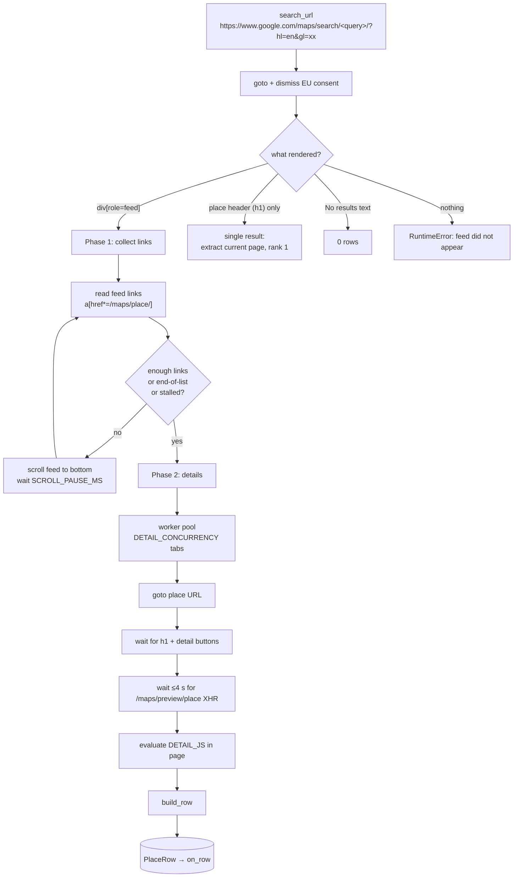

# Google Maps scraping internals

`app/scraper/maps.py` drives a real Chromium browser through Playwright. This page explains
each phase, where every field comes from, and what to check when Google changes something.

## 1. Pipeline

### Phase 1 – collect links

- The results feed is `div[role="feed"]`; every listing is an `a[href*="/maps/place/"]`
  whose `aria-label` is the business name. Links are de-duplicated by URL (without query
  string) and numbered in feed order → **Rank**.
- The result card next to the link is read for the visible review count (`span.UY7F9`,
  e.g. `(344)`) and rating (`span.MW4etd`). These are only fallbacks.
- Scrolling: `feed.scrollTop = feed.scrollHeight`, then wait `SCROLL_PAUSE_MS` (+ random
  jitter). Google appends 20 results per page. The loop stops when
  1. `limit` links are collected,
  2. the feed shows *"You've reached the end of the list."*, or
  3. `SCROLL_STALL_LIMIT` consecutive scrolls produced no new links.
- While scrolling, every `GET /search?tbm=map…` XHR response is captured (`RecordCapture`).
  Each contains the structured record of every listed place (see §3).

### Phase 2 – details

`DETAIL_CONCURRENCY` tabs pull place URLs from a queue. For each place:

1. `page.goto(href)` – the href from the feed already contains the `!19s<place id>` and
   `!3d<lat>!4d<lng>` fragments, which are parsed as a last-resort source.
2. Wait for the header (`h1.DUwDvf`) and for one of the detail buttons
   (`button[data-item-id="address"]`, `a[data-item-id="authority"]`,
   `button[data-item-id^="phone"]`).
3. Wait up to ~4 s for the `GET /maps/preview/place…` XHR, which carries the **full record**
   of the place (description, review count, everything). If it never arrives, the page HTML
   is scanned for `window.APP_INITIALIZATION_STATE` (older layout).
4. Run `DETAIL_JS` inside the page to read the DOM.
5. `build_row()` merges all sources (precedence below).
6. Sleep a random `MIN_DELAY_MS`–`MAX_DELAY_MS` before the next place.

Failures retry `DETAIL_RETRIES` times; a place that still fails produces a row from the
search record / link only, with the error stored in `enrichment_note` and in
`Job.stats.errors`.

### Single-result queries

When the query is unambiguous (`"Triad Home Solutions Arlington"`), Google skips the feed
and renders the place directly. The scraper detects the header without a feed and extracts
that page as rank 1. The search XHR still fires and supplies the full record.

## 2. Field sources and precedence

`build_row(ref, dom, full_record, search_record)` picks the first non-empty value in this
order: **place XHR record → search XHR record → DOM → result card / link URL**.

| Field | Place / search record | DOM (`DETAIL_JS`) | Card / URL |
| --- | --- | --- | --- |
| Name | `[11]` | `h1.DUwDvf` | `aria-label` of the link |
| Address | `[39]` (or `[2]` lines joined) | `button[data-item-id="address"]` aria-label | – |
| City / State / Country | `[183][1]` components (city `[3]`, state `[5]`, country `[6]`) | parsed from the address (`parse_address`) | – |
| Website | `[7][0]` | `a[data-item-id="authority"]` href | – |
| Phone | `[178][0][3]` (E.164) or `[178][0][0]` | `button[data-item-id^="phone:tel:"]` | – |
| Rating | `[4][7]` | `div.F7nice span[aria-hidden]` | `span.MW4etd` |
| Review count | `[4][8]` | `span[aria-label$="reviews"]` | `span.UY7F9` |
| Category | `[13][0]` | `button.DkEaL` | – |
| Description | `[154][0][0]` ("From the business"), fallback `[32][1][1]` (editorial) | `div.PYvSYb` | – |
| Place id | `[78]` | – | `!19s…` in the href |
| Latitude / longitude | `[9][2]`, `[9][3]` | – | `!3d…!4d…` in the href |
| CID | `[10]` | – | – |
| Status (closed) | `[34][4][4]` | `span[aria-label*="Permanently closed"]` | – |
| Rank | – | – | position in the feed |

Post-processing (all in `app/scraper/parsing.py`):

- `country` → ISO-3166 alpha-2 (`United States` → `US`), `state` → full name (`TX` → `Texas`)
  for US / CA / AU codes;
- `phone` → national format `(817) 606-8303`, `phone_unformatted` → E.164 `+18176068303`
  via the `phonenumbers` library, region taken from the country;
- `website` → scheme added, `utm_*` / `gclid` / `fbclid` … parameters and `#fragments`
  removed, Google redirect wrappers unwrapped;
- `url` → `https://www.google.com/maps/search/?api=1&query=<name>&query_place_id=<id>`;
- `description` → whitespace collapsed to single spaces.

## 3. Google's place record (index map)

Google Maps ships place data as deeply nested JSON arrays prefixed with `)]}'` in three
places: the `/search?tbm=map` XHR (list page), the `/maps/preview/place` XHR (place page) and
sometimes inside `window.APP_INITIALIZATION_STATE`. `app/scraper/records.py` never relies
on *where* a record sits: `find_place_records()` walks the tree and returns every list that
looks like a place (index `[11]` is a name string and `[78]` a place id).

Index map used by `record_to_dict()` (`IDX` in `records.py`, checked by
`tests/test_records.py::test_index_map_is_documented`):

| Key | Path | Notes |
| --- | --- | --- |
| name | `[11]` | |
| address | `[39]` | full formatted address |
| address_lines | `[2]` | `["street", "City, ST zip", "Country"]` |
| website | `[7][0]` | |
| phone_e164 | `[178][0][3]` | `+18176068303` |
| phone_intl | `[178][0][0]` | `+1 817-606-8303` |
| rating | `[4][7]` | float |
| review_count | `[4][8]` | int – **absent in list-page records** |
| place_id | `[78]` | `ChIJ…` |
| cid | `[10]` | `0x…:0x…` |
| categories | `[13]` | list of strings, first one is the primary category |
| latitude / longitude | `[9][2]` / `[9][3]` | |
| components | `[183][1]` | `[borough, street, street, city, postal_code, state, country]` |
| description | `[154][0][0]` | "From the business" text – **only in place-page records** |
| editorial | `[32][1][1]` | Google's editorial summary (older layout, usually `null` now) |
| status | `[34][4][4]` | e.g. `"Permanently closed"` |

Every lookup goes through `dig()`, which returns `None` for a missing / moved index, so a
layout change degrades to empty fields rather than an exception — and the DOM fallback
usually still fills the important ones.

## 4. Browser configuration

| Setting | Effect |
| --- | --- |
| `HEADLESS` | headless Chromium (default). `false` (or *Show the browser window* in the panel) opens a visible window – invaluable for debugging selectors. |
| `LOCALE` / `?hl=en` | forces the English UI so texts like *"You've reached the end of the list"* and aria-label prefixes (`Address:`, `Phone:`) match. |
| `REGION_CODE` | adds `&gl=<code>` to bias results to a country (Google otherwise uses your IP's country). |
| `USER_AGENT` | a normal desktop Chrome UA – Playwright's default announces *HeadlessChrome*. |
| `--disable-blink-features=AutomationControlled` | hides `navigator.webdriver`. |
| `BLOCK_MEDIA` | aborts image / font / media / tile requests: pages load 2–3× faster and use far less bandwidth. |
| `PROXY_SERVER` | routes all browser traffic through a proxy. |

EU visitors get a consent interstitial first; `_dismiss_consent()` clicks *Accept all* /
*Reject all* when it appears.

## 5. Anti-bot behaviour and limits

- Google usually tolerates a few hundred place views per hour from a residential IP. The
  built-in jitter (`MIN_DELAY_MS`–`MAX_DELAY_MS`), media blocking and modest concurrency keep
  the footprint small.
- Signs of throttling: the feed never appears (captcha / "unusual traffic" page), place pages
  load without detail buttons, empty records. The job fails with
  *"Google Maps results feed did not appear"* – wait, lower `DETAIL_CONCURRENCY`, or use a
  proxy.
- Google stops paging at roughly **120 results** per query. For more, run several narrower
  queries (`roofing companies in katy tx`, `… in pearland tx`, …).
- Results depend on the searching IP's location unless the query names a place; use
  `REGION_CODE` to pin the country.

## 6. When Google changes its layout

Symptoms → what to look at:

| Symptom | Likely cause | Fix |
| --- | --- | --- |
| 0 links collected, job fails at feed | feed selector or consent flow changed | run with `HEADLESS=false`, inspect the results pane, update `FEED_SELECTOR` / `PLACE_LINK_SELECTOR` |
| rows have name but no phone/website/address | detail XHR path or `data-item-id` attributes changed | check the `/maps/preview/place` response in DevTools (Network tab), compare with the index map; check `DETAIL_JS` selectors |
| description / review count empty for everyone | `[154]` / `[4][8]` moved | dump a record with `records_from_rpc()` and search for the text; update `IDX` and this table |
| city/state empty while address is filled | `[183][1]` moved | same as above; `parse_address()` still fills US/CA/AU/UK style addresses |

Debug helper: run a query with `--headed` and set a breakpoint in `_extract_from_page`, or
save an XHR body from DevTools and feed it to `records_from_rpc()` in a REPL.
