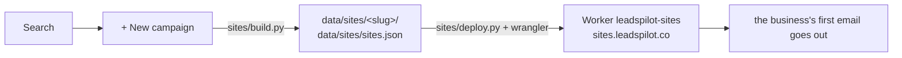

# Preview websites

Every business a campaign emails gets a **preview website** at `https://sites.leadspilot.co/<slug>/`
(`SITES_URL`), made from its Google Maps details: its name, city, phone, rating, reviews link and the
towns around it. The first email says the website is built, so **a business's first email waits until
its website is online**. When the business wants to keep it, you take over (the *Keep this site* button
emails `piyush@leadspilot.co`).



## 1. What a website is made of

| Part | Where | What |
| --- | --- | --- |
| design | `sites/designs/<design>/` | `index.html.j2`, `site.css`, `site.js` – the page, its look and animations (`bold`) |
| trade pack | `sites/trades/<trade>.json` | the words, services, photos, colours, FAQ and roof check of one trade; named after the business type (*Roofer* → `roofer.json`) |
| photos | `sites/assets/<trade>/` | resized once per size into `data/sites/.image-cache`, then copied into each site |
| town list | `sites/geo/places.tsv` | every US town with its location, from the Census Bureau (`sites/geo/make_places.py`) |
| the business | its search row | name, city, state, phone, email, rating, reviews, place id, location |

A business type without a trade pack has **no website design yet**: a campaign for it can't start
(*there's no website design for Plumber yet …*). Today only **Roofer** has one; its design is locked
(git tag `roofer-design-v1`).

The accent colour, headline and hero photo are picked from the pack by a hash of the business's name
and city, so two roofers in one city don't get the same page.

## 2. Who gets a website (`sites/build.py`)

When a campaign is made, each of its businesses gets a website, or is left out with the reason:

- a business without a city on Google gets **the city it was searched in**, and that city's state
  (from `"Katy, TX"`, the businesses' own states, or the town of that name nearest to them);
- a business **more than 60 miles** from that city is left out – Google's results now and then reach
  far outside the searched place (a Toronto plumber in a Houston search);
- a **shop that sells to the trade** ("Roofing supply store", wholesalers …) is left out;
- a rating **under 4.0**, or from **fewer than 5 reviews**, stays off the page (the page shows it big);
- the service-area map shows the business's city and up to 5 bigger towns within 30 miles.

A business that already has a website (the same Google place or email) keeps its address.

## 3. How long a website is online (`sites/deploy.py`)

The latest of these decides:

| Since | Online for | Why |
| --- | --- | --- |
| it was built (no email yet) | 30 days | |
| a first email without the link | 21 days | older emails offered to send the link later |
| the first email with the link (`{Website}`) | 14 days | room for follow-ups that go out late (weekends, the daily limit) |
| the last email, when the emails link the site | 2 days | it says the preview "comes down tomorrow" |
| the business replied | 30 days | it stays up while you talk |
| on hold | until the hold is lifted | the business wants to keep it |

The Roofer emails (a business type with a design starts with them, `SITE_STEPS` in
`app/outreach/templates.py`) link the site in all three: day 0, day 3, and day 6 - *comes down
tomorrow*.

The Worker (`sites/worker/src/index.js`) reads each site's end date from `_status.json`, uploaded with
the sites (never served): an ended site shows *This preview has ended* (`410`); a site on hold shows
*Your new website is being set up* instead of the countdown. Every page is `noindex`.

## 4. Uploading

The panel uploads by itself 30 seconds after a change – a new campaign's websites, first emails that
went out – and again every 10 minutes while an upload fails. Only changed files are sent. The *Preview
websites* line of the Outreach tab's setup list shows how many are online and any upload error.

Set up once, on the computer the panel runs on:

1. install [Node.js](https://nodejs.org);
2. in `sites/worker`: `npm install`;
3. in `sites/worker`: `npx wrangler login` – log in with the Cloudflare account that owns
   `leadspilot.co`. `wrangler.jsonc` names that account (`account_id`), so an upload under another
   login fails instead of going to the wrong account.

| Setting | Default | |
| --- | --- | --- |
| `PREVIEW_SITES` | `true` | `false`: campaigns get no websites and first emails don't wait (the tests set it) |
| `SITES_URL` | `https://sites.leadspilot.co` | where the websites are online |

## 5. By hand

```bash
python sites/render.py sites/trades/roofer.json sites/samples/roofer-dallas.json   # one sample site
python sites/build.py job_5deb5c9d7bd1                                            # a search's websites
python sites/deploy.py --dry-run                                                  # check an upload
python sites/deploy.py                                                            # upload
```

`.claude/launch.json` has two preview servers: `sites` (the built sites, port 4173) and
`sites-worker` (the Worker with `wrangler dev`, port 8787, after `python sites/deploy.py --prepare`).

## 6. When something goes wrong

| Symptom | Cause | Fix |
| --- | --- | --- |
| *not logged in to Cloudflare* | wrangler has no login on this computer | `npx wrangler login` in `sites/worker` |
| *Node.js isn't installed* | `node` isn't on the PATH | install Node.js, restart the panel |
| first emails never go out, *once its website is online* | uploads fail | the setup list shows why |
| a new website address doesn't open on your PC | the router remembers it didn't exist yet | wait up to an hour, or try on mobile data |
